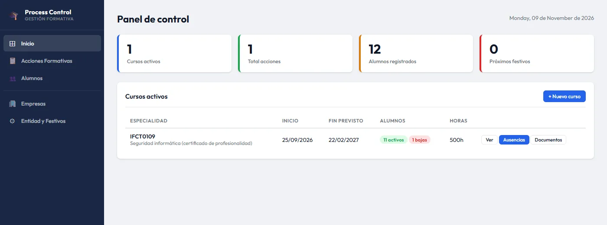
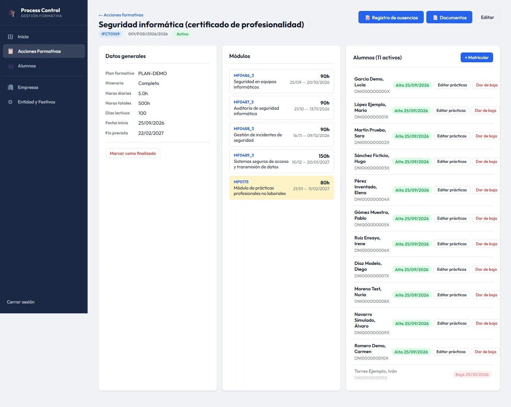
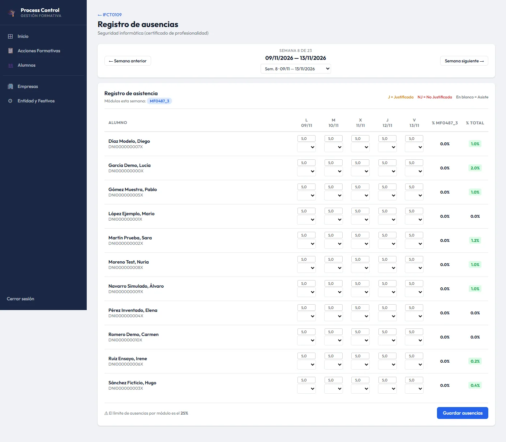
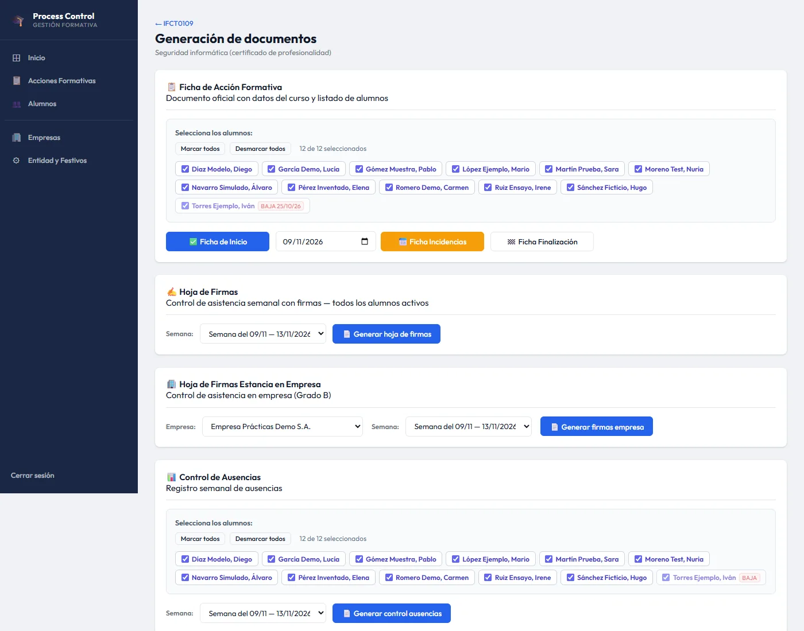
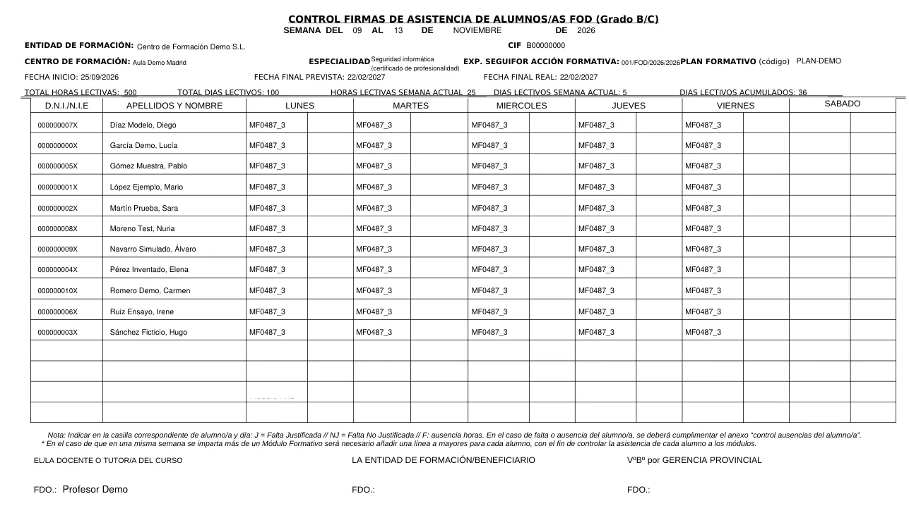

Este proyecto es distinto a los demás del portfolio, porque **no lo hice para un laboratorio, sino para un cliente real**: un centro de formación que imparte cursos subvencionados (certificados de profesionalidad).

> Por confidencialidad no menciono al cliente, y **todas las capturas son de una instalación de demostración con datos inventados**: alumnos, empresas, DNI y centro son ficticios.
{: .prompt-info }

---

## El problema

Cada curso subvencionado obliga a entregar a la administración un montón de documentación con formato fijo:

- **Ficha de la acción formativa** al inicio y cada vez que hay una incidencia (altas, bajas…).
- **Hojas de firmas semanales** de asistencia, con el módulo que se imparte cada día.
- **Control de ausencias** por alumno y por módulo, con el porcentaje de faltas.
- **Parte mensual**, y documentación específica de las **prácticas en empresa** (firmas y ausencias del tutor de la empresa).

Todo eso se hacía **a mano, en PDFs y hojas de cálculo**, cruzando calendarios, festivos y horas de cada módulo. Era lento y muy fácil equivocarse: un día festivo mal contado descuadra todo el calendario de módulos.

## La solución

Una aplicación web en **Python + Flask** que funciona en la red local del centro, con la base de datos compartida, y en la que el personal administrativo solo introduce los datos una vez.

{: .shadow }
_Panel principal: cursos activos, alumnos y próximos festivos (datos de demo)_

### Modelo de datos

```text
EntidadFormacion ─┐
                  ├── AccionFormativa ── Modulo (horas, orden, ¿prácticas?)
Empresa ── Tutor ─┘          │
                             └── Matricula ── Alumno
                                    │
                                    └── Ausencia (fecha, módulo, horas, J/NJ)
DiaNoLectivo (festivos)
```

Lo más delicado está en `services/calculos.py`. A partir de la fecha de inicio, las horas diarias, los festivos y si hay clase los sábados, la aplicación **calcula el calendario real de cada módulo**: qué día empieza, qué día termina y qué módulo se imparte en cada fecha. A partir de ahí puede rellenar todo lo demás sin intervención.

{: .shadow }
_Detalle del curso: módulos con sus fechas calculadas y alumnos matriculados_

### Registro de ausencias

Las ausencias se registran por semanas, en una rejilla alumno × día, distinguiendo justificadas (J) y no justificadas (NJ). La aplicación avisa cuando un alumno supera el límite de faltas de un módulo (el 25 %), que es lo que puede hacerle perder el derecho al certificado.

{: .shadow }

### Generación de documentos oficiales

Esta era la parte que más tiempo les ahorraba. La administración da sus propias plantillas en PDF, así que no tenía sentido diseñar documentos nuevos. Lo que hice fue **rellenar las plantillas oficiales por coordenadas** con **PyMuPDF**: copio la página de la plantilla, escribo cada campo en su posición y pagino automáticamente cuando hay más alumnos de los que caben en una hoja.

```python
def _ta(page, x0, y0, x1, y1, text, fs=7.0, bold=False):
    """Escribe texto dentro de una celda, reduciendo la fuente hasta que quepa."""
    font = fitz.Font("helv")
    while fs >= 4.0 and font.text_length(text, fontsize=fs) > (x1 - x0 - 2):
        fs -= 0.5
    y = y0 + ((y1 - y0) - fs * 0.718) / 2 + fs * 0.718   # centrado vertical
    page.insert_text((x0 + 1, y), text, fontname="helv-bold" if bold else "helv", fontsize=fs)
```

Ese pequeño detalle de **reducir la fuente hasta que el texto quepa en la celda** fue clave, porque los nombres de especialidades y de empresas tienen longitudes muy distintas.

{: .shadow }
_Desde un único panel se genera cualquier documento del curso, por semana o por mes_

{: .shadow }
_Hoja de firmas semanal generada automáticamente (datos ficticios)_

---

## Decisiones técnicas

- **Flask + SQLAlchemy + SQLite**: el centro no tiene servidor ni personal técnico. Un único proceso en un equipo de la oficina, con la base de datos en una carpeta compartida, era lo más fácil de mantener.
- **Migraciones "caseras" al arrancar**: el cliente iba pidiendo campos nuevos con la aplicación ya en uso. Hice una función que, al arrancar, comprueba con `PRAGMA table_info` qué columnas faltan y las añade **sin perder datos**. Así cada actualización es "copiar la carpeta y reiniciar".
- **Blueprints por dominio** (`acciones`, `alumnos`, `ausencias`, `documentos`, `empresas`…) y la lógica de cálculo separada de las vistas, para poder probarla de forma aislada.

## Lo que aprendí (y lo que mejoraría)

Ha sido mi primer proyecto con alguien que **depende de verdad** de que funcione, y eso cambia las prioridades. Importa menos la elegancia del código y más que no se pierdan datos, que los PDF salgan *exactamente* como los pide la administración y que cualquier persona sepa usarlo sin formación.

Mirándolo ahora con ojos de seguridad, la siguiente versión tiene deberes claros: contraseñas con hash (`werkzeug.security`), `SECRET_KEY` fuera del código, servir la app con un servidor WSGI en lugar del de desarrollo y copias de seguridad automáticas de la base de datos. Lo dejo escrito porque reconocer la deuda técnica también forma parte del trabajo.
