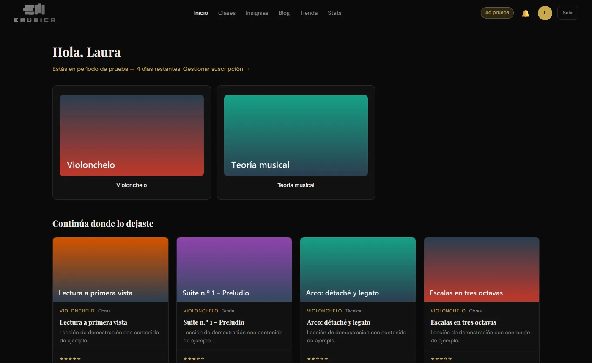
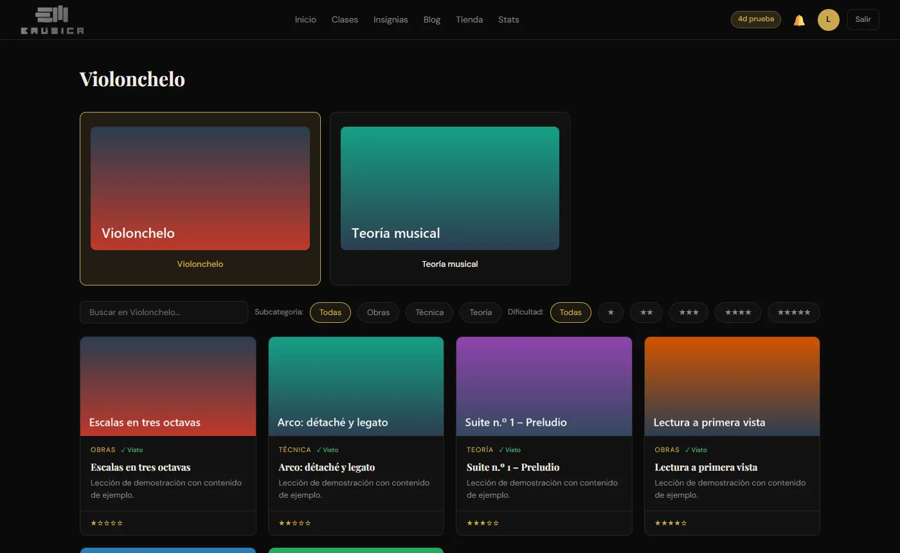
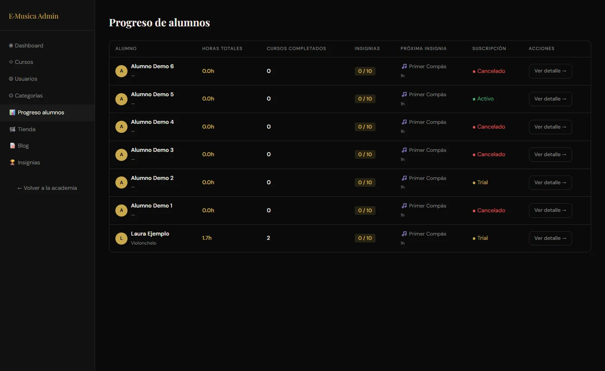
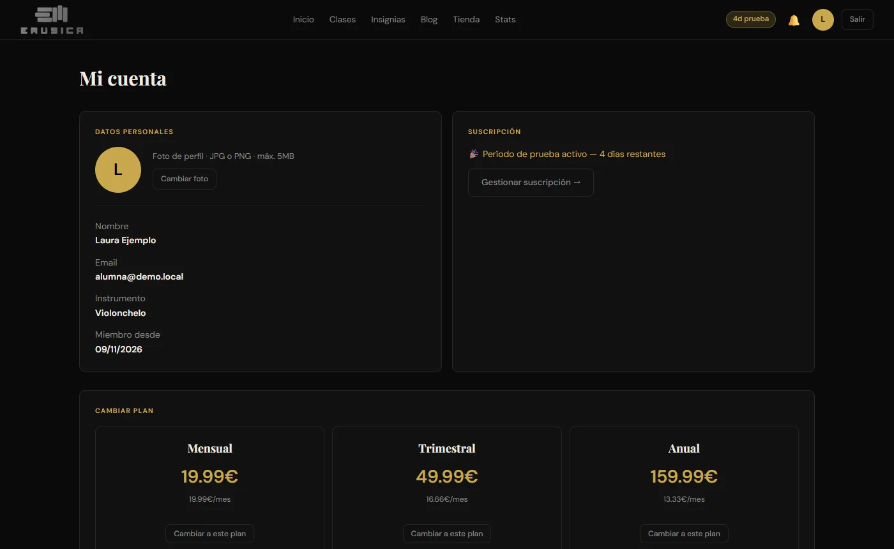
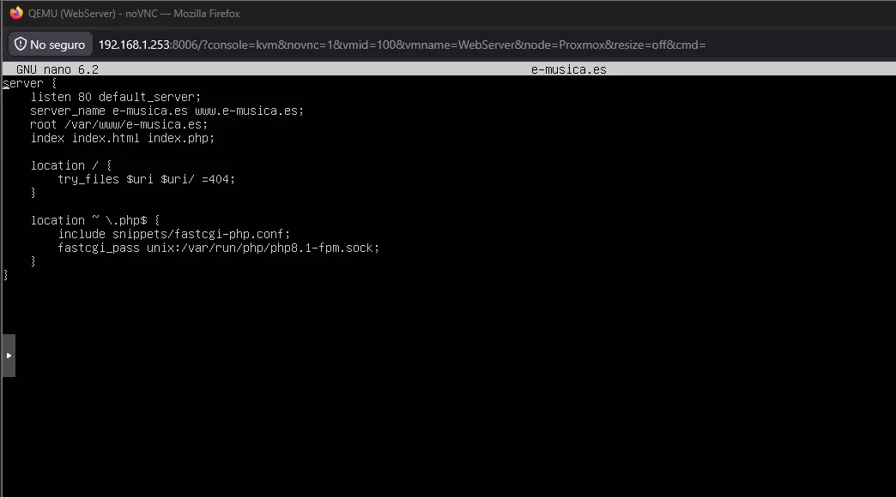
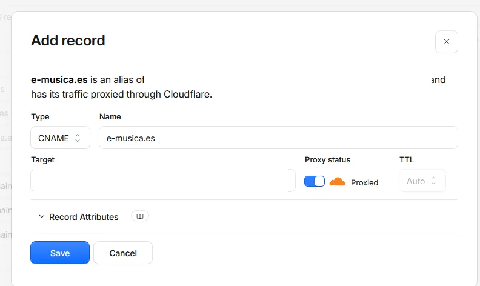

Antes que informático soy violonchelista, y desde hace tiempo tenía en la cabeza dar clases online "bien hechas": no un canal de vídeos sueltos, sino una academia con itinerarios, materiales descargables, seguimiento del progreso y suscripción. **e-Música Academia** es esa plataforma, y está en producción en `academia.e-musica.es`.

En este post cuento cómo está construida y, sobre todo, cómo la desplegué en mi propio servidor **sin exponer ni un solo puerto a Internet**.

> Las capturas son de una instancia local con **usuarios y cursos de demostración**. No aparece ningún dato de alumnos reales.
{: .prompt-info }

---

## Qué hace

**Para el alumno:**
- Catálogo por especialidad (violonchelo, teoría musical…), con filtros por tipo y dificultad.
- Lecciones en vídeo servidas desde **Bunny Stream** (CDN), con partituras, PDF y audios asociados.
- Progreso guardado (minutos vistos, cursos completados), insignias y comentarios por lección.
- Periodo de prueba de 7 días y gestión de su suscripción.

{: .shadow }
_Inicio del alumno: especialidades y "continúa donde lo dejaste"_

{: .shadow }

**Para el profesor/administrador:** gestión de cursos y materiales, usuarios, blog, tienda y un panel de **progreso por alumno** para ver quién se ha atascado.

{: .shadow }
_Panel de administración: progreso y estado de suscripción de cada alumno (datos de demo)_

---

## Arquitectura

```text
Navegador ──HTTPS──> Cloudflare (DNS + proxy + TLS)
                          │  túnel saliente (cloudflared)
                          ▼
             VM "WebServer" en Proxmox (Ubuntu)
             nginx (proxy inverso, vhost por dominio)
                          │
                          ▼
             gunicorn  ──>  Flask app (127.0.0.1:5001)
                               ├── SQLAlchemy (BD)
                               ├── Stripe API + webhooks
                               └── Bunny Stream (vídeo)
```

El backend es **Flask** con *blueprints* separados (`auth`, `views`, `admin`, `api`, `webhook`) y **SQLAlchemy**. Toda la configuración sensible (claves de Stripe, de Bunny, `SECRET_KEY`) sale de variables de entorno. En producción la aplicación **se niega a arrancar** si falta la `SECRET_KEY`, para no acabar nunca con una clave de desarrollo en un servidor real.

### Pagos: Stripe con webhooks

Hay tres planes (mensual, trimestral y anual) creados como *Prices* recurrentes en Stripe. El pago se hace en **Stripe Checkout**, así que la tarjeta nunca pasa por mi servidor. Lo importante es cómo se entera la aplicación de que alguien ha pagado, ha cancelado o se le ha rechazado un cobro: con **webhooks**.

```python
event = stripe.Webhook.construct_event(payload, sig_header, webhook_secret)  # verifica la firma
etype = event["type"]

if etype in ("customer.subscription.created", "customer.subscription.updated"):
    ...  # activa / actualiza plan, estado y fin de periodo
elif etype == "customer.subscription.deleted":
    ...  # cierra el acceso
elif etype == "invoice.payment_failed":
    ...  # marca past_due y avisa
elif etype == "invoice.payment_succeeded":
    ...  # renueva el periodo
```

La **verificación de la firma** (`construct_event`) es lo que impide que cualquiera mande un POST falso a `/webhook/stripe` diciendo "este usuario ha pagado". El estado de la suscripción en mi base de datos **solo cambia por eventos firmados por Stripe**, nunca por lo que diga el navegador.

{: .shadow }

### Materiales protegidos

Los PDF, partituras y audios **no se sirven como estáticos**. Están fuera de la carpeta pública y se entregan a través de una vista que comprueba primero que el usuario tenga acceso:

```python
@bp.route("/archivo/<int:archivo_id>")
@login_required
def ver_archivo(archivo_id):
    if not current_user.tiene_acceso:      # admin, trial o suscripción activa
        abort(403)
    ...
    return send_file(ruta, as_attachment=False)
```

---

## Despliegue: producción sin abrir puertos

La plataforma corre en una VM de mi [servidor Proxmox](/posts/ProxmoxWebServer/), junto a otras webs. La aplicación escucha **solo en `127.0.0.1`**, la sirve **gunicorn** como servicio de systemd y delante tiene **nginx** con un *virtual host* por dominio:

{: .shadow }

Para llegar desde Internet uso **Cloudflare Tunnel**. El daemon `cloudflared` abre una conexión **saliente** hacia Cloudflare, y los registros DNS del dominio apuntan al túnel. Resultado: **el router no tiene ningún puerto abierto**, mi IP doméstica no aparece en el DNS y el TLS y la protección anti-DDoS los pone Cloudflare.

{: .shadow }
_El dominio pasa a ser un alias del túnel (identificador oculto)_

---

## Lo que aprendí

- **Los pagos no se confirman en el frontend.** El navegador puede mentir; el webhook firmado no.
- **Producción es otra cosa.** Copias de la base de datos, servicios que se recuperan solos y, más adelante, el [endurecimiento con systemd](/posts/API-eventos-FastAPI-hardening/) y la [gestión de parches](/posts/Gestion-parches-produccion/) de este mismo servidor.
- **Construir para un dominio que conoces** (en mi caso, la enseñanza musical) hace que las decisiones de producto salgan solas: sabía qué necesita un alumno de violonchelo antes de escribir una línea de código.
