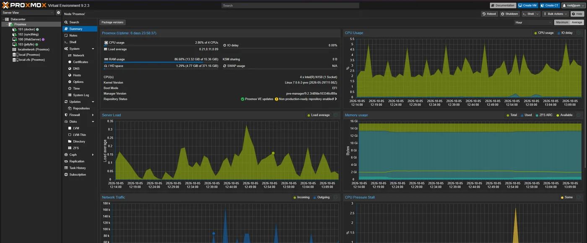
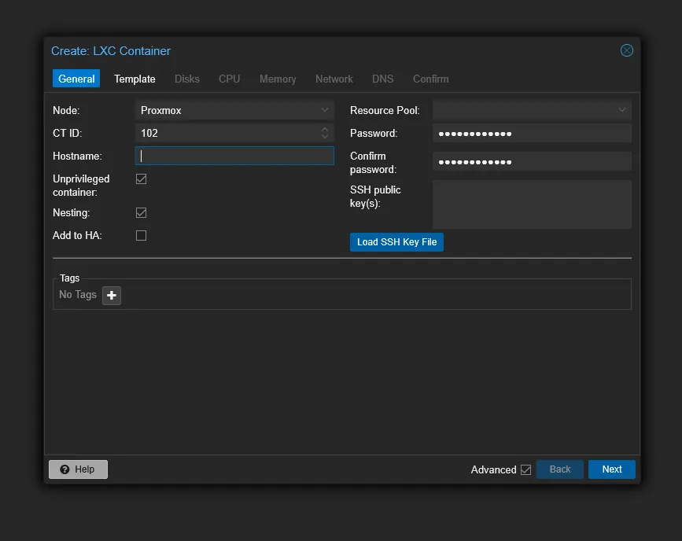
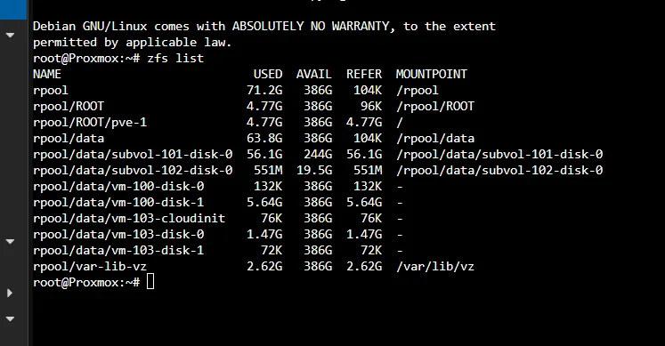
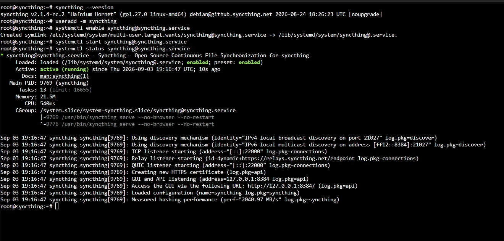
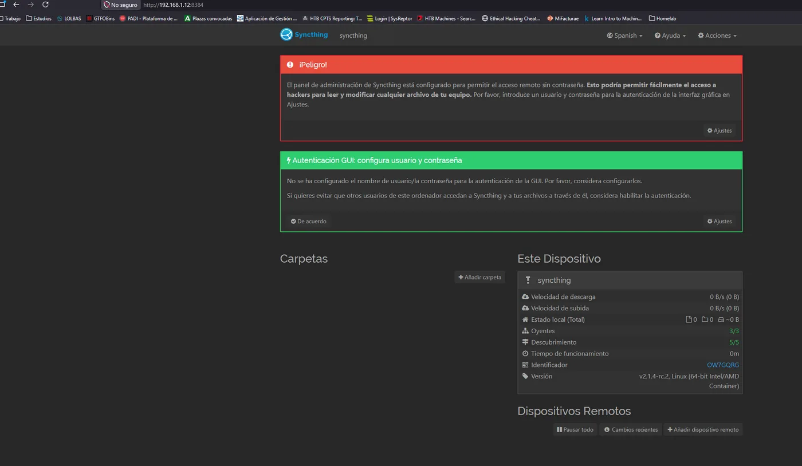
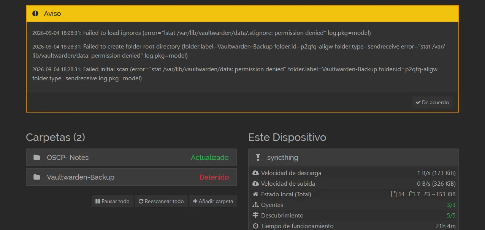
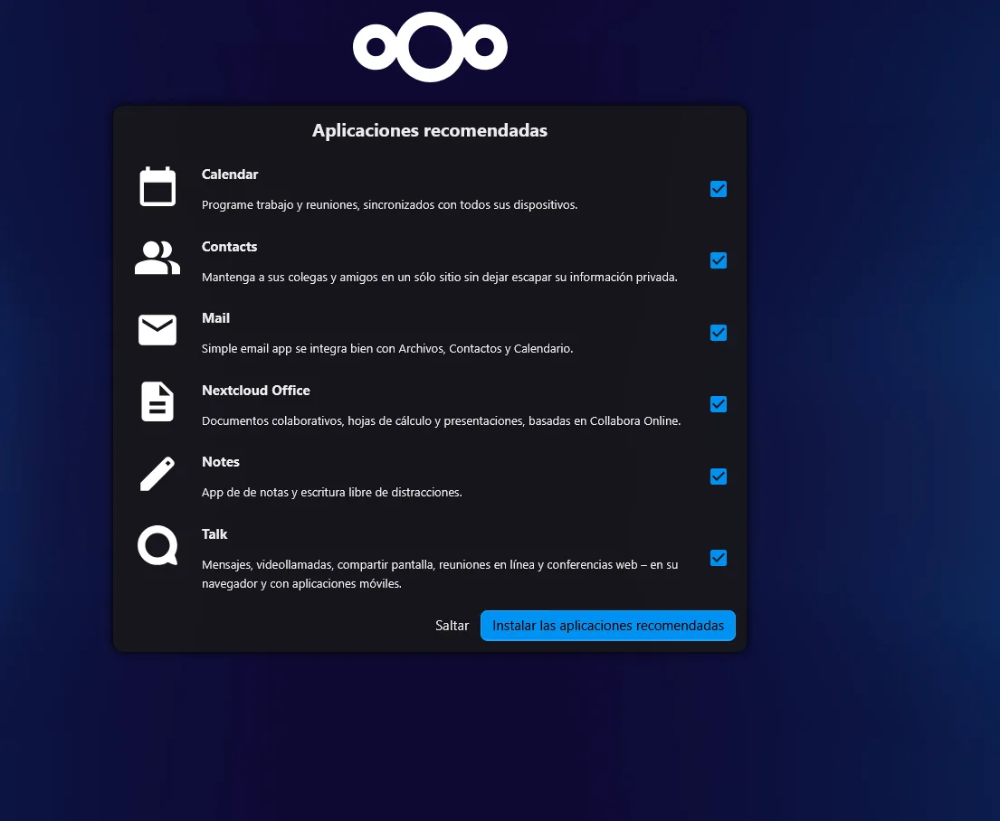
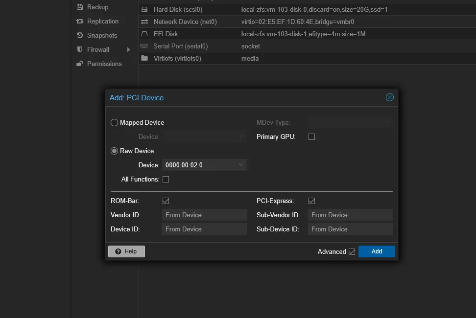
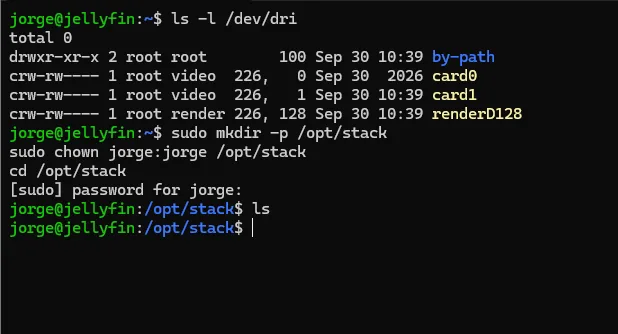

En los dos posts anteriores monté el [servidor Proxmox](/posts/Proxmox/) y publiqué el primer [servidor web con Cloudflare](/posts/ProxmoxWebServer/). Con la base funcionando, llegó la parte divertida: **dejar de depender de servicios en la nube de otros** y alojar los míos en casa. Esta entrega recoge los servicios que más uso en el día a día.

{: .shadow }
_El datacenter con sus VMs (WebServer, Jellyfin) y contenedores LXC (docker, syncthing)_

---

## Cómo reparto la carga: VM o LXC

Antes de instalar nada, una decisión que repito mucho: **contenedor LXC o máquina virtual**.

- **LXC** (contenedor de sistema): ligero, arranca al instante, comparte kernel con el host. Lo uso para servicios Linux "de siempre" como Syncthing.
- **VM**: aislamiento completo con su propio kernel. La uso cuando quiero separación fuerte (el servidor web expuesto) o necesito pasar hardware, como la GPU para Jellyfin.

{: .shadow }

---

## Almacenamiento: ZFS

Todo se apoya en **ZFS**, que me da *snapshots* instantáneos, comprobación de integridad (checksums) y *datasets* separados por servicio. Antes de cualquier cambio gordo hago un snapshot y, si algo sale mal, vuelvo atrás en segundos.

{: .shadow }
_`zfs list`: un dataset por VM y por contenedor_

---

## Syncthing: sincronización sin nube

Lo primero que quise quitarme fue la sincronización de archivos tipo Dropbox. **Syncthing** sincroniza carpetas entre mis equipos **directamente, cifrado y sin servidor central**: nada pasa por la nube de nadie. Lo monté en un contenedor LXC dedicado.

{: .shadow }

{: .shadow }

Un detalle de seguridad que la propia herramienta avisa: su panel de administración **hay que protegerlo con usuario y contraseña**, porque desde ahí se pueden añadir o modificar carpetas de todos los equipos. Lo primero que hice fue ponerle credenciales.

{: .shadow }

---

## Nextcloud: mi nube privada

Para calendario, contactos y archivos compartidos con un enlace, monté **Nextcloud**. Es "mi Google Drive", pero en mi casa y con mis reglas de acceso.

{: .shadow }

Igual que las webs, no está expuesto a Internet directamente: se llega por **Cloudflare Tunnel / Tailscale**, sin abrir puertos en el router.

---

## Jellyfin con aceleración por GPU

El servicio que más quebraderos me dio, y el que más aprendí. **Jellyfin** es un servidor multimedia (como un Plex autoalojado). El problema es la **transcodificación**: convertir vídeo al vuelo con la CPU dispara el consumo. La solución es dejárselo a la **GPU integrada**.

Para que la VM "vea" la GPU hay que hacer **PCI passthrough**: ceder el dispositivo gráfico del host a la máquina virtual.

{: .shadow }

Dentro de la VM lo compruebo mirando que existan los dispositivos de render:

{: .shadow }
_`/dev/dri` con `renderD128`: la GPU ya está disponible para transcodificar_

Con eso, Jellyfin transcodifica por hardware y la CPU se queda tranquila. Entre medias me peleé con los grupos IOMMU y los permisos de `/dev/dri`, pero el resultado valió la pena.

---

## Conclusión

El homelab ha pasado de "un Proxmox con una web" a una pequeña **infraestructura de servicios** que uso de verdad: sincronización, nube, multimedia y varias webs, todo sobre ZFS, repartido entre VMs y contenedores según lo que pida cada caso, y **sin exponer nada directamente a Internet**.

Y, para mí, lo importante: es el mismo servidor que mantengo parcheado, monitorizo con [Wazuh](/posts/SOCWazuh/) y uso como campo de pruebas para casi todo lo que publico aquí. Administrar algo que de verdad usas enseña mucho más que cualquier tutorial.
