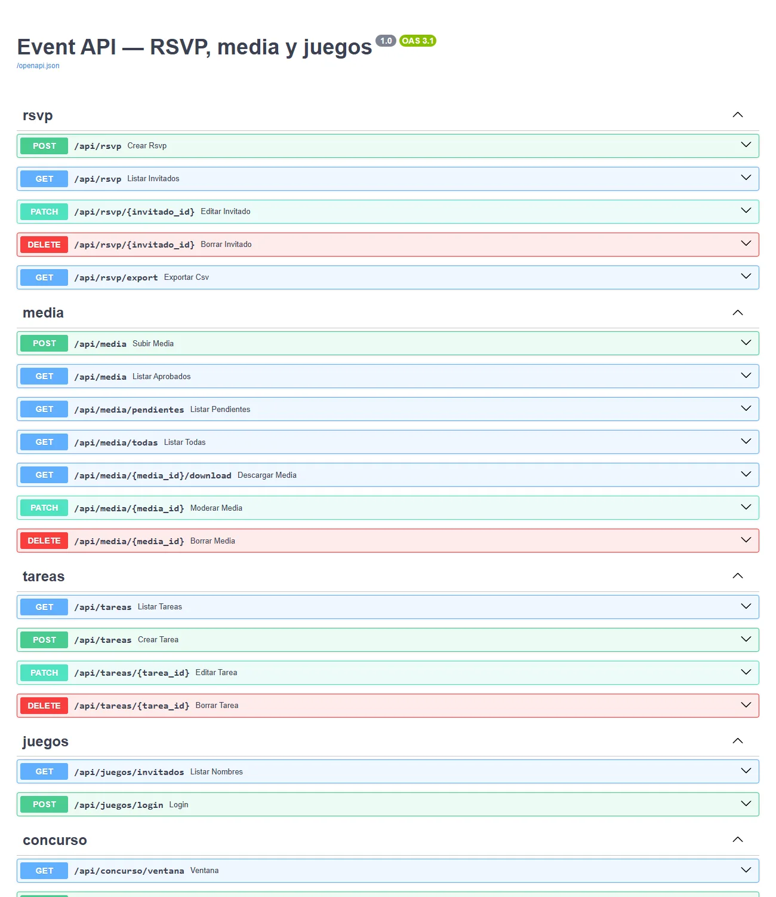
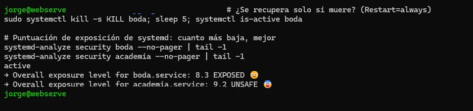
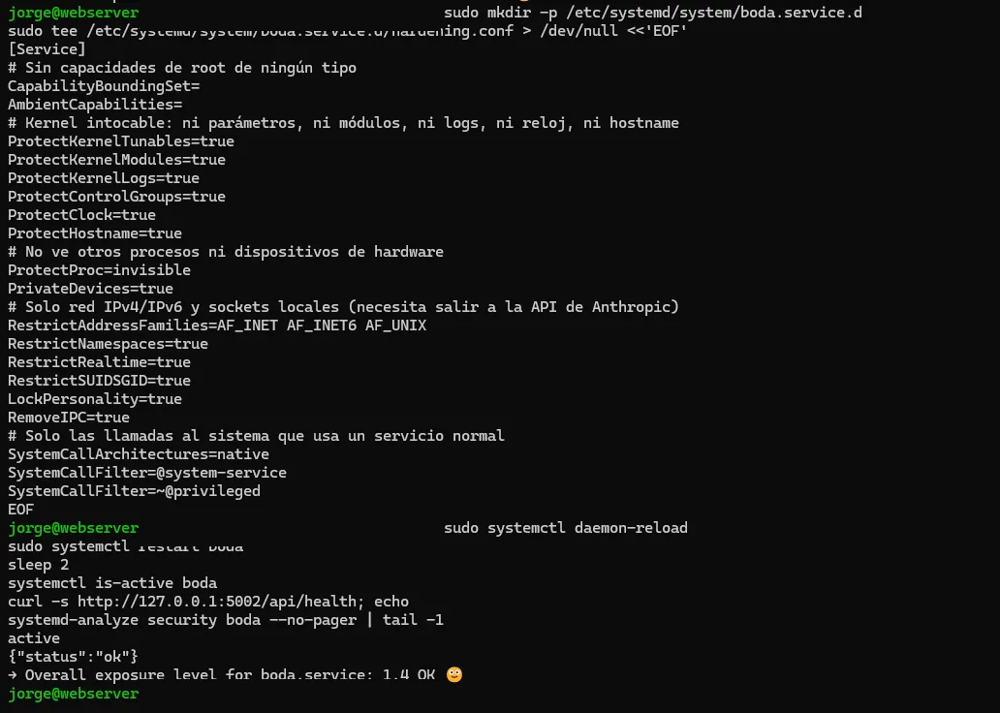

Me pidieron montar la web de un evento (en concreto, una boda) y lo aproveché para construir algo que tenía ganas de hacer bien: una **API REST en FastAPI** en producción, con usuarios reales, autodocumentada y endurecida a nivel de sistema. Este post va de dos cosas que me importan mucho: **diseñar la API con seguridad desde el principio** y **endurecer el servicio** una vez desplegado.

> Todo lo relacionado con datos de invitados se ha omitido. Las capturas son de la documentación de la API y de la configuración del servicio, sin datos personales.
{: .prompt-info }

---

## Qué expone la API

Tres frontends (web pública, panel de administración y una pequeña app de juegos para el día del evento) hablan con un único backend FastAPI:

{: .shadow }
_FastAPI genera la documentación interactiva (Swagger) sola a partir del código_

Los grupos de endpoints: `rsvp` (confirmaciones y menús), `media` (subida y **moderación** de fotos/vídeos), `tareas` (gestión, solo admin) y los minijuegos.

---

## Seguridad en el diseño, no después

Tres decisiones que tomé desde el primer commit:

**1. La contraseña de administración nunca se guarda en claro.** El servidor solo conoce su **hash bcrypt** (en una variable de entorno), y la aplicación no arranca si falta. La comprobación es constante en tiempo:

```python
def require_admin(authorization: str = Header(default="")) -> None:
    token = authorization.removeprefix("Bearer ").strip()
    if not token or not bcrypt.checkpw(token.encode(), ADMIN_PASSWORD_HASH.encode()):
        raise HTTPException(status_code=401, detail="No autorizado")
```

**2. Lo público expone lo mínimo.** El endpoint público de invitados devuelve solo `id` y `nombre` de quien confirmó; nunca alergias, menús ni notas. La galería y el concurso solo muestran lo **ya aprobado**, nunca lo pendiente de moderar.

**3. La puntuación de los juegos se calcula en el servidor.** El navegador manda *qué respuesta* se eligió, no *cuántos puntos* vale. El backend consulta su fuente de verdad y puntúa. Así nadie manipula su marcador editando el JavaScript. Es el mismo principio que aplico a los pagos en [e-Música](/posts/eMusica-Academia/): **el cliente nunca es la autoridad**.

---

## IA que no puede tumbar el login

En el acceso a los juegos hay un saludo personalizado generado con un LLM. El riesgo es evidente: si la llamada a la IA falla, **no puede impedir que alguien entre**. Por eso toda la lógica —incluida la importación de la librería y la creación del cliente— va dentro de un único `try/except` con un saludo genérico de reserva:

```python
def generar_saludo(invitado) -> str:
    if not ANTHROPIC_API_KEY:
        return SALUDO_GENERICO            # sin clave -> genérico
    try:
        import anthropic
        cliente = anthropic.Anthropic(api_key=ANTHROPIC_API_KEY)
        respuesta = cliente.messages.create(model="claude-haiku-4-5-...", ...)
        return respuesta.content[0].text.strip()
    except Exception:
        return SALUDO_GENERICO            # cualquier fallo -> genérico
```

Esto viene de un error real: una versión nueva de `httpx` rompió la creación del cliente de `anthropic`, y como estaba **fuera** del try/except, tumbó el arranque de toda la app. La lección: **una función accesoria (la IA) nunca debe poder derribar una función esencial (entrar)**. Metí todo dentro del try y fijé las versiones en `requirements.txt`.

---

## Hardening con systemd

La app corre como servicio de systemd detrás de nginx. Pero un servicio, por defecto, puede hacer **mucho más de lo que necesita**: ver todos los procesos, escribir en medio sistema de ficheros, cargar módulos del kernel… Si alguien comprometiera la app, todo eso sería su punto de partida.

systemd trae un montón de opciones de *sandboxing* integradas. Para medir cuánto gana, se usa `systemd-analyze security`, que da una nota de exposición. El servicio recién creado salía fatal:

{: .shadow }
_Exposición "EXPOSED" / "UNSAFE": el servicio puede hacer casi de todo_

Así que escribí un *drop-in* de endurecimiento que le quita a la app todo lo que no usa:

{: .shadow }

Las opciones clave:

| Opción | Qué hace |
|---|---|
| `CapabilityBoundingSet=` | Sin ninguna capacidad de root |
| `ProtectSystem=strict` / `ProtectHome=` | Sistema de ficheros en solo lectura salvo lo imprescindible |
| `ProtectKernelModules/Tunables/Logs` | No toca el kernel |
| `PrivateDevices` / `ProtectProc` | No ve dispositivos ni otros procesos |
| `RestrictAddressFamilies=AF_INET AF_INET6 AF_UNIX` | Solo las redes que usa |
| `SystemCallFilter=@system-service` | Solo las llamadas al sistema propias de un servicio |
| `NoNewPrivileges` / `RestrictSUIDSGID` | No puede escalar privilegios |

Tras recargar y reiniciar, la misma herramienta da una nota muchísimo mejor, y la app sigue funcionando exactamente igual. **Gran parte del endurecimiento de un servicio Linux moderno son unas líneas de configuración y cero cambios de código.**

---

## Conclusión

Juntar las dos caras (desarrollo y sistemas) en un mismo proyecto es justo lo que más me gusta. La API está bien pensada por dentro —hashes, mínimos privilegios de datos, puntuación en servidor, IA tolerante a fallos— y bien encajada por fuera, como un servicio con el mínimo privilegio posible sobre el sistema. Mentalidad de Blue Team aplicada a mi propio código, que es la mejor forma que conozco de interiorizarla.
