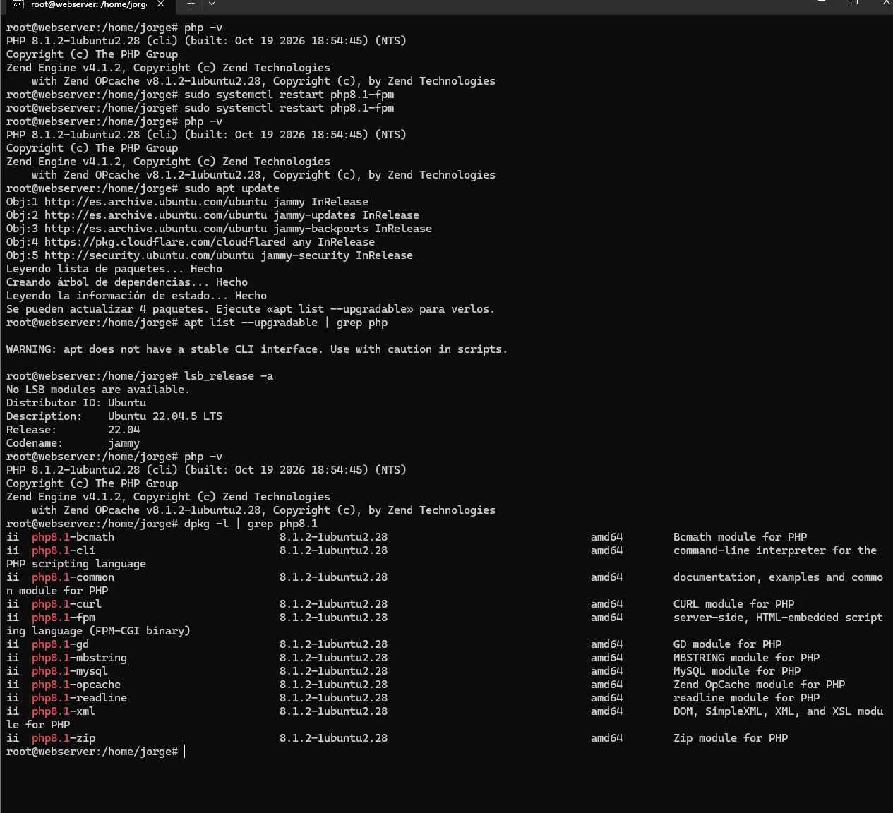
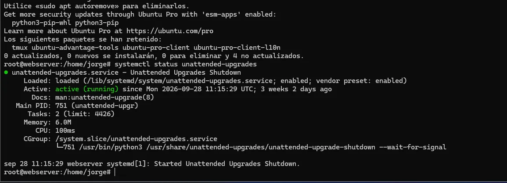
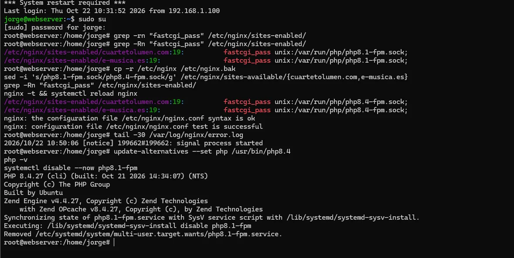
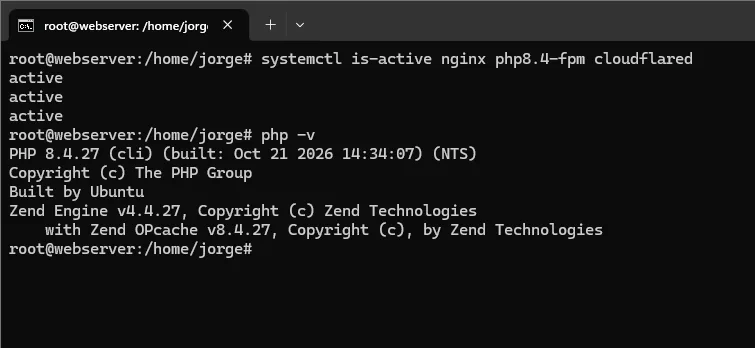

La parte menos vistosa de la seguridad defensiva, y una de las más importantes, es **mantener los sistemas al día**. En las ofertas aparece como "gestión de vulnerabilidades y parches", y no es teoría: lo hago de verdad en mi propio [servidor](/posts/ProxmoxWebServer/), que tiene **varias webs en producción**. Este post cuenta dos tareas reales: automatizar los parches de seguridad y migrar la versión de PHP sin tirar los servicios.

---

## El ciclo de vulnerabilidades

Gestionar vulnerabilidades no es "dar a actualizar de vez en cuando". Es un ciclo: **identificar → priorizar → remediar → validar**, y repetir. Con varias webs encima no puedo permitirme ni quedarme atrás en parches ni romper algo por actualizar a lo loco.

{: .shadow }
_Punto de partida: el servidor con PHP 8.1_

## Parches de seguridad automáticos

Lo primero: que las **actualizaciones de seguridad** del sistema no dependan de que yo me acuerde. En Debian/Ubuntu eso es **`unattended-upgrades`**, configurado para aplicar **solo** el repositorio de seguridad de forma desatendida (lo de seguridad casi nunca rompe nada; las versiones nuevas de funcionalidad, mejor a mano).

{: .shadow }
_unattended-upgrades aplicando solo las actualizaciones de seguridad_

Así, lo rutinario y de bajo riesgo se parchea solo, y yo reservo mi atención para lo que sí requiere criterio.

## Lo que sí hago a mano: migrar PHP 8.1 → 8.4

PHP 8.1 se acerca al fin de su soporte de seguridad, así que las webs en PHP del servidor había que llevarlas a **8.4**. Esto **no se automatiza**: un cambio de versión mayor puede romper aplicaciones, y hay varias en el mismo servidor. Es el ejemplo perfecto de "parche que hay que priorizar y validar con cuidado".

El plan:

1. **Instalar 8.4 junto a 8.1** (conviven), sin tocar aún nada.
2. Localizar en la configuración de **nginx** dónde cada sitio apunta al socket de PHP-FPM:

   ```bash
   grep -Rn "fastcgi_pass" /etc/nginx/sites-enabled/
   ```

3. **Cambiar el socket** de `php8.1-fpm.sock` a `php8.4-fpm.sock` en los vhosts (con copia de seguridad previa de la config).
4. **Validar la sintaxis** antes de recargar, que es el paso que evita el susto:

   ```bash
   nginx -t && systemctl reload nginx
   ```

{: .shadow }
_Cambiando el socket de PHP 8.1 a 8.4 en los sitios y validando con `nginx -t`_

5. Probar cada web, y solo entonces **retirar 8.1** (`systemctl disable --now php8.1-fpm`).

## Validación

El último paso del ciclo, el que más se olvida: **comprobar que todo quedó bien**. Servicios activos y la versión correcta:

```bash
systemctl is-active nginx php8.4-fpm cloudflared
php -v
```

{: .shadow }
_Todo activo y PHP 8.4 en marcha. Migración sin caída._

Las webs siguieron disponibles durante todo el proceso: al convivir las dos versiones, el cambio de socket es casi instantáneo y reversible (basta con restaurar el vhost y recargar).

---

## Por qué esto importa

- **Automatiza lo rutinario, reserva el criterio para lo de riesgo.** Parches de seguridad, solos; cambios de versión mayor, con plan y validación.
- **Valida siempre antes de recargar.** `nginx -t` cuesta un segundo y evita dejar sitios caídos.
- **Ten marcha atrás.** Copia de la config y las dos versiones conviviendo: si algo falla, vuelves en segundos.

Es trabajo poco glamuroso, pero es exactamente lo que separa un servidor que aguanta de uno que un día aparece comprometido por un CVE que llevaba meses parcheado. Gestionar de verdad una infraestructura, y no solo montarla, es lo que más me ha enseñado sobre seguridad operativa.
