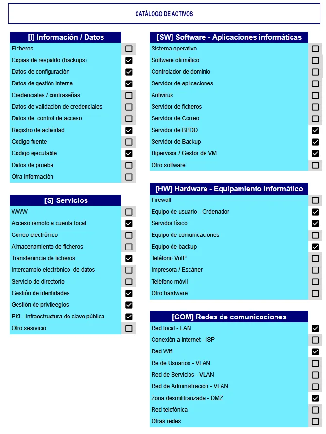
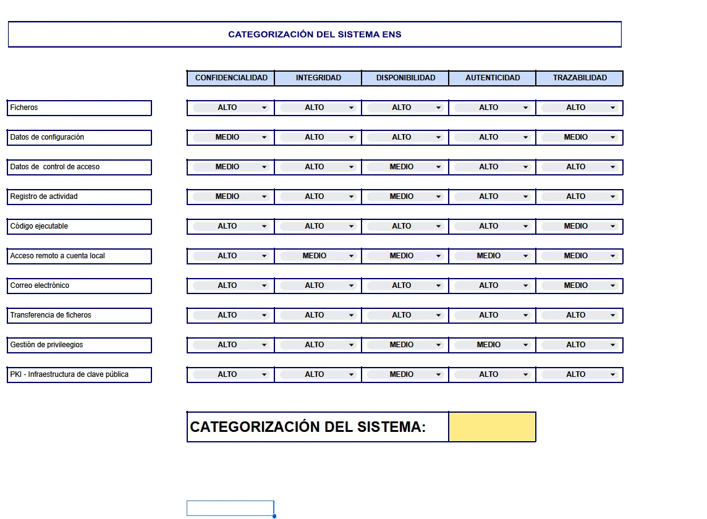
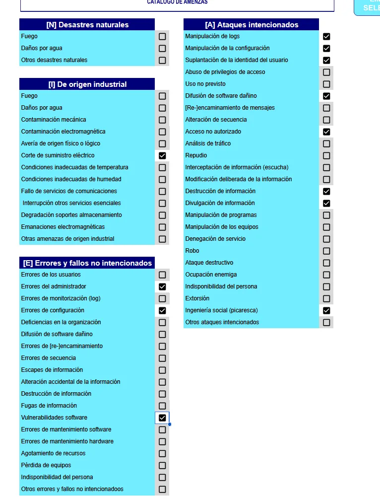
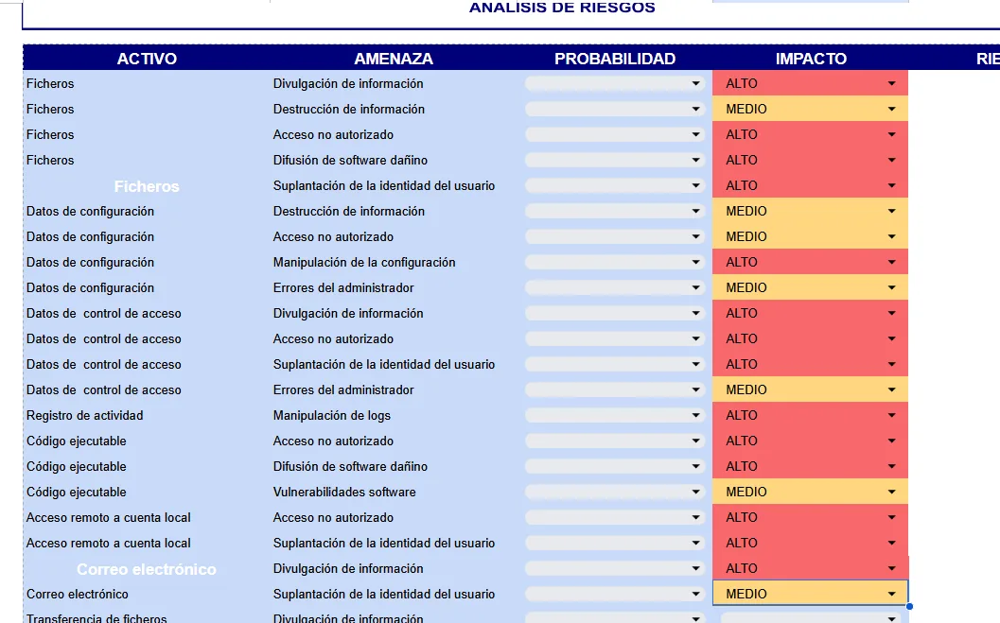
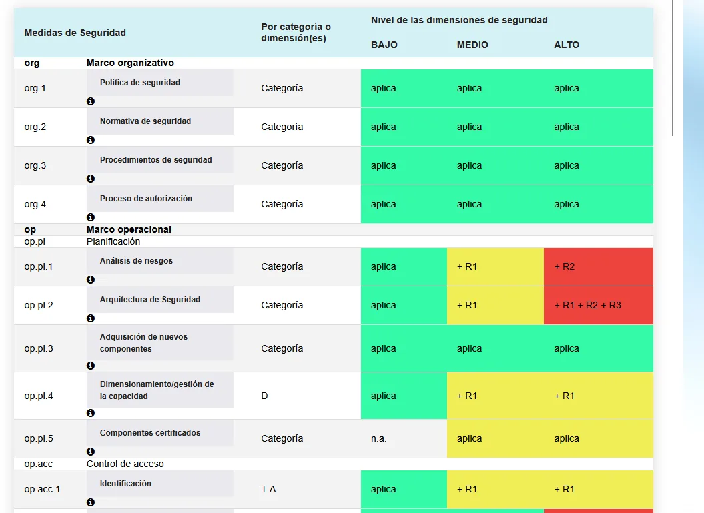

La ciberseguridad no es solo lo técnico. Buena parte del trabajo real (sobre todo en la administración pública española y en empresas que trabajan con ella) es **GRC**: *Governance, Risk & Compliance*. En el máster me ha tocado hacer un **análisis de riesgos y la categorización de un sistema según el ENS**, y quería dejarlo aquí porque complementa muy bien la parte de laboratorios: de nada sirve detectar un ataque si antes no sabes **qué estás protegiendo y cuánto importa**.

> El ejercicio está hecho sobre un sistema de ejemplo del máster, con datos ilustrativos. No corresponde a ninguna organización real.
{: .prompt-info }

---

## Por qué el ENS

El **Esquema Nacional de Seguridad** (RD 311/2022) es de obligado cumplimiento para el sector público español y para quien le presta servicios. Define una forma estructurada de responder a tres preguntas: *¿qué tengo?*, *¿qué puede pasarle?* y *¿qué medidas me exige su nivel de criticidad?*.

El proceso que seguí tiene cuatro pasos encadenados.

## 1. Inventario de activos

Todo empieza por saber qué hay que proteger. El ENS agrupa los activos por tipo: información y datos, servicios, software, hardware, redes de comunicaciones, instalaciones y personal.

{: .shadow }
_Inventario por categorías: datos, software, hardware, redes, servicios…_

Es el paso más aburrido y el más importante: **lo que no está en el inventario, no se protege ni se analiza**.

## 2. Categorización del sistema

A cada activo (y al sistema en conjunto) se le valora en las cinco **dimensiones de seguridad** del ENS: **Confidencialidad, Integridad, Disponibilidad, Autenticidad y Trazabilidad**, con niveles BAJO / MEDIO / ALTO.

{: .shadow }
_Cada activo valorado en las cinco dimensiones; la peor marca el nivel_

La categoría final del sistema es la **más alta** de entre todas sus dimensiones. Un único dato que exija "ALTO" en integridad sube todo el sistema a esa categoría, con las medidas que eso conlleva.

## 3. Análisis de riesgos

Aquí se cruza cada activo con las **amenazas** que le aplican (siguiendo la línea de MAGERIT): desastres naturales, de origen industrial, errores no intencionados y ataques deliberados. Para cada par activo–amenaza se estima **probabilidad** e **impacto**, y de ahí sale el **nivel de riesgo**.

{: .shadow }

{: .shadow }
_Probabilidad × impacto = riesgo, con el típico código de colores_

El código de colores no es decoración: permite **priorizar**. No se puede (ni se debe) tratar todo a la vez; se empieza por el riesgo alto y se decide qué se mitiga, qué se asume, qué se transfiere y qué se evita.

## 4. Medidas del Anexo II

Según la categoría del sistema, el ENS obliga a aplicar un conjunto concreto de **medidas** (Anexo II), organizadas en marco organizativo (`org`), operacional (`op`) y de protección (`mp`). El nivel del sistema determina si cada medida se aplica tal cual o con refuerzos (R1, R2, R3).

{: .shadow }
_Para cada medida, qué exige el nivel BAJO / MEDIO / ALTO_

---

## Lo que me llevo

- **El riesgo se gestiona, no se elimina.** El objetivo no es "riesgo cero" (imposible), sino un riesgo **asumido conscientemente** y por quien tiene autoridad para hacerlo.
- **Lo técnico y lo normativo se necesitan.** El ENS te dice *qué* hay que proteger y *cuánto*; mis laboratorios de [SIEM](/posts/SOCWazuh/) y [Active Directory](/posts/AD-Lab-dominio-comprometido/) son el *cómo*. Un perfil que entiende las dos capas vale mucho más.
- **El inventario y la valoración son la base.** Si fallan, todo lo demás (las medidas, las auditorías, la respuesta a incidentes) se construye sobre arena.

Este trabajo conecta directamente con el RGPD y con marcos como ISO 27001, y es una de las vías profesionales que más me interesan: la que une el conocimiento técnico con el gobierno de la seguridad.
