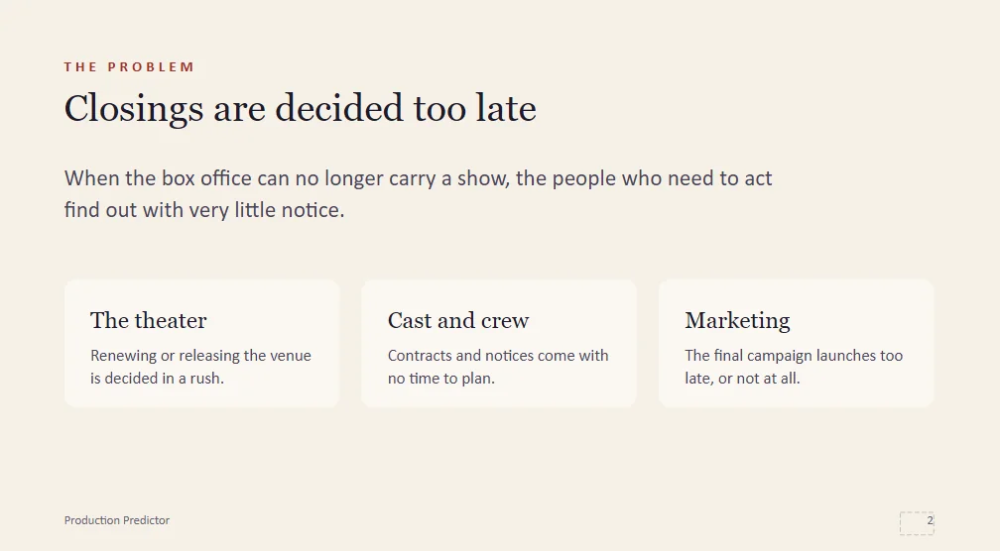
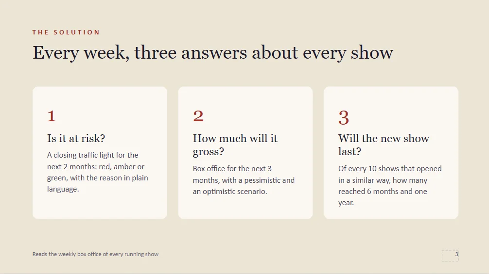

Este proyecto es diferente al resto del portfolio: **no es un laboratorio, es un producto**. CueAnalytics es una herramienta que estoy desarrollando y lanzando junto a un socio, y nace de juntar mis dos mundos: llevo años trabajando como músico en producciones de gran formato, y ahora me dedico a la tecnología y la IA.

> CueAnalytics es una herramienta privada y comercial. Aquí solo cuento la idea a grandes rasgos; los detalles técnicos y del modelo no son públicos.
{: .prompt-info }

---

## El problema

En el teatro musical, cuando la taquilla ya no sostiene una obra, la decisión de cerrarla suele llegar **tarde**. Y quienes tienen que reaccionar se enteran con muy poco margen:

- **El teatro**, que tiene que renovar o liberar la sala.
- **El elenco y el equipo**, con contratos y preavisos que no dan tiempo a organizarse.
- **Marketing**, que lanza la última campaña cuando ya no puede cambiar nada.

{: .shadow }

## La idea

CueAnalytics lee cada semana la taquilla de los espectáculos en cartel y responde a **tres preguntas** sobre cada uno:

1. **¿Está en riesgo?** Un semáforo de cierre a dos meses vista, explicado en lenguaje claro.
2. **¿Cuánto va a recaudar?** Una previsión de taquilla con un escenario pesimista y otro optimista.
3. **¿Aguantará el estreno?** Para las obras recién estrenadas, si van camino de durar.

{: .shadow }

El resultado es una **alerta semanal**: un semáforo por espectáculo que permite actuar antes de que la tendencia sea evidente.

{: .shadow }

---

## Lo que me llevo

Más allá de la parte técnica, este proyecto me está enseñando algo que en los laboratorios no se aprende: **convertir una idea en algo que alguien quiera usar**. Hay que entender a fondo el problema del cliente, explicar el valor sin jerga y presentarlo a quien toma las decisiones.

Si trabajas en el sector y te interesa, toda la información está en [getcueanalytics.com](https://getcueanalytics.com).
