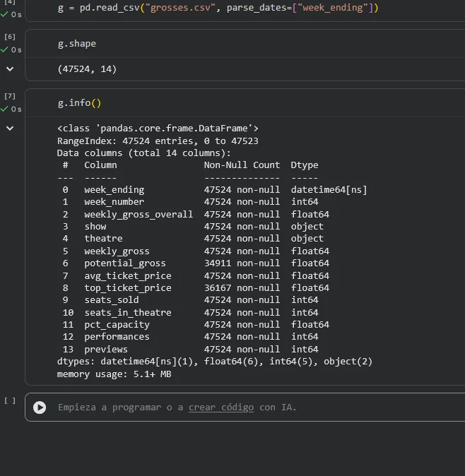
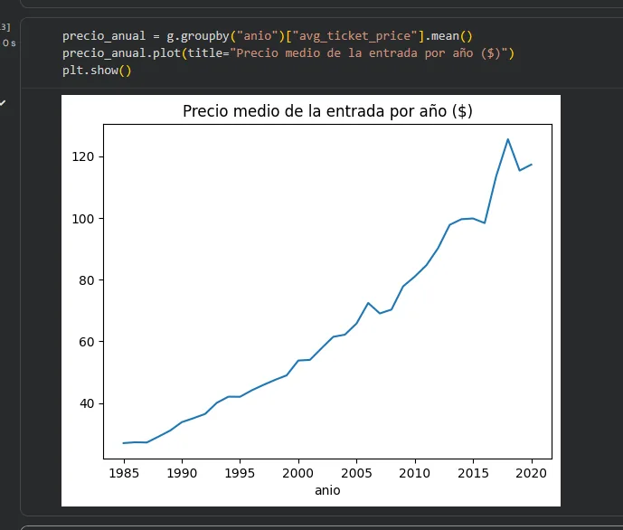
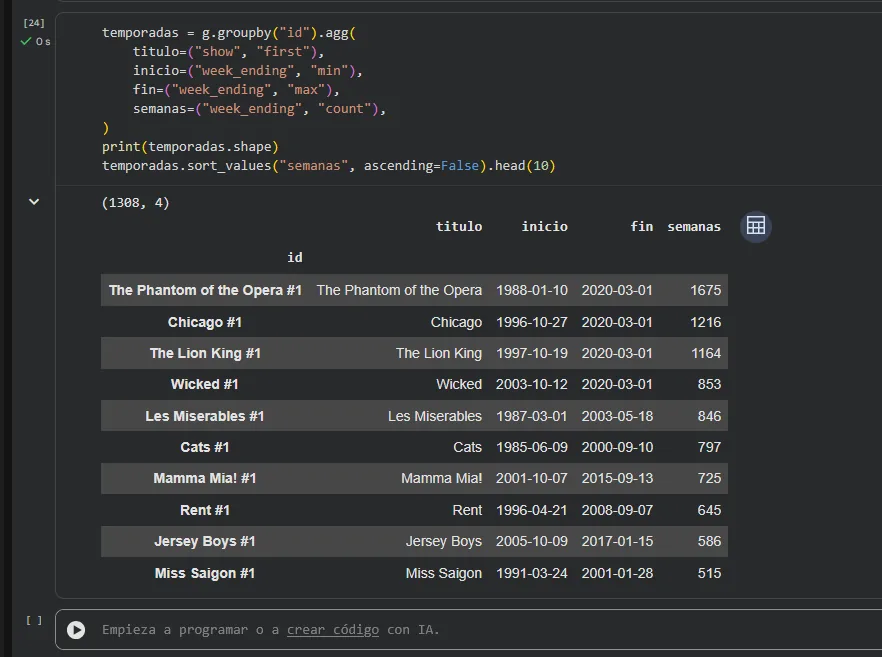
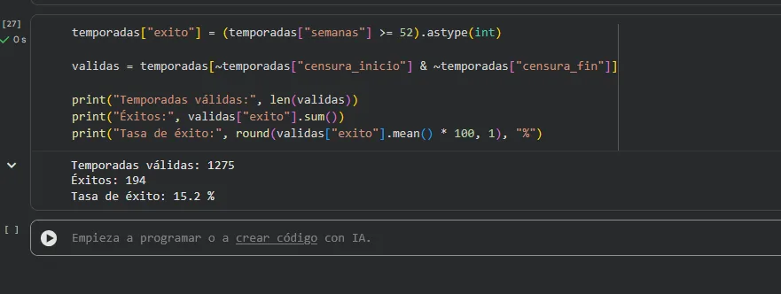
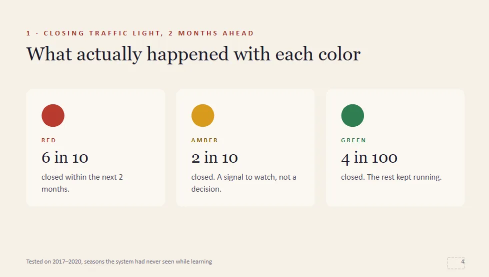
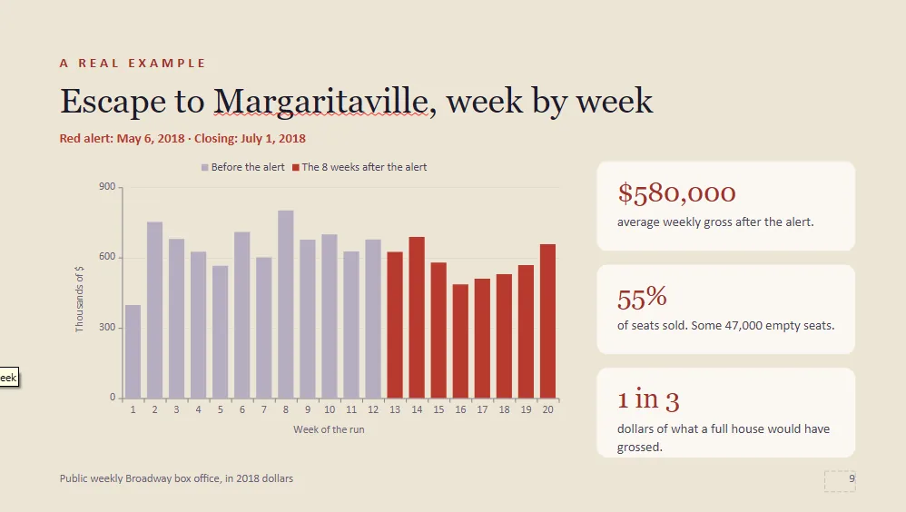

Este proyecto une mis dos mundos: la **música y el espectáculo**, de donde vengo, y la **ciencia de datos**, hacia donde voy. **CueAnalytics** (internamente *Production Predictor*) es una prueba de concepto que desarrollé junto a un socio para responder a una pregunta muy concreta del sector: **¿cuándo va a cerrar un espectáculo?**

En teatro, cuando la taquilla ya no da para sostener una obra, la decisión de cerrar suele tomarse **tarde**: la gente que tiene que actuar (teatro, elenco, equipo, marketing) se entera con muy poco margen. La idea es dar una **señal temprana** con semanas de antelación.

> Proyecto propio, con datos **públicos** de Broadway (TidyTuesday, 1985 – marzo 2020). No usa datos privados de ninguna producción.
{: .prompt-info }

---

## Los datos

Partí del histórico semanal de taquilla de Broadway: unas **47.000 filas**, con recaudación, aforo, precio medio y de qué obra y teatro es cada semana.

{: .shadow }
_Estructura del dataset: 47.524 semanas de taquilla_

El trabajo de datos fue reconstruir, para cada obra, su **"run"** completo (de estreno a cierre) a partir de semanas sueltas, para poder razonar sobre su trayectoria.

{: .shadow }

{: .shadow }
_Las obras más longevas: El Fantasma de la Ópera, Chicago, El Rey León…_

## El reto de verdad: no hacer trampas

En un problema temporal como este, el error más fácil y más grave es la **fuga de información** (*data leakage*): usar para predecir la semana *t* algo que solo se sabe después. Puse una regla de oro, con un test que lo comprueba siempre:

> Cualquier característica de la semana *t* usa **solo** semanas ≤ *t* del mismo run.

Flags como "cerró por COVID" o "run corto" **no son features**: solo sirven para filtrar o analizar, porque dependen del final. La sinopsis tampoco, porque menciona premios y récords que son el resultado. Esto es lo que separa una métrica bonita y falsa de una útil.

## Los modelos

Comparé varios enfoques sobre el mismo problema:

- **Modelos tabulares** (LightGBM, regresión logística) con características de la trayectoria de taquilla.
- **Deep learning** (una GRU) para tratar la secuencia semanal.
- **Análisis de supervivencia**, el marco natural de "¿cuánto le queda en cartel?".

Lo importante no es solo acertar, sino que la **probabilidad signifique algo**. Una probabilidad del 70 % tiene que acertar, a la larga, el 70 % de las veces. Para eso apliqué **calibración isotónica**, pero solo cuando mejoraba de verdad fuera de muestra (medido con el *Brier score*).

Y las métricas, honestas para un problema con pocos cierres por semana (clases desbalanceadas): **AUC-PR** y **Brier skill**, no la *accuracy*, que aquí engaña. Las decisiones de modelado se toman con **validación**; el conjunto de test **solo se reporta**, nunca se usa para elegir.

{: .shadow }

## De las métricas al producto

Un modelo no se le enseña a un productor con una curva AUC-PR. Por eso el resultado final son **dos lenguajes**: un informe técnico con todo el detalle, y una presentación para productores sin una sola palabra técnica, con un **semáforo** a 8 semanas.

{: .shadow }
_Para cada obra, tres respuestas: ¿en riesgo?, ¿cuánto recaudará?, ¿seguirá el año que viene?_

Para que se entienda el valor, lo acompañé de un caso real reconstruido semana a semana: cuánto se habría ganado de margen actuando con la antelación que da el aviso.

{: .shadow }

Todo se presenta en un **dashboard en Streamlit** y en informes HTML autocontenidos, generados automáticamente desde los artefactos del entrenamiento.

---

## Lo que me llevo

- **La parte difícil del ML no es el modelo, es no engañarse.** Evitar la fuga de información, validar bien y calibrar las probabilidades importa más que elegir el algoritmo de moda.
- **Traducir el resultado es parte del trabajo.** El mismo modelo tiene que hablar con un técnico y con alguien de negocio; si no, no sirve de nada.
- **El dominio importa.** Conocer el mundo del espectáculo me dio las preguntas correctas antes de tocar los datos.

CueAnalytics es la dirección en la que quiero seguir especializándome: **IA aplicada a problemas reales**, de principio a fin, desde los datos hasta la decisión.
