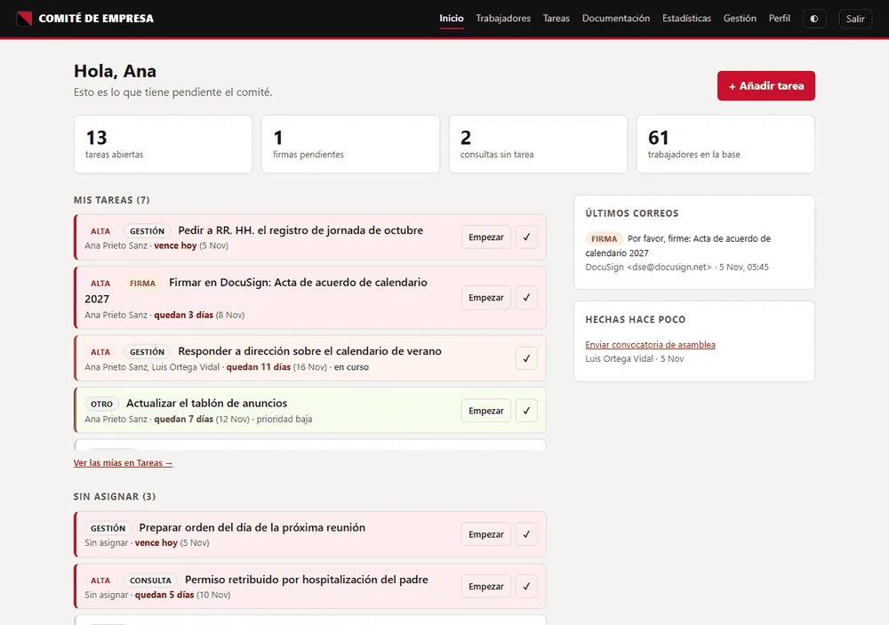
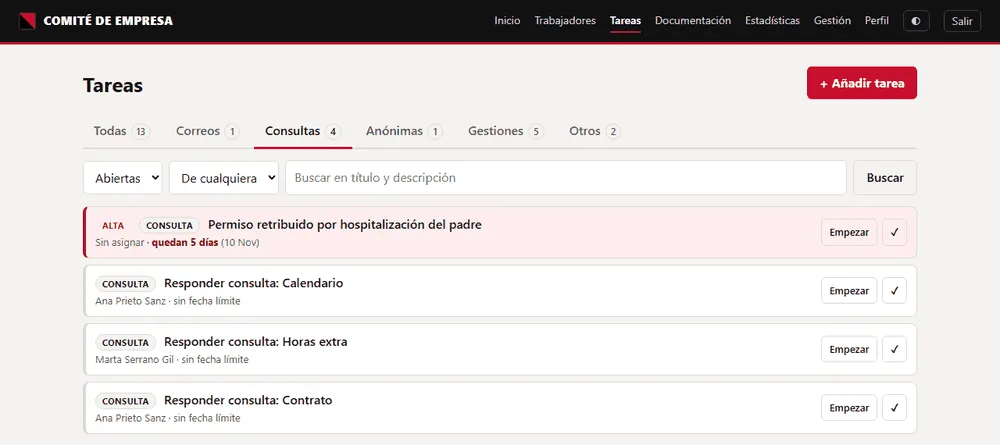
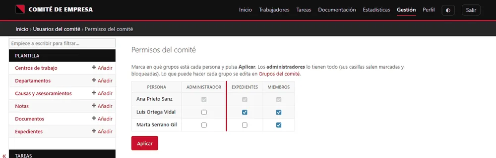
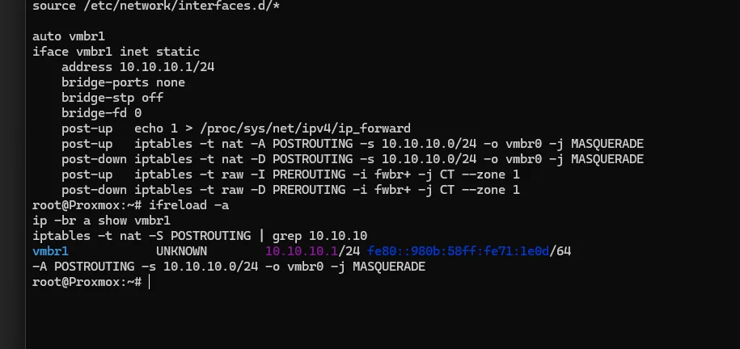
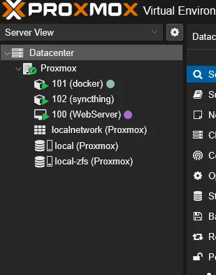
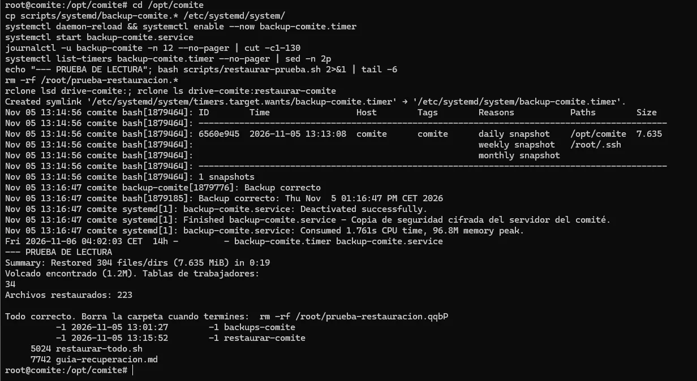
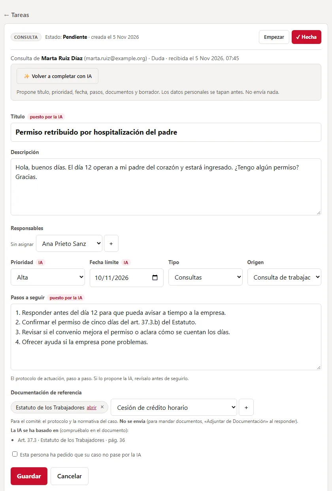

De todos mis proyectos, este es el que más junta las tres cosas que hago: **desarrollo, sistemas y seguridad**, y además con un requisito que no admite atajos: **maneja datos personales de trabajadores**. Es una plataforma interna para la gestión de un comité de empresa, y la diseñé con una idea por delante de todo: **privacidad por diseño**.

> Soy miembro del comité y lo construí para resolver una necesidad real. Las capturas son de una base de **datos de demostración, con nombres y datos inventados**; nada que aparezca aquí corresponde a personas reales.
{: .prompt-warning }

---

## Qué resuelve

El comité gestiona fichas de trabajadores, consultas, expedientes, tareas, documentación y correo centralizado. Antes, todo eso vivía en hojas de cálculo y correos sueltos. La plataforma lo unifica:

{: .shadow }
_Panel de inicio: tareas pendientes, últimos correos y cifras (datos de demo)_

- **Tareas y consultas:** cada consulta (del formulario o del correo) se convierte en una tarea con su hilo.
- **Correo centralizado:** un *worker* importa Gmail y Google Forms cada pocos minutos y los convierte en tareas; las respuestas salen en el mismo hilo.
- **Documentación y expedientes** con control de acceso.

{: .shadow }

---

## Seguridad y privacidad primero

Al tratar con datos personales, estas fueron reglas **no negociables** desde el diseño:

**Minimización y plazos.** Se guarda lo justo, con plazos de borrado automáticos. Nada de perfilar ni puntuar a trabajadores por afinidad sindical u opiniones.

**Roles y auditoría.** Grupos con permisos distintos (Miembros, Expedientes, Administración) y un registro de auditoría: los accesos a fichas, expedientes y documentos **quedan registrados**.

{: .shadow }

**Documentos nunca como estáticos:** cada documento se sirve por una vista que comprueba permiso y deja traza, nunca como una URL pública.

---

## Arquitectura: nada expuesto a Internet

La plataforma corre en una **VM aislada** de un mini-PC con Proxmox, en una red interna propia (`10.10.10.0/24`) con su firewall. La aplicación (Django + PostgreSQL + un worker, en Docker Compose) **solo escucha en `127.0.0.1`**.

{: .shadow }
_La VM del comité, en su propia red aislada con NAT y firewall_

Los miembros acceden por **Tailscale** (`tailscale serve` con HTTPS): la plataforma está publicada **solo dentro de la red privada del comité**, sin abrir un solo puerto al exterior. Lo que debe ser público (los formularios de entrada) vive en Google Forms, y es el servidor el que va a buscarlo, no al revés.

{: .shadow }

**Copias de seguridad cifradas:** backup diario con `restic` a Google Drive, con prueba de restauración. Una plataforma que guarda datos de trabajadores sin copias verificadas no es una opción.

{: .shadow }

---

## La parte que más me gusta: IA que no ve datos personales

El comité recibe muchas consultas parecidas que hay que responder citando el convenio y el estatuto. Quería ayudarme de un LLM para preparar borradores… **sin que los datos personales de nadie salgan del servidor**. Y eso es exactamente lo que promete el aviso de privacidad a la plantilla, así que tenía que cumplirlo de verdad.

La solución es **pseudonimizar antes de salir y revertir al volver**:

```text
Texto del caso
   │  (dentro de la VM)
   ▼
Tapar datos personales  →  "Soy Ana Prieto, 600 123 123"  →  "Soy PERSONA_1, TELEFONO_1"
   │
   ▼  (solo el texto tapado sale hacia la IA)
La IA responde usando "PERSONA_1"…
   │
   ▼  (de vuelta en la VM)
Destapar  →  "Hola, Ana Prieto:"
```

La tabla *marcador → dato real* **vive solo en memoria mientras dura la petición**: no se guarda ni se envía. Y el tapado se hace de varias formas a la vez, porque ninguna basta por sí sola:

1. **Regex** para correos, DNI/NIE, IBAN, nº de la Seguridad Social, teléfonos y direcciones.
2. Los **datos de la ficha** de quien escribe (su nombre, apellidos, correo…).
3. La **lista de nombres** de la plantilla y del comité (que nunca sale del servidor).
4. **Presidio + spaCy** para nombres que no están en ninguna lista ("mi jefe, Luis Ortega").
5. Departamentos y centros, que en una plantilla pequeña también identifican.

Y una regla tajante: **si la pseudonimización falla, no se envía nada**. Mejor sin IA que con una fuga.

{: .shadow }
_El botón "Completar con IA" propone; una persona siempre revisa y envía_

Además, la IA **solo propone, nunca envía ni asigna**. Y para que sea barata y precisa, uso dos modelos: uno económico elige qué artículos del convenio son relevantes, y uno más potente redacta el borrador. Como la IA solo devuelve texto con un formato fijo (JSON) y **no tiene herramientas**, lo peor que podría provocar un correo malicioso que intentara darle órdenes es un mal borrador que una persona va a revisar igualmente. Mitigar el *prompt injection* también es diseño.

---

## Conclusión

Es el proyecto del que más orgulloso estoy, porque demuestra que se puede usar IA con datos sensibles **sin renunciar a la privacidad**, y porque toca todas las capas: una app Django bien pensada, desplegada en una infraestructura aislada, con copias verificadas y auditoría, y una integración de IA diseñada para no filtrar nada. Es, en pequeño, cómo creo que debería construirse software que maneja datos de personas.
