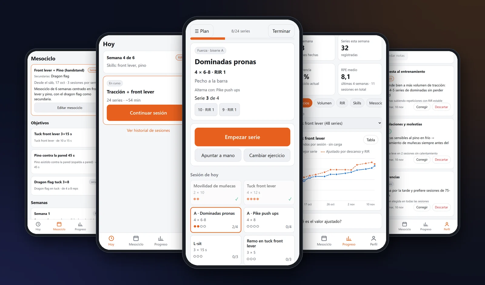
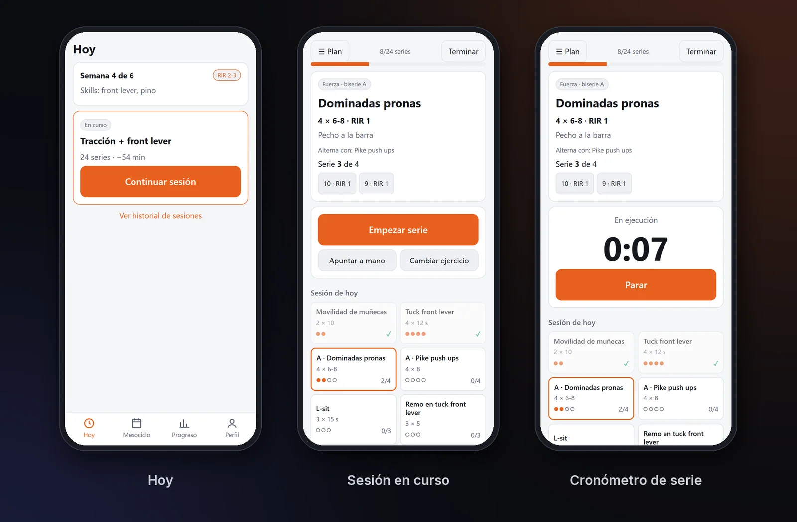
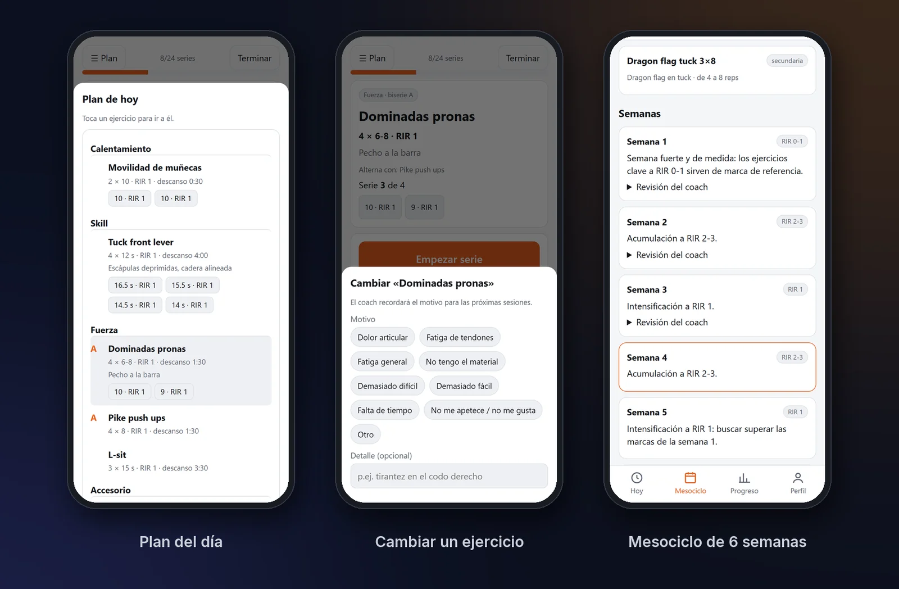
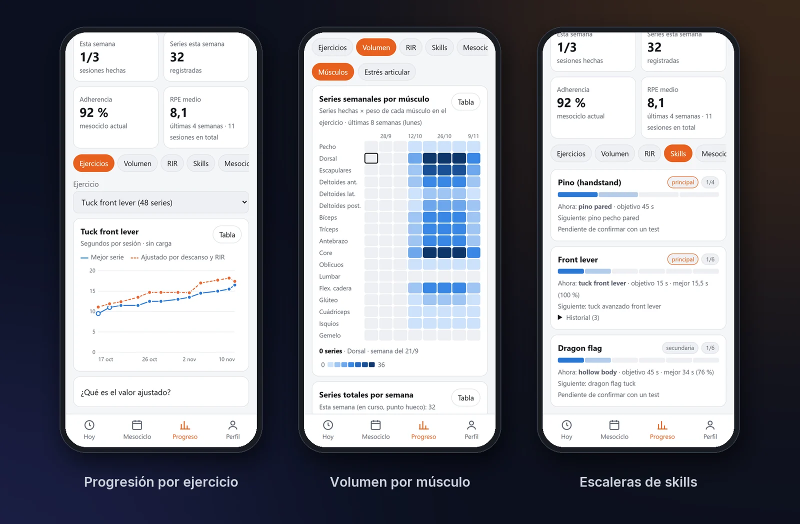
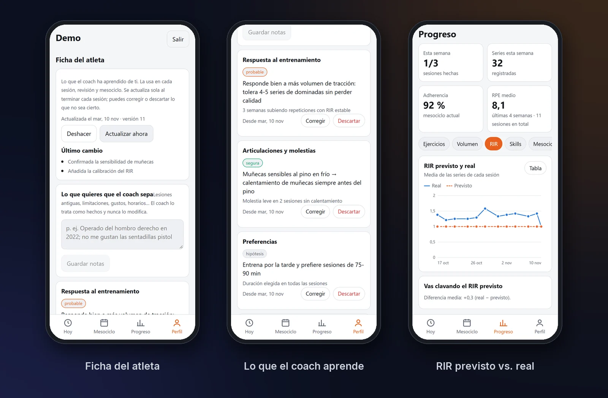

Entreno calistenia, y llevaba tiempo programando mis entrenamientos en hojas de cálculo: series, descansos, progresiones hacia el *front lever* o el pino… Cada semana tocaba decidir a mano qué subir, qué mantener y qué cambiar si algo molestaba. Así que construí lo que me hubiera gustado tener: **un entrenador personal con IA que planifica, se adapta a lo que de verdad pasa en cada sesión y no se salta las reglas.**


_La app es una PWA: se instala en el móvil y se usa durante el entrenamiento_

> Todas las capturas son de una instalación de demostración con un atleta inventado. La app real corre en mi servidor y es privada.
{: .prompt-info }

---

## Qué hace

1. **Planifica un mesociclo de 6 semanas** a partir de las skills que eliges (hasta 3 principales y 3 secundarias), de tu nivel y de tu historial.
2. **Genera la sesión de cada día** según el tiempo disponible, el material que tienes a mano y cómo vienes: sesiones saltadas, marcas recientes, molestias…
3. **Te acompaña mientras entrenas**: serie a serie, con cuenta atrás, cronómetro para los isométricos y registro de repeticiones, segundos y RIR.
4. **Mide tu progreso** y te avisa cuando superas un paso de la escalera de una skill.


_El flujo de un entrenamiento: la sesión de hoy, el ejercicio en curso y el cronómetro_

---

## La idea clave: el modelo propone, el código decide

La parte que más me importaba era no fiarme a ciegas del LLM. Un modelo de lenguaje es muy bueno razonando sobre tu historial y explicando por qué cambia algo, pero **puede equivocarse con los números**. Por eso cada sesión que propone pasa por un validador en Python con **reglas duras de entrenamiento**:

| Regla | Qué comprueba |
|---|---|
| Volumen | Entre 20 y 24 series por sesión (menos solo en la semana de descarga) |
| Descansos | Según la exigencia del ejercicio: 3,5–5 min para skills y fuerza alta, 1,5–3 min para el resto |
| Biseries | El descanso *efectivo* de cada ejercicio, contando el trabajo del otro |
| Duración | Que la sesión estimada quepa en el tiempo que tienes y lo aproveche |
| Material | Que no aparezca ningún ejercicio para el que no tienes el material de hoy |
| Intensidad | El RIR objetivo de cada semana del mesociclo (medida, acumulación, intensificación, descarga) |

Si la propuesta incumple algo, el backend **le devuelve al modelo los errores concretos y le pide una corrección**. Si aun así no cuadra, un último paso **lo arregla de forma determinista** (recortar series, ajustar descansos) antes de enseñártela. El modelo aporta criterio; el código garantiza que lo que llega al móvil es entrenable.


_Si un ejercicio molesta, se cambia en mitad de la sesión y el coach recuerda el motivo para las siguientes_

Durante la sesión puedes **cambiar un ejercicio** indicando el motivo (dolor articular, fatiga de tendones, falta de material…). La app propone alternativas con menos estrés sobre esa articulación y el coach lo tiene en cuenta al programar las siguientes sesiones.

---

## Progreso medible, no impresiones

El progreso no lo decide la IA: es **lógica determinista**. Cada skill tiene una **escalera de pasos**; por ejemplo, el front lever va de *tuck* a *tuck avanzado*, a una pierna, *straddle*, *half* y completo. Un paso se da por superado cuando consigues la marca objetivo en **3 series con RIR ≥ 1**. Así, subir de nivel depende de lo que haces, no de lo que el modelo crea.

Detrás hay un catálogo propio de **333 ejercicios y 22 skills**. Lo construí a partir de una guía de calistenia y de datasets públicos de ejercicios, con material necesario, prerrequisitos, músculos implicados y estrés articular de cada uno.


_La evolución de cada ejercicio (también ajustada por descanso y RIR), el volumen semanal por músculo y el punto en el que estás de cada skill_

---

## Memoria: la ficha del atleta

Un LLM no recuerda nada entre llamadas. Para que el coach "te conozca", la app mantiene una **ficha del atleta**: aprendizajes concretos sobre cómo respondes al volumen, qué articulaciones vigilar, cómo calibras el RIR o qué prefieres. Cada aprendizaje tiene su **evidencia y su nivel de confianza**.

- Se **reescribe en segundo plano** tras cada sesión completada y al cerrar un mesociclo.
- Se envía en **todas** las llamadas al modelo, así que cada sesión nueva tiene en cuenta lo aprendido.
- Está **versionada** y se puede deshacer. Además, tú puedes corregir o descartar cualquier punto: **si editas algo, tu versión manda** sobre la del modelo.


_La ficha del atleta, con su evidencia, y la comparación entre el esfuerzo previsto y el real_

---

## Bajo el capó

```text
PWA (React + TypeScript, instalable)
        │  HTTPS (Caddy, certificado propio)
        ▼
FastAPI ──► Reglas y validación (Python) ──► PostgreSQL 17
   │                                          (Alembic + copia diaria)
   └──► Coach IA (API de Claude)
          · Modelo de planificación: mesociclo, revisiones semanales, cierre
          · Modelo diario: sesión de cada día (más rápido y barato)
```

- **Salida estructurada:** el modelo responde con objetos validados por **Pydantic** (plan del mesociclo, sesión, revisión semanal, ficha), no con texto libre que haya que interpretar.
- **Caché del prompt:** las reglas y el catálogo son un bloque de sistema estable que se cachea, así cada llamada sale más barata y rápida.
- **Coste bajo control:** cada llamada registra tokens y coste por usuario, consultables desde el panel de administración.
- **Robustez:** si el modelo rechaza una petición, hay un respaldo en el servidor. Los fallos de la IA (por ejemplo, al actualizar la ficha) **nunca rompen** el cierre de una sesión.
- **Tests sin gastar tokens:** el flujo completo (mesociclo → sesión → registro → sustitución → progreso → cierre) se prueba con **pytest** y un coach simulado que sustituye al modelo.
- **Despliegue:** Docker Compose en un contenedor LXC de mi [servidor Proxmox](/posts/Homelab-servicios/), con migraciones automáticas al arrancar y copias de seguridad diarias de la base de datos. Accesible solo desde casa o por Tailscale, sin abrir puertos.

---

## Lo que me llevo

Lo más valioso de este proyecto no ha sido "llamar a un LLM", sino **diseñar alrededor de él**: decidir qué decide el modelo (razonar, adaptar, explicar) y qué decide el código (reglas, progreso, datos). Esa frontera es la que hace que una aplicación con IA sea fiable.

Y, de paso, ahora entreno con un coach que se acuerda de que mis muñecas necesitan calentar antes del pino.
