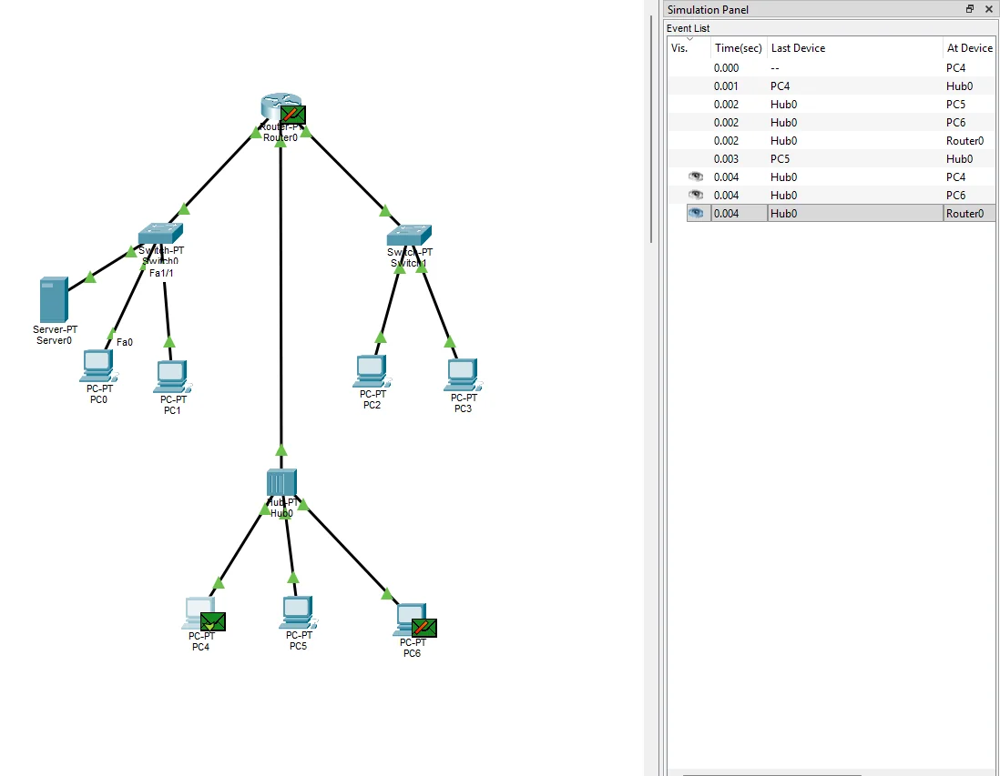
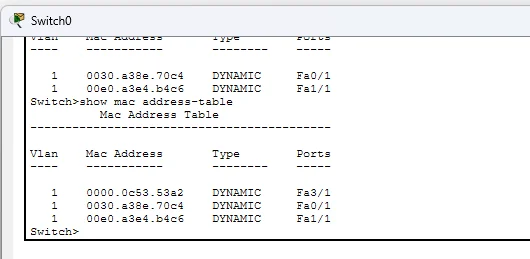
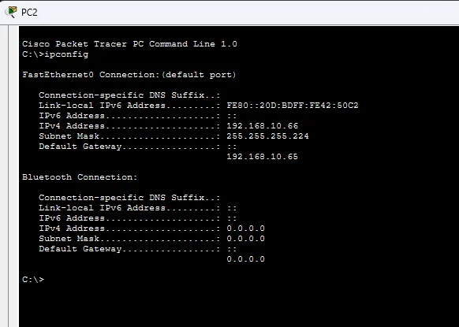
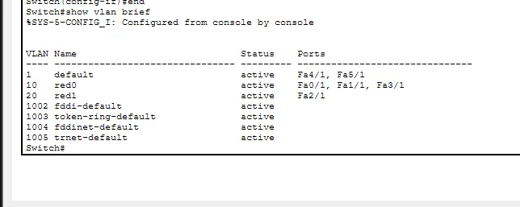
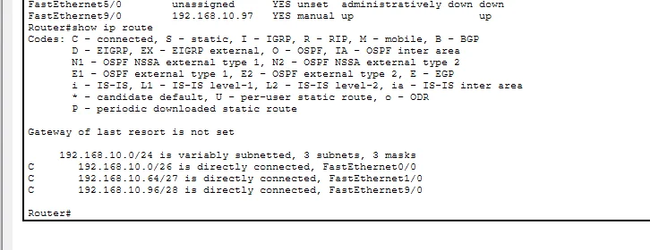
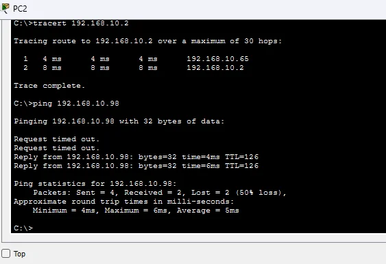
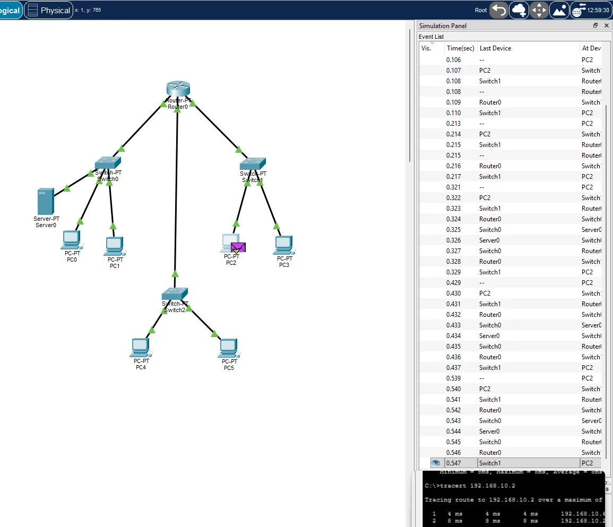
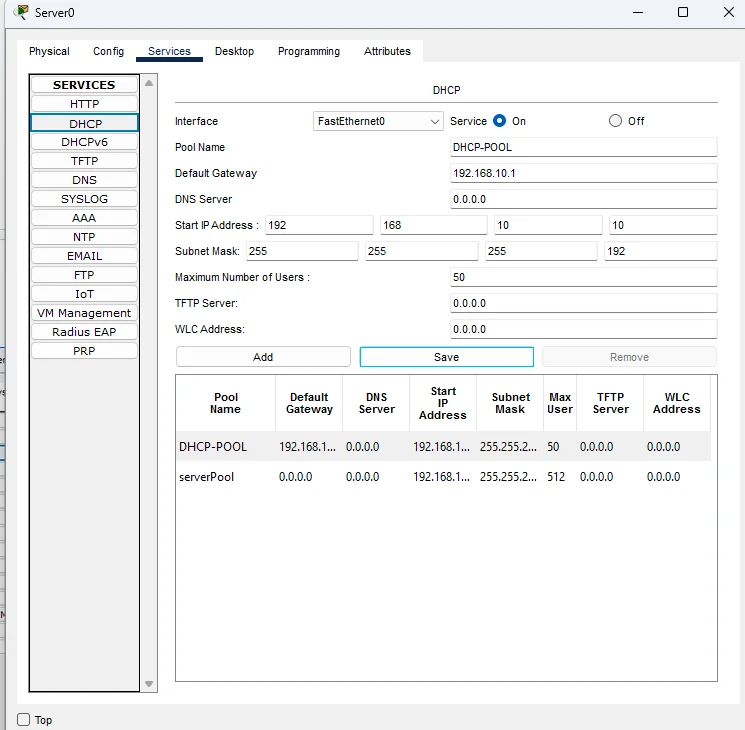

Antes de montar homelabs, SIEMs o servidores web, hay que entender la capa que lo sostiene todo: **la red**. Este post recoge el diseño e implementación de una red empresarial de tres departamentos en **Cisco Packet Tracer**, siguiendo el orden natural de un despliegue real: primero la topología física, luego la capa de enlace, después el direccionamiento, el enrutamiento y, por último, los servicios.

El escenario: una empresa con tres redes departamentales —**Administración** (≈50 equipos), **Monitorización** (≈25 sondas) y **Laboratorio** (≈10 equipos)— que hay que direccionar, conectar y comunicar.

> Es un ejercicio de fundamentos, pero los conceptos (VLSM, VLANs, rutas, DHCP) son exactamente los que luego aplico en el [homelab](/posts/Proxmox/) y en cualquier infraestructura real.
{: .prompt-info }

---

## Topología y capa física

El punto de partida es una topología **en árbol**: de un nodo raíz (el router) cuelgan dos redes, cada una conectada a su switch, y de los switches los equipos finales.

{: .shadow }

Aquí conviene tener claro el papel de cada dispositivo intermedio:

- **Router** (capa 3): lee la IP de destino y, según su tabla de encaminamiento, decide a qué red envía cada paquete.
- **Switch** (capa 2): lee las direcciones MAC y entrega la trama **solo** al puerto del destinatario.

Todos los enlaces son de **cobre de par trenzado directo** (RJ-45): las distancias son cortas y cada enlace une dispositivos de distinto tipo (PC–switch, switch–router). La fibra entraría en juego para enlaces de gran capacidad o distancia, donde además es inmune a interferencias electromagnéticas.

## Ethernet y aprendizaje de MAC

Un switch no nace sabiendo dónde está cada equipo: lo **aprende**. A partir de las tramas que recibe, asocia cada dirección MAC al puerto por el que ha llegado y construye su tabla:

```
Switch# show mac address-table
```

{: .shadow }

La diferencia se ve en modo simulación: en el **primer** ping el switch aún no conoce el destino y difunde la trama; una vez aprendida la MAC, el **segundo** ping va directo al puerto correcto y el resto de equipos ni se entera. Es justo lo que distingue un switch de un hub, que repite todo por todos los puertos (un único dominio de colisión); el switch crea **un dominio de colisión por puerto**, y por eso en full-duplex conmutado CSMA/CD deja de tener sentido.

## Direccionamiento con VLSM

La parte más de lápiz y papel, y la más importante. Hay que dividir `192.168.10.0/24` ajustando cada subred a su tamaño real con **VLSM** (máscaras de longitud variable), empezando por la subred más grande:

| Subred | Hosts necesarios | Red | Prefijo | Rango útil | Broadcast |
|---|---|---|---|---|---|
| Administración | 50 | `192.168.10.0` | `/26` (62 hosts) | `.1 – .62` | `.63` |
| Monitorización | 25 | `192.168.10.64` | `/27` (30 hosts) | `.65 – .94` | `.95` |
| Laboratorio | 10 | `192.168.10.96` | `/28` (14 hosts) | `.97 – .110` | `.111` |

La idea de VLSM es no malgastar direcciones: a Administración le doy un `/26` porque necesita más de 32 direcciones; a Monitorización le basta un `/27`; y Laboratorio cabe de sobra en un `/28`. Cada subred reserva su primera dirección para la red y la última para el broadcast.

Configurado el plan, cada equipo recibe su IP, máscara y puerta de enlace:

{: .shadow }

## Aislar tráfico dentro de un switch: VLANs

Siguiente reto: que un PC hable con el servidor pero **no** con otro PC, estando los tres en el mismo switch. La respuesta son las **VLANs**, que dividen un switch físico en varios switches lógicos sin tocar el cableado.

```
Switch# show vlan brief
```

{: .shadow }

Asignando los puertos a VLANs distintas se consigue el aislamiento a nivel lógico, manteniendo las mismas direcciones IP. Es el mecanismo base de la segmentación de red.

## Enrutamiento, ARP e ICMP

Para que las subredes se comuniquen, el router necesita una interfaz en cada una. Las redes directamente conectadas aparecen solas en la tabla, sin protocolo de enrutamiento dinámico:

```
Router# show ip route
```

{: .shadow }

Un detalle que me pareció muy didáctico en modo simulación: **el primer ping entre subredes se pierde**. ¿Por qué? Porque antes de enviar nada hay que resolver direcciones MAC con **ARP**: el PC pregunta por la MAC de su puerta de enlace, y el router pregunta por la MAC del destino. Mientras se resuelven esas consultas, el primer *Echo Request* se descarta. A partir del segundo, con las tablas ARP pobladas, el ping fluye.

Y con `tracert` se ve el camino salto a salto, apoyándose en el **TTL** (cada router lo decrementa en 1; al llegar a 0 el paquete se descarta, lo que evita bucles infinitos):

{: .shadow }

### Tres routers y rutas estáticas

Para simular departamentos en edificios distintos, rehago la topología con **un router por subred**, conectados en cadena (Router0–Router1–Router2):

{: .shadow }

Aquí ya no basta con las redes conectadas: cada router solo conoce las suyas. Hay que añadir **rutas estáticas** indicando, para cada red remota, la `Network`, la `Mask` y el `Next Hop` (la IP del router vecino que lleva hacia allí). Un par de detalles que tuve que cuidar:

- Los enlaces router–router unen dispositivos del mismo tipo, así que necesitan **cable cruzado** (y uno de ellos, por agotar las interfaces de cobre, va por **fibra**).
- Al reconvertir la topología hay que **reasignar las puertas de enlace**: si no, una misma IP queda configurada en dos routers y la subred deja de funcionar.

Con las rutas bien puestas, vuelve a haber conectividad extremo a extremo entre las tres subredes.

## DHCP: configuración automática

Configurar IPs a mano no escala. El último paso es levantar un servicio **DHCP** en el servidor para que los equipos obtengan su configuración solos:

{: .shadow }

En modo simulación se ve el baile de mensajes **DORA**: el cliente, que aún no tiene IP, lanza un `DISCOVER` en broadcast (origen `0.0.0.0`, destino `255.255.255.255`); el servidor responde con un `OFFER`; el cliente lo acepta con un `REQUEST` y el servidor confirma con el `ACK`. A partir de ahí, IP automática.

¿Por qué reservar IPs fijas para routers, switches y servidores? Porque son los que **dan servicio** al resto: si la puerta de enlace o el DNS cambiaran de dirección, la red dejaría de encontrarlos. DHCP ahorra tiempo, evita errores de tecleo y, sobre todo, impide direcciones duplicadas porque el servidor lleva el control de lo que reparte.

---

## Lo que me llevo

Montar esto de cero deja un mapa mental muy claro de cómo encaja cada capa:

- **El direccionamiento es diseño, no improvisación.** VLSM obliga a pensar en tamaños y a no desperdiciar espacio.
- **Capa 2 y capa 3 hacen cosas distintas.** MAC y puertos abajo; IP y rutas arriba. Entender ARP es entender por qué "no va el primer ping".
- **Segmentar (VLANs) y enrutar son las dos caras de conectar y a la vez aislar**, que es exactamente de lo que va la seguridad de red.

Son los cimientos sobre los que luego levanto el resto del [homelab](/posts/Homelab-servicios/) y cualquier servicio que exponga.
