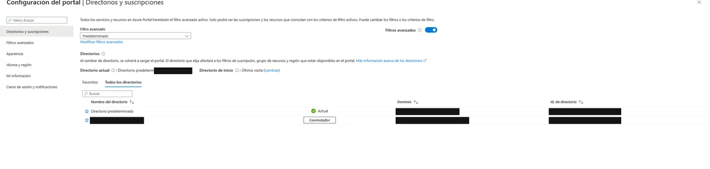
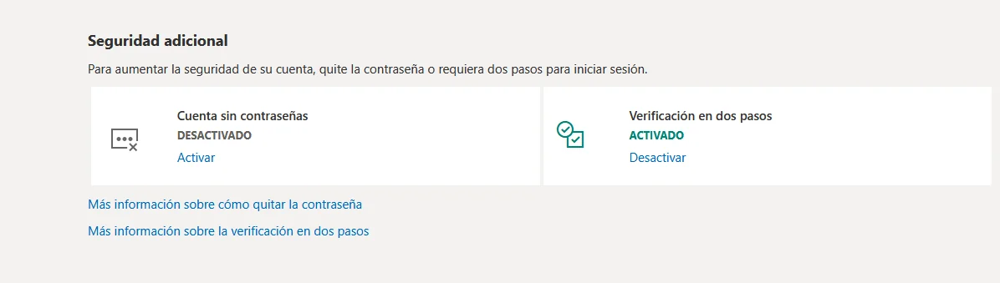
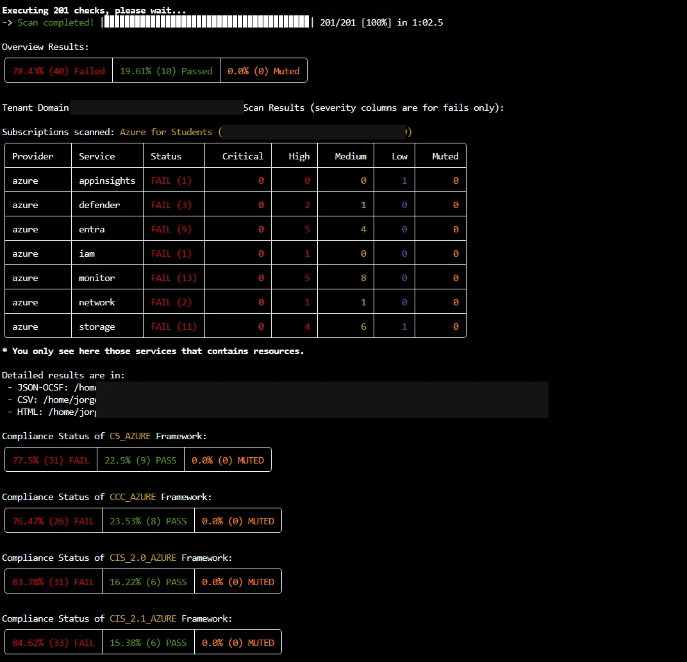

Quería un destino **offsite** para las copias de seguridad de mi [homelab de Proxmox](/posts/Proxmox/), pero me interesaba más el *cómo* que el *dónde*: montarlo en Azure aplicando **buenas prácticas de seguridad cloud** y, sobre todo, **auditar** después mi propia configuración con una herramienta CSPM, como haría un analista de seguridad con un entorno ajeno.

Este primer writeup es justo esa parte: **gobierno, identidad, endurecimiento y auditoría**. El servicio de backup en sí (vzdump + restic cifrando contra Azure Blob) es la segunda mitad del proyecto y lo contaré en otro artículo. Es un enfoque muy parecido al de mi [análisis de riesgos según el ENS](/posts/GRC-analisis-riesgos-ENS/), pero llevado a la práctica sobre una nube real.

> CSPM (*Cloud Security Posture Management*) es, en corto, revisar de forma automática si tu configuración cloud cumple buenas prácticas y marcos como CIS. No mira *dentro* de las máquinas; mira cómo está **configurada** la nube.
{: .prompt-info }

---

## Fase 0: revisar la identidad antes de desplegar nada

Antes de crear un solo recurso, miré qué identidades y accesos colgaban de mi cuenta. Es el primer sitio donde mira cualquier auditoría, y me llevé una sorpresa: mi cuenta aparecía en **dos directorios** (tenants de Microsoft Entra ID).

{: .shadow }

El primero era el mío. El segundo era el de **una organización externa** con la que colaboré hace tiempo: seguía teniendo acceso como **usuario invitado** (Entra B2B). Se reconoce por el formato del UPN, `usuario_gmail.com#EXT#@organizacion.onmicrosoft.com`: mi cuenta personal, marcada como externa, representada en *su* directorio.

Las **cuentas de invitado olvidadas** son un hallazgo clásico en auditorías de identidad: alguien colaboró, nadie revocó el acceso y la puerta sigue abierta. Si me comprometieran la cuenta, el atacante entraría también en ese tenant con los permisos que tuviera allí. Como ya no colaboraba con ellos, apliqué el **mínimo privilegio a mi propia identidad** y abandoné la organización.

> **Fase 0 para el informe:** revisé los directorios asociados a mi cuenta, detecté acceso residual de invitado B2B (UPN con `#EXT#`) en un tenant externo con el que ya no colaboro y lo eliminé. Mentalidad de auditor antes de tocar un recurso.
{: .prompt-tip }

## Fase 1: desplegar, pero endurecido

### Las dos llaves: plano de control y plano de datos

El concepto que vertebra todo el diseño. En Azure hay dos tipos de permiso completamente separados:

- **Plano de control** (ARM): cambiar las *normas* del recurso. Por ejemplo, activar o desactivar el versionado. Esa llave solo la tengo yo, protegida con MFA.
- **Plano de datos**: leer y escribir blobs. Esa es la llave que le daré a Proxmox.

¿Por qué importa? Porque si un ransomware compromete el Proxmox y roba su credencial, podrá borrar blobs, **pero no podrá tocar las normas de la cuenta**. Y la norma dirá: "lo borrado se conserva 14 días". Ahí está la defensa en profundidad.

### El contenedor del proyecto y las guardas de gobierno

Lo creé todo por **Azure CLI / Cloud Shell**, no a clics: queda constancia, es repetible y es como se trabaja en cloud. Sobre una suscripción **Azure for Students** (con límite de gasto, así que no hay sustos de factura), monté un **resource group** siguiendo la convención de nombres de Microsoft (`rg-proxmox-backup`), en **Spain Central** (los datos se quedan en la UE, argumento de RGPD) y con **etiquetas** (`owner`, `project`, `environment`, `data-classification=confidential`). El etiquetado no es cosmético: es de lo primero que valora una auditoría CSPM.

Además dejé puesta una **Azure Policy** que restringe las regiones donde se pueden crear recursos: una guarda de gobierno para no desplegar por error fuera de la UE.

### La storage account, decisión a decisión

Aquí está el grueso del endurecimiento. Una cuenta `StorageV2`, `Standard`, redundancia `LRS` (es ya la copia *offsite*; duplicarla con GRS sería duplicar coste) y nivel de acceso **Cool** (barato para datos que se escriben y casi no se leen). Y, sobre todo, estos controles:

{: .shadow }

- **Transferencia segura obligatoria, TLS mínimo 1.2** → cifrado en tránsito, se rechaza HTTP.
- **Acceso anónimo al blob: deshabilitado** → nada de "buckets abiertos", el error de cloud más repetido.
- **Acceso con clave compartida: deshabilitado** → las claves de cuenta son "root" sobre todos los datos y no caducan. Al desactivarlas, **todo acceso pasa por Entra ID + RBAC**, que es auditable y revocable.
- **Autorización de Microsoft Entra como valor por defecto: habilitada.**

Los contenedores, lógicamente, **privados**. Azure ni siquiera deja elegir otra cosa porque el acceso anónimo está deshabilitado a nivel de cuenta:

{: .shadow }

### Acceso de mínimo privilegio (RBAC)

La identidad que usará Proxmox no recibe la llave maestra, sino el rol **Colaborador de datos de Storage Blob** (*Storage Blob Data Contributor*), y acotado **al contenedor**, no a la cuenta ni a la suscripción. Restic necesita leer y borrar (índices, snapshots, `prune`), así que el mínimo privilegio *real* es ese rol en el ámbito más pequeño posible.

{: .shadow }

### La capa anti-ransomware

Esta es la parte que de verdad protege los backups, y vive en el **plano de control** (fuera del alcance de la credencial de Proxmox):

{: .shadow }

- **Soft delete** de blobs y de contenedores: **14 días** de recuperación. Lo borrado no se purga desde el plano de datos.
- **Versionado** de blobs: cada sobrescritura o borrado conserva la versión anterior.
- **Regla de ciclo de vida**: elimina versiones antiguas a los **30 días**, para que el coste no crezca sin control. Seguridad y coste van de la mano.

Evalué la **inmutabilidad WORM** pero decidí **no activarla**: bloquearía los borrados que restic necesita para su `prune`. Es una decisión consciente de compatibilidad, no un olvido, y así lo documento.

Y para cerrar la identidad del administrador, **MFA** activado desde el primer día (con app Authenticator, no SMS):

{: .shadow }

## La auditoría: Prowler contra mi propia nube

Con todo montado, lo interesante: **auditar mi propia configuración** como si no la hubiera hecho yo. Usé **Prowler**, una herramienta CSPM open source, autenticándome con la CLI de Azure:

```bash
prowler azure --az-cli-auth --subscription-ids "$SUB_ID"
```

{: .shadow }

El resultado es una foto del estado de seguridad: **201 comprobaciones**, con el detalle por servicio y el **cumplimiento frente a varios marcos** (CIS, C5, CCF… y mapeable a ENS, RGPD o NIS2).

{: .shadow }

La línea base fue contundente: **40 comprobaciones FAIL** (un 78%) y solo **16,22% de cumplimiento CIS 2.0**. Los *fails* se concentraban en `monitor` (13), `storage` (11) y `entra` (9). Que aparezca tanto fallo "de fábrica" es la lección número uno: **una nube recién creada no es una nube segura**; trae por defecto muchas opciones pensadas para comodidad, no para seguridad.

### Triaje y remediación

Un listado de hallazgos no es el trabajo; el trabajo es **decidir qué hacer con cada uno**: corregir, aceptar con justificación, o marcar como no aplicable. De lo que corregí:

- **Identidad (Entra):** endurecí la configuración de usuarios, las **restricciones de colaboración externa** (invitados) y el **consentimiento de aplicaciones OAuth**, para que un usuario no pueda autorizar apps a sus datos sin pasar por un administrador.
- **Datos:** clave compartida deshabilitada, versionado y soft delete activados (ya mostrados arriba).
- **Acceso:** RBAC acotado y recordatorio de **rotación de claves** a 90 días.

> Un detalle honesto y revelador: Prowler marcaba el MFA como no configurado **aunque yo lo tenía activo**. No es un falso positivo cualquiera: es que ese control vive en un plano de identidad que la herramienta no ve con esos permisos. Ninguna herramienta lo ve todo; hay que **entender sus límites** y complementarla con revisión manual.
{: .prompt-warning }

## Riesgos aceptados (y por qué)

Tan importante como lo que corriges es documentar lo que **decides no cambiar**, con su control compensatorio:

- **Acceso de red público** en lugar de Private Endpoint: mi conexión doméstica es CG-NAT/IP dinámica y un endpoint privado exigiría VPN y coste. Lo compenso con el **firewall de la cuenta por IP** y todo lo anterior (sin anónimo, sin clave compartida, solo Entra, TLS).
- **Cifrado con claves de Microsoft** en vez de CMK con Key Vault: no hace falta, porque **restic ya cifra en cliente** con mi contraseña. Azure nunca ve los datos en claro; es cifrado de extremo a extremo.
- **LRS** en vez de GRS: decisión consciente coste/riesgo dentro de una estrategia **3-2-1**.

---

## Lo que me llevo

- **Auditar lo propio enseña más que leer un checklist.** Ver 40 fallos en mi propia nube recién creada deja claro por qué el *hardening* es un paso explícito, no algo que venga puesto.
- **Las dos llaves (control vs datos) son la idea clave.** La resiliencia frente a ransomware no está en la credencial, sino en normas (versionado, soft delete) que esa credencial no puede tocar.
- **CSPM es una foto, no la película.** Da postura y cumplimiento, pero no mira dentro de las máquinas (eso es CWPP) y tiene puntos ciegos como el MFA. Es un punto de partida, no un sello.

El siguiente paso natural es **repetir el escaneo** para cuantificar la mejora tras la remediación, y montar el backup real con restic. Eso, y los números de coste, en la segunda parte. Mientras, si te interesa la base sobre la que corre todo esto, está en mi serie de [homelab con Proxmox](/posts/Homelab-servicios/).
