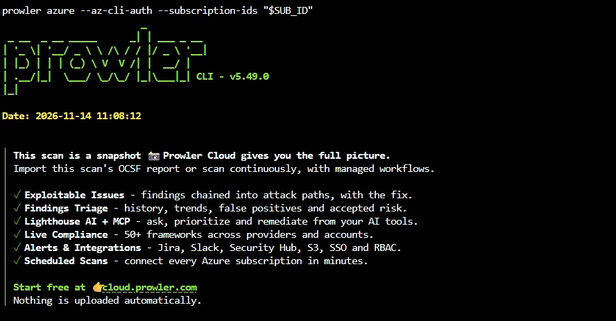
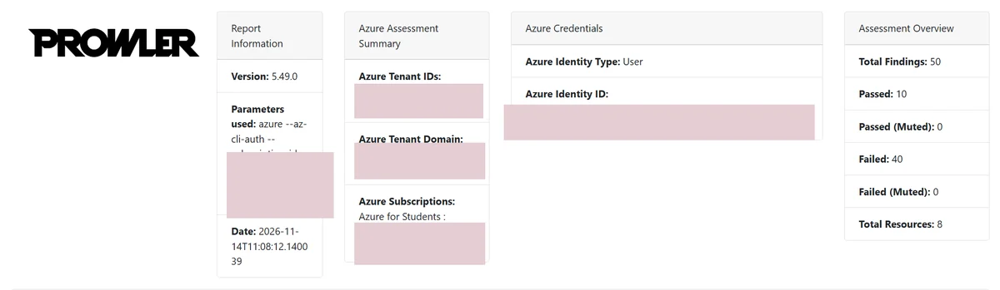
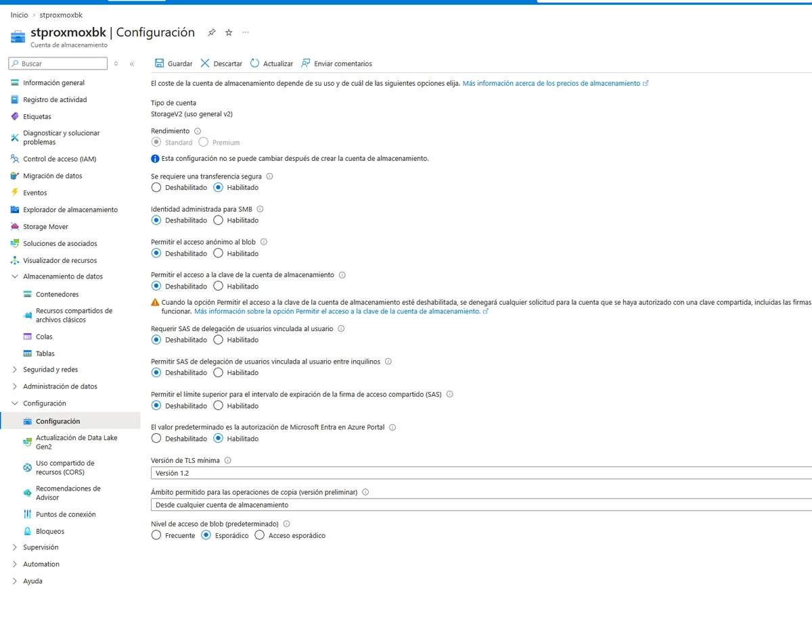
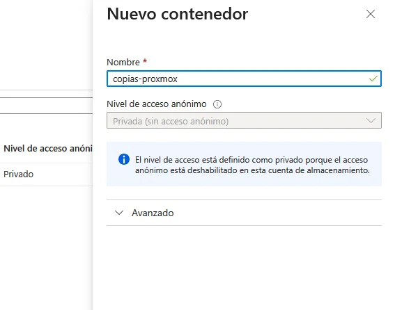
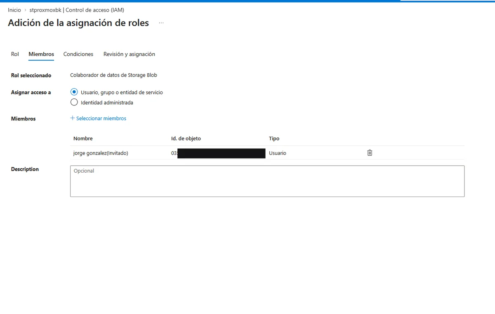
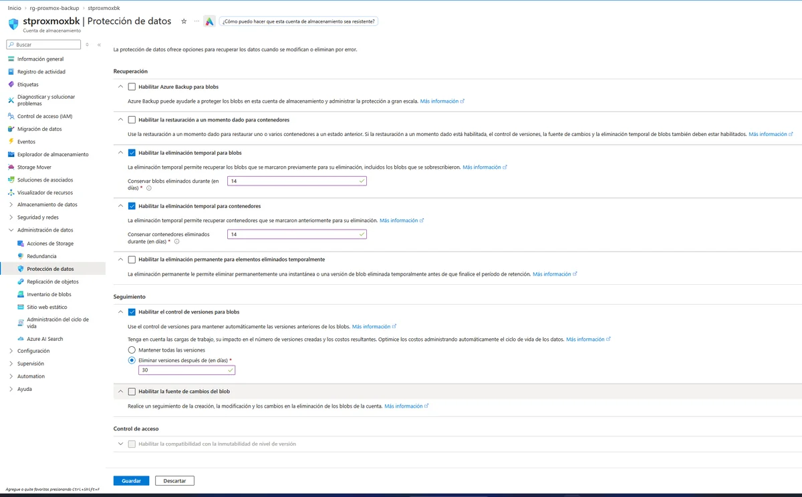

Quería un destino **offsite** para las copias de seguridad de mi [homelab de Proxmox](/posts/Proxmox/), pero me interesaba más el *cómo* que el *dónde*: montarlo en Azure y, sobre todo, **auditar** mi propia configuración con una herramienta CSPM, igual que un analista haría con un entorno ajeno. El orden importa y es el que de verdad seguí: **desplegué una base, la pasé por Prowler y endurecí a partir de lo que el informe me dijo que estaba mal.**

Este primer writeup es esa parte: **gobierno, identidad, auditoría y remediación**. El servicio de backup en sí (vzdump + restic cifrando contra Azure Blob) es la segunda mitad del proyecto y lo contaré en otro artículo. Es un enfoque parecido al de mi [análisis de riesgos según el ENS](/posts/GRC-analisis-riesgos-ENS/), pero sobre una nube real.

> CSPM (*Cloud Security Posture Management*) es, en corto, revisar de forma automática si tu configuración cloud cumple buenas prácticas y marcos como CIS. No mira *dentro* de las máquinas; mira cómo está **configurada** la nube.
{: .prompt-info }

---

## Fase 0: revisar la identidad antes de desplegar nada

Antes de crear un solo recurso, miré qué identidades y accesos colgaban de mi cuenta. Es el primer sitio donde mira cualquier auditoría, y me llevé una sorpresa: mi cuenta aparecía en **dos directorios** (tenants de Microsoft Entra ID).

{: .shadow }

El primero era el mío. El segundo era el de **una organización externa** con la que colaboré hace tiempo: seguía teniendo acceso como **usuario invitado** (Entra B2B). Se reconoce por el formato del UPN, `usuario_gmail.com#EXT#@organizacion.onmicrosoft.com`: mi cuenta personal, marcada como externa, representada en *su* directorio.

Las **cuentas de invitado olvidadas** son un hallazgo clásico en auditorías de identidad: alguien colaboró, nadie revocó el acceso y la puerta sigue abierta. Si me comprometieran la cuenta, el atacante entraría también en ese tenant con los permisos que tuviera allí. Como ya no colaboraba con ellos, apliqué el **mínimo privilegio a mi propia identidad** y abandoné la organización.

## El punto de partida: desplegar la base

Con la identidad limpia, monté la base del proyecto por **Azure CLI / Cloud Shell** (no a clics: queda constancia, es repetible y es como se trabaja en cloud). Sobre una suscripción **Azure for Students** (con límite de gasto, así que no hay sustos de factura):

- Un **resource group** con la convención de nombres de Microsoft (`rg-proxmox-backup`), en **Spain Central** (los datos se quedan en la UE, argumento de RGPD) y con **etiquetas** (`owner`, `project`, `environment`, `data-classification=confidential`). El etiquetado no es cosmético: es de lo primero que valora una auditoría.
- Una **Azure Policy** que restringe las regiones donde se pueden crear recursos, como guarda de gobierno para no desplegar por error fuera de la UE.
- Una **storage account** (`StorageV2`, `Standard`, redundancia `LRS`, nivel **Cool**) con el contenedor donde vivirán los backups.

Y aquí está el punto clave del ejercicio: **creé la cuenta con sus valores por defecto a propósito**, para después auditarla y ver de qué parte se la juega una nube recién hecha. Nada de endurecerla todavía.

## La auditoría con Prowler

Lo primero antes de tocar un ajuste: **auditar lo desplegado** como si no lo hubiera hecho yo. Usé **Prowler**, una herramienta CSPM open source, autenticándome con la CLI de Azure:

```bash
prowler azure --az-cli-auth --subscription-ids "$SUB_ID"
```

{: .shadow }

El resultado es una foto del estado de seguridad: **201 comprobaciones**, con el detalle por servicio y el **cumplimiento frente a varios marcos** (CIS, C5, CCF… y mapeable a ENS, RGPD o NIS2).

{: .shadow }

Prowler también genera un **informe en HTML** (además de CSV y JSON) con el mismo resumen y el detalle navegable de cada comprobación, muy cómodo para el triaje y para adjuntar como evidencia:

{: .shadow }

La línea base fue contundente: **40 comprobaciones FAIL** (un 78%) y solo **16,22% de cumplimiento CIS 2.0**. Los fallos se repartían así:

| Servicio | Fallos | Ejemplos de lo que marcaba |
|---|---|---|
| `monitor` | 13 | sin alertas de Activity Log ni *diagnostic settings* |
| `storage` | 11 | clave compartida activa, acceso anónimo posible, sin versionado |
| `entra` | 9 | consentimiento OAuth abierto, invitados y registro de apps sin restringir |
| `defender` | 3 | planes de Defender desactivados |
| `network` | 2 | sin Network Watcher ni Bastion |
| `iam` / `appinsights` | 1 + 1 | nº de *Owners*, sin App Insights |

Que una nube recién creada suspenda así es la lección número uno: **por defecto viene optimizada para comodidad, no para seguridad**. El informe (HTML/CSV/JSON) no es el trabajo; es la **lista de tareas**.

## Leer el informe y remediar

Con el informe delante, el trabajo real es **decidir qué hacer con cada hallazgo**: corregir, aceptar con justificación o marcar como no aplicable. Empecé por lo que más valor/riesgo tenía: **datos e identidad**.

### Las dos llaves: plano de control y plano de datos

El concepto que guía la remediación. En Azure hay dos tipos de permiso separados:

- **Plano de control** (ARM): cambiar las *normas* del recurso (p. ej. activar el versionado). Esa llave solo la tengo yo, con MFA.
- **Plano de datos**: leer y escribir blobs. Esa es la llave que acabará teniendo Proxmox.

Si un ransomware compromete el Proxmox y roba su credencial, podrá borrar blobs, **pero no podrá tocar las normas de la cuenta**. Y la norma dirá: "lo borrado se conserva 14 días". Ahí está la defensa en profundidad.

### Datos: endurecer la storage account

Contra los fallos del grupo `storage`, apliqué el endurecimiento que faltaba:

{: .shadow }

- **Acceso con clave compartida: deshabilitado** → las claves de cuenta son "root" sobre todos los datos y no caducan. Al desactivarlas, **todo acceso pasa por Entra ID + RBAC**, auditable y revocable.
- **Acceso anónimo al blob: deshabilitado** y **autorización de Microsoft Entra por defecto** → se cierra el clásico "bucket abierto".
- **Transferencia segura obligatoria, TLS mínimo 1.2** → cifrado en tránsito.

Los contenedores, en consecuencia, **privados** (Azure ni deja elegir otra cosa con el acceso anónimo cerrado a nivel de cuenta):

{: .shadow }

Y el acceso para Proxmox, de **mínimo privilegio**: el rol **Colaborador de datos de Storage Blob** (*Storage Blob Data Contributor*) acotado **al contenedor**, no a la cuenta ni a la suscripción.

{: .shadow }

La capa **anti-ransomware**, que vive en el plano de control (fuera del alcance de Proxmox): resolví los fallos de versionado activando **versionado de blobs**, **soft delete** de blobs y contenedores (**14 días**) y una **regla de ciclo de vida** que elimina versiones a los 30 días para que el coste no se dispare.

{: .shadow }

### Identidad: endurecer Entra ID

El grupo `entra` concentraba fallos jugosos de gobierno de identidad. Los remedié:

- **Consentimiento de aplicaciones OAuth**: de "cualquier usuario puede autorizar apps a sus datos" a requerir aprobación de administrador.
- **Registro de aplicaciones y creación de grupos/tenants** por usuarios no admin: restringido.
- **Invitaciones de invitados**: limitadas.
- **MFA**: Prowler avisaba de que la cuenta administradora **no tenía MFA**, y era cierto. Lo activé con la app Authenticator (no SMS, que es interceptable mediante *SIM swapping*).

{: .shadow }

> El caso del MFA resume bien el valor del ejercicio: la herramienta señaló un control de identidad que de verdad faltaba, lo leí en el informe y lo corregí. Auditar no sirve de nada si no actúas sobre los hallazgos.
{: .prompt-tip }

## Riesgos aceptados (y por qué)

Varios fallos del informe **decidí no corregirlos**, de forma consciente y con su control compensatorio. Documentarlo es tan importante como remediar:

- **Acceso de red público** (fallos de *Public Network Access disabled*, *default deny*, *Private Endpoint*, *Bastion*): mi conexión doméstica es CG-NAT/IP dinámica y un endpoint privado exigiría VPN y coste. Lo compenso con el **firewall de la cuenta por IP** y todo lo anterior (sin anónimo, sin clave compartida, solo Entra, TLS).
- **Cifrado con claves de Microsoft** en vez de CMK (fallo *customer-managed keys*): no hace falta, porque **restic cifrará en cliente**. Azure nunca verá los datos en claro; es cifrado de extremo a extremo.
- **LRS** en vez de GRS (fallo *geo-redundant replication*): decisión coste/riesgo dentro de una estrategia **3-2-1** (la copia en Azure ya es la externa).
- **Planes de pago de Defender** (IoT, Endpoint, Cloud Apps) y **Network Watcher**: fuera del alcance y del presupuesto de un lab personal; el Secure Score gratuito basta.
- **Alertas de Activity Log y diagnostic settings** (grupo `monitor`): quedan como **siguiente paso** del proyecto, no como riesgo asumido.
- **Nº de *Owners***: soy el único administrador de una suscripción personal.

## Lo que me llevo

- **Auditar primero y endurecer después** es el orden que de verdad enseña: ver 40 fallos en mi propia nube recién creada deja claro por qué el *hardening* es un paso explícito y no algo que venga puesto.
- **Las dos llaves (control vs datos) son la idea clave.** La resiliencia frente a ransomware no está en la credencial, sino en normas (versionado, soft delete) que esa credencial no puede tocar.
- **CSPM es una foto, no la película.** Da postura y cumplimiento, pero no mira dentro de las máquinas (eso es CWPP): es un punto de partida, no un sello.

El cierre natural es **repetir el escaneo** para cuantificar la mejora tras la remediación, y montar el backup real con restic. Eso, y los números de coste, en la segunda parte. Mientras, la base sobre la que corre todo está en mi serie de [homelab con Proxmox](/posts/Homelab-servicios/).
