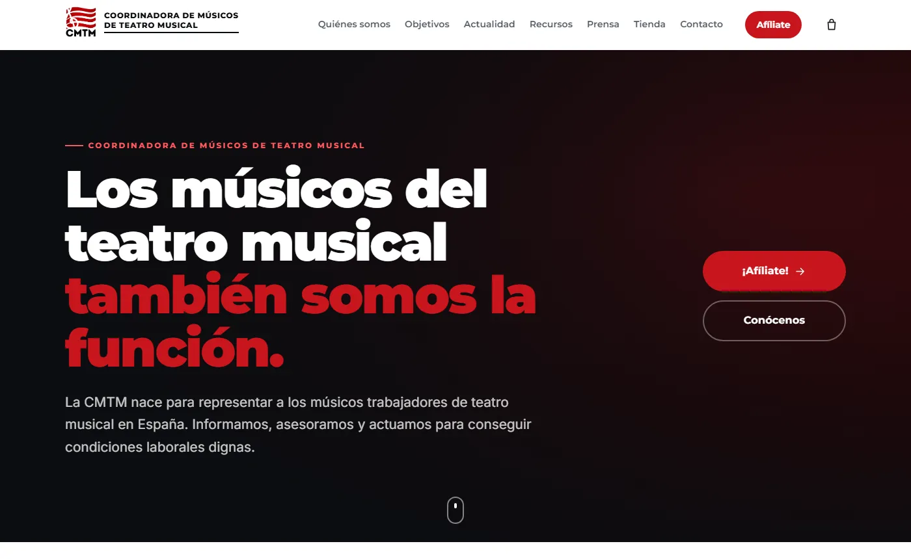
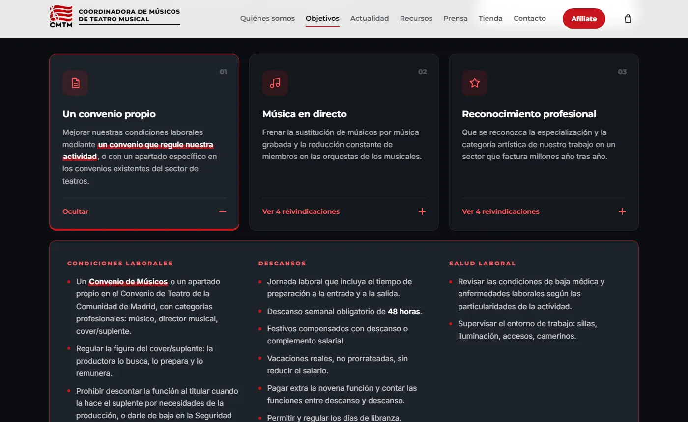
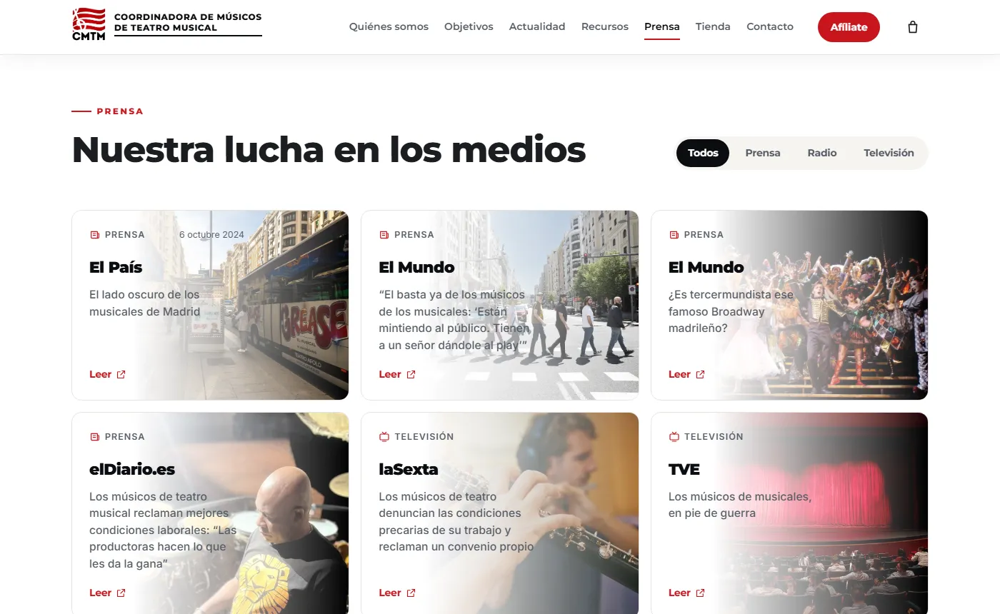
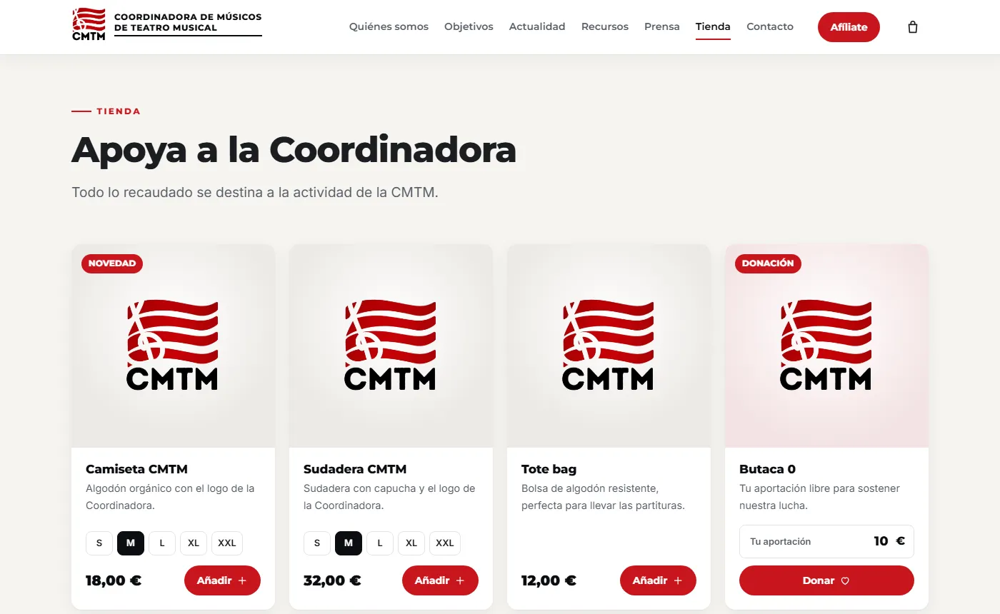
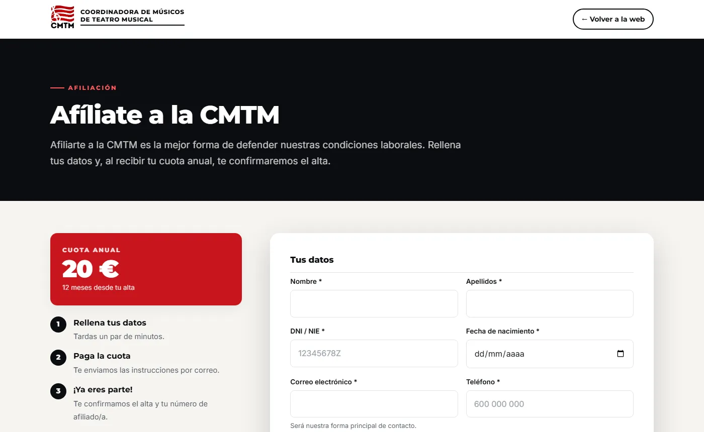
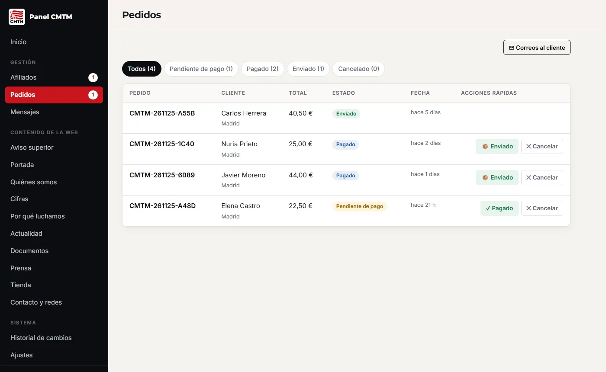
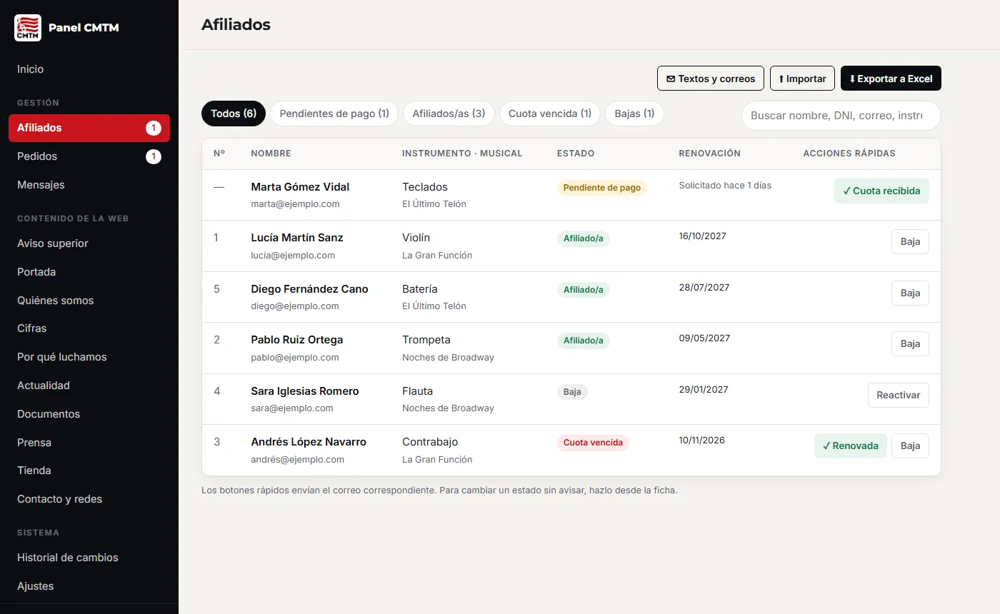

La **CMTM (Coordinadora de Músicos de Teatro Musical)** reúne a los músicos que tocan en los musicales en España y pelea por un convenio propio y unas condiciones dignas. Unos amigos de la coordinadora me pidieron rehacer su web: la que tenían estaba hecha con un creador automático, la tienda era de demostración y la afiliación se hacía con un formulario de Google y una transferencia que había que cuadrar a mano.

El resultado ya está en producción en [cmtm.es](https://cmtm.es). En este post cuento cómo está hecha y por qué, con una condición que lo marcaba todo: **el hosting compartido solo admite PHP**, y quien la va a mantener **no es técnico**.

> Las capturas de la web pública son del contenido real de cmtm.es. Las del panel son de una copia local con **pedidos y afiliados inventados**: no aparece ningún dato real.
{: .prompt-info }

---

## Qué hace

Es una web de **una sola página** (quiénes somos, objetivos, actualidad, documentos, prensa, tienda y contacto) más una página de afiliación.

{: .shadow }

Los objetivos y las reivindicaciones eran dos secciones con mucho texto. Los fusioné en tarjetas que despliegan las reivindicaciones de cada objetivo, así la sección se lee de un vistazo y no ocupa media web.

{: .shadow }
_Cada objetivo despliega sus reivindicaciones, agrupadas por tema_

En **Prensa**, basta con pegar el enlace de la noticia en el panel: al guardar, el servidor descarga la página, busca su imagen de previsualización (`og:image`) y la usa de fondo con un fundido. Si el periódico no la da, se puede subir a mano.

{: .shadow }

La **tienda** tiene carrito, tallas, gastos de envío (gratis a partir de cierto importe) y una «Butaca 0» de **donación libre**: solo euros enteros, redondeados y limitados en el navegador **y otra vez en el servidor**, que recalcula todos los precios. Lo que diga el navegador sobre importes no se usa nunca.

{: .shadow }

La **afiliación** sustituye al formulario de Google: datos personales, laborales (instrumento y musical) y consentimientos, con validación real del DNI/NIE (la letra de control), de la edad y del código postal, y sin duplicados por DNI. La cuota es anual y cuenta 12 meses desde el alta.

{: .shadow }

---

## Arquitectura: PHP sin base de datos

```text
Navegador ──HTTPS──> CDN de Hostinger ──> Apache + PHP 8.3 (hosting compartido)
                                            ├── index.php, afiliate.php   web pública
                                            ├── api/                      pedidos, afiliación, contacto, webhook
                                            ├── panel/                    administración
                                            └── data/  (JSON, fuera de git)  contenido, pedidos, afiliados, ajustes

GitHub (rama main) ──despliegue automático──> public_html
Stripe ──webhook firmado──> api/stripe-webhook.php
```

Sin frameworks, sin Composer y sin paso de compilación: HTML, CSS, JavaScript y PHP. Para el volumen de una asociación (unos cientos de afiliados y algunos pedidos al mes), **una base de datos no aportaba nada** y sí más cosas que mantener. Todo se guarda en archivos JSON. El contenido y las fichas de afiliados se escriben de forma atómica (archivo temporal + `rename`), para no dejar nunca uno a medias.

El contenido inicial vive en el código (`content/default.php`) y lo que se cambia desde el panel se guarda en `data/contenido.json`, que se combina encima. La carpeta `data/` y las subidas están **fuera de git**: así un despliegue nunca pisa lo que la coordinadora ha escrito, ni las claves que ha metido en el panel.

En local lo levanto con Docker: `php -S` con un pequeño `router.php` que imita las reglas del `.htaccess`, **Mailpit** para atrapar los correos y el **Stripe CLI** para recibir webhooks. Lo probé en PHP 8.2, 8.3 y 8.4.

---

## Un panel para una persona no técnica

Era el requisito más importante: que **una sola persona** pueda cambiar cualquier texto, foto, producto o correo sin tocar código ni pedirme nada.

- Los formularios del panel **se generan a partir de un esquema** de cada sección (textos, listas reordenables, galerías de fotos, fechas…). Añadir un campo nuevo es añadir una línea al esquema.
- Cada guardado deja una **copia de la versión anterior** (se conservan las 60 últimas) y se puede volver a cualquiera.
- Los pedidos y los afiliados tienen **botones rápidos** de estado. Cada uno envía el correo que toca, con plantillas editables con etiquetas como `{nombre}` o `{renovacion}`.

{: .shadow }
_Pedidos por estado: «Pagado» y «Enviado» avisan al cliente por correo (datos inventados)_

- Los afiliados se **importan desde el Excel del antiguo formulario de Google** (reconoce sus columnas y usa la «marca temporal» como fecha de alta) y se **exportan a Excel**. El panel marca automáticamente las cuotas vencidas.

{: .shadow }
_Afiliados: pendientes, activos, cuotas vencidas y bajas (datos inventados)_

- Un botón descarga una **copia del contenido** (textos y fotos) en un `.zip`. Lo escribí a mano, en PHP puro, para no depender de que el hosting tenga la extensión `zip`. Sirve de copia de seguridad y para tener mi entorno local igual que producción.

---

## Pagos: Stripe sin SDK

Para no meter dependencias, hablo con la **API REST de Stripe directamente con cURL**, fijando la versión de la API en cada petición. Hay dos flujos:

- **Tienda:** Stripe Checkout en modo pago. La sesión caduca a la hora y, si nadie paga, el pedido se cancela solo.
- **Cuota de afiliación:** Checkout en modo **suscripción anual**, con **tarjeta o domiciliación SEPA**. A los afiliados que ya pagaban se les manda un **enlace personal firmado (HMAC)** para domiciliar la cuota, y el primer cobro se programa para **su fecha de renovación**, no para hoy. Para darse de baja o cambiar de tarjeta usan el **portal de clientes de Stripe**, sin escribir a nadie.

Igual que en [e-Música Academia](/posts/eMusica-Academia/), el estado de un pago **solo cambia por un webhook firmado por Stripe**. Sin SDK, la verificación de la firma la hago yo:

```php
function stripe_verify_signature(string $payload, string $header, string $secret, int $tolerance = 300): bool
{
    if ($secret === '' || $header === '') return false;
    $t = null;
    $sigs = [];
    foreach (explode(',', $header) as $part) {
        [$k, $v] = array_pad(explode('=', trim($part), 2), 2, '');
        if ($k === 't') $t = (int) $v;
        if ($k === 'v1') $sigs[] = $v;
    }
    if (!$t || !$sigs || abs(time() - $t) > $tolerance) return false;   // evita reenvíos antiguos
    $expected = hash_hmac('sha256', $t . '.' . $payload, $secret);
    foreach ($sigs as $s) {
        if (hash_equals($expected, $s)) return true;                    // comparación en tiempo constante
    }
    return false;
}
```

Además, cada evento se apunta para **no procesarlo dos veces** (Stripe reintenta los envíos). Un detalle que me encontré al probar: según la versión de la API, la factura trae la suscripción en un sitio distinto (`invoice.subscription` o `parent.subscription_details`) y la baja programada llega como `cancel_at` o como `cancel_at_period_end`. El webhook entiende los dos formatos.

Todo el circuito (alta con tarjeta, alta con SEPA, compra, renovación, baja desde el portal, sesiones caducadas, firmas falsas y eventos repetidos) está probado de principio a fin en el entorno de pruebas de Stripe, y la compra y el alta, también desde el hosting. En producción se activará cuando la asociación termine el alta de su cuenta real. Mientras tanto, la web funciona con **transferencia**: es el mismo código con Stripe desactivado desde el panel.

---

## Correo y seguridad

El hosting permite `mail()`, pero para que los correos lleguen bien escribí un **cliente SMTP mínimo** (SSL o STARTTLS, `AUTH LOGIN`) que envía desde el buzón del dominio, con errores comprensibles para el panel («usuario o contraseña del correo incorrectos» en vez de solo un `535 5.7.8`). El dominio ya tenía SPF, DKIM y DMARC configurados; para qué sirve cada uno lo conté en [este post](/posts/Correo-dominio-SPF-DKIM-DMARC/).

En seguridad, lo básico bien hecho:

- **Formularios:** token CSRF, *honeypot* antispam y límite de envíos.
- **Panel:** contraseña con *bcrypt*, bloqueo de 15 minutos tras 5 intentos fallidos, sesión de 4 horas y cabeceras para que no se pueda incrustar en otra web.
- **Archivos:** `data/`, `includes/`, `content/` y `config.php` bloqueados desde fuera. Las subidas se validan por su **tipo real** (no por la extensión) y en esa carpeta no se ejecuta nada.
- **Secretos:** las claves de Stripe y la contraseña del correo se meten en el panel y se quedan en el servidor. Nunca pasan por git.

---

## Puesta en producción

Despliego con la integración de **GitHub de Hostinger**: cada *push* a `main` actualiza la web. Primero la monté en el dominio temporal del hosting y, ya probada, **le pasé `cmtm.es`** a la web nueva, quitándoselo a la antigua (que queda guardada como copia).

- Antes del cambio **anoté las DNS del correo** (MX, SPF, DKIM y DMARC) y después comprobé que seguían igual. Cambiar la web no puede llevarse por delante el correo de la asociación.
- Las direcciones de la web antigua (`/prensa`, `/contacto`, `/reivindicaciones`…) siguen enlazadas en Google y en redes, así que **redirigen con un 301** a su sección de la nueva. `www` lleva al dominio sin `www`.
- HTTPS ya lo fuerza la CDN de Hostinger. Repetirlo en el `.htaccess` con `%{HTTPS}` puede provocar un **bucle de redirecciones** si la CDN le pasa la petición a Apache en HTTP, así que ese paso lo dejo a la CDN.

---

## Lo que aprendí

- **Las limitaciones simplifican.** Sin base de datos ni frameworks, todo cabe en la cabeza: cualquiera con algo de PHP puede entender el proyecto entero en una tarde.
- **El panel es el producto.** La web la ve el público, pero quien vive con ella es la persona que la mantiene. Muchas decisiones (botones rápidos, plantillas de correo, importar el Excel antiguo) salieron de preguntarme qué haría esa persona un martes cualquiera.
- **Contenido y código, separados.** Desde el primer despliegue, lo que se escribe en el panel solo vive en el servidor. Eso protege el contenido, pero obliga a pensar cómo traerlo a local: de ahí la copia en `.zip`.
- **Los pagos, por webhook.** Como en e-Música: el navegador puede mentir; el evento firmado por Stripe, no.
