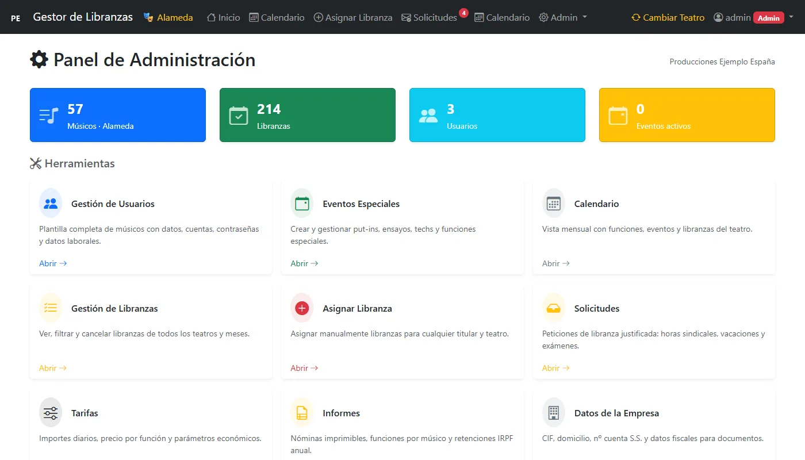
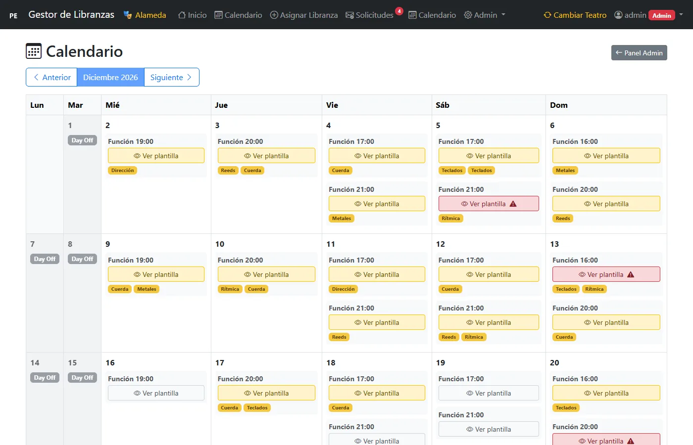
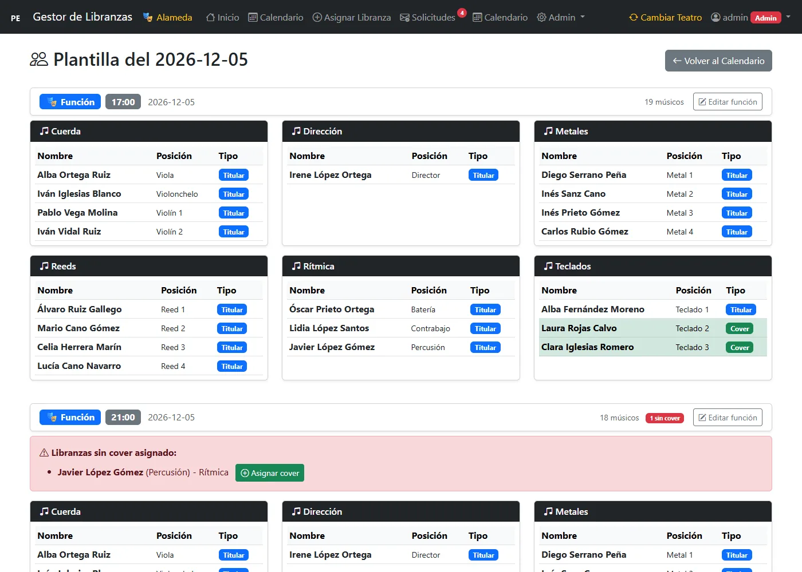
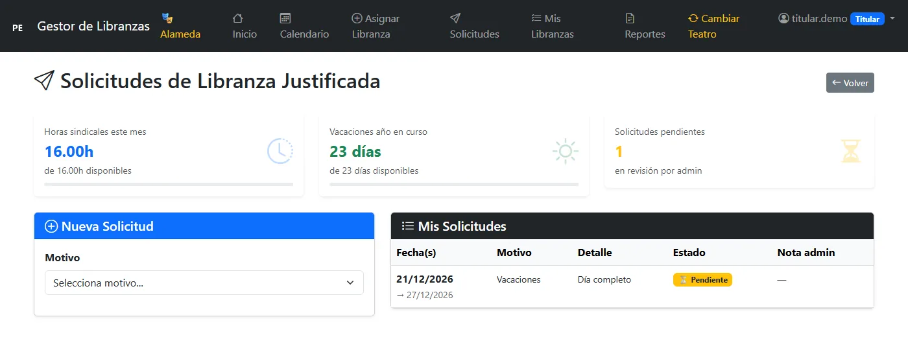
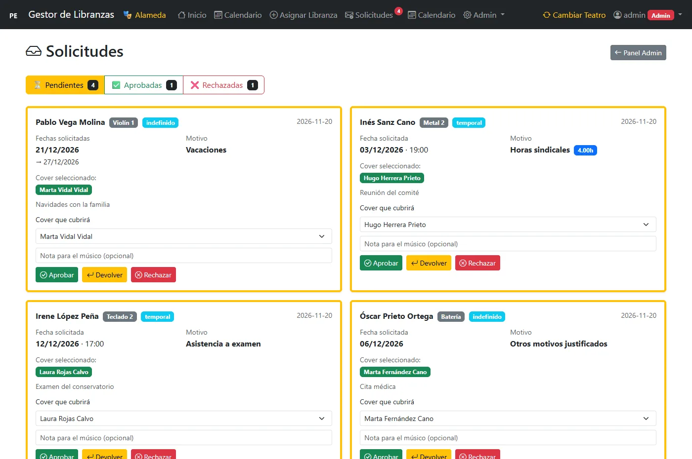
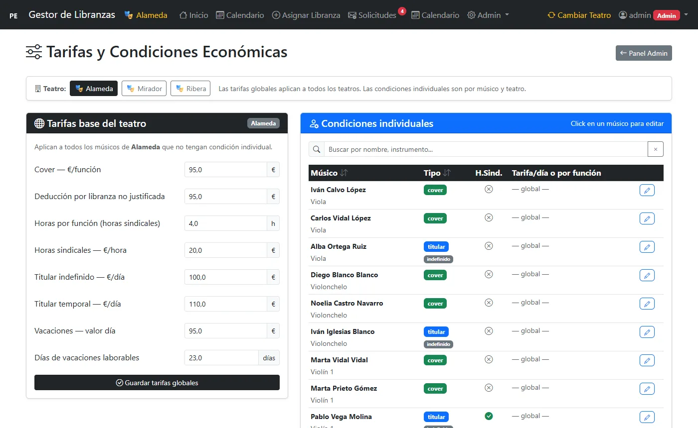

En la orquesta de un musical, cada atril tiene un **titular**. Cuando el titular **libra** (vacaciones, horas sindicales, un examen, una cita médica…), toca un **cover**: un músico que se sabe el libro y le sustituye en esa función. Parece sencillo hasta que lo multiplicas por varios teatros, dos funciones algunos días, covers que no pueden estar en dos atriles a la vez y un convenio que dice qué cuenta como vacaciones, cuántas horas sindicales tiene cada uno y qué se descuenta de la nómina.

Este gestor de libranzas lleva todo eso: quién libra, quién cubre, qué falta por cubrir y cuánto cobra cada uno a final de mes. Si has leído el post de la [web de la CMTM](/posts/CMTM-Web/), el contexto te sonará.

> La aplicación maneja datos laborales reales, así que **todo lo que se ve aquí es inventado**: la empresa («Producciones Ejemplo»), los teatros (Alameda, Mirador y Ribera), los músicos y los importes. Las capturas son de una copia que monté aparte, con el mismo esquema de base de datos pero sin una sola fila de los datos reales.
{: .prompt-info }

---

## Qué hace

Hay tres roles, cada uno con lo suyo:

- **Administración:** ve todos los teatros, aprueba o rechaza solicitudes, asigna covers, define tarifas y saca las nóminas.
- **Titular:** pide libranzas justificadas, registra las que no puede hacer y consulta sus bolsas de vacaciones y de horas sindicales.
- **Cover:** ve las funciones que le toca cubrir y su resumen del mes.

{: .shadow }
_El panel de administración de uno de los teatros (datos inventados)_

El **calendario** muestra el mes con sus funciones: los lunes y martes son *day off*, y cada función marca en rojo si alguien libra y todavía no tiene cover.

{: .shadow }
_Cada día con sus funciones; las marcadas en rojo tienen una libranza sin cubrir_

Desde cada función se abre su **plantilla**: quién toca en cada sección, quién es cover ese día y, arriba, un aviso con las libranzas sin cubrir y un botón para asignar cover.

{: .shadow }
_Plantilla por secciones. En verde, los covers; en rojo, lo que falta por cubrir_

---

## Las reglas del convenio, en código

La parte interesante no es el CRUD, sino traducir reglas laborales a código sin que se escape ningún caso:

| Motivo | Regla |
|---|---|
| **Vacaciones** | Solo para contratos indefinidos. Una bolsa anual de días laborables, y solo cuentan **de miércoles a domingo**: lunes y martes no hay función. |
| **Horas sindicales** | Una bolsa **mensual** (una hora por cada día del mes). Cada función libre consume las horas que tenga configuradas el teatro. |
| **Examen** | Primera función, segunda función o día completo. |
| **Otros motivos** | Una función concreta o el día entero, y se puede adjuntar justificante (PDF o imagen). |
| **Cancelar** | El titular solo puede anular una libranza con **4 días de antelación** y, si es del mes en curso, **antes del día 20**. Después, solo administración. |

{: .shadow }
_El titular ve sus bolsas antes de pedir: horas sindicales del mes y días de vacaciones del año_

Las vacaciones son un buen ejemplo de regla que parece trivial. Se piden por rango de fechas, pero se descuentan **días laborables**, no días naturales, y cada día genera una libranza por cada función que tenga:

```python
d = fecha_ini
while d <= fecha_fin:
    if d.weekday() >= 2:                      # miércoles a domingo: día laborable
        dias_laborables += 1
    for hora in obtener_horarios_funcion(d.weekday()):
        fechas_horas.append((d.strftime('%Y-%m-%d'), hora))   # una libranza por función
    d += timedelta(days=1)
```

---

## Aprobar una solicitud

Las solicitudes llegan a administración como tarjetas, con el cover que propone el titular. Se pueden **aprobar**, **rechazar** o **devolver** al titular con una nota para que complete información, por ejemplo el justificante.

{: .shadow }
_Vacaciones, horas sindicales, examen y otros motivos, cada uno con su cover propuesto_

Aprobar dispara varias cosas, y tienen que ocurrir **todas o ninguna**:

1. Calcular las funciones afectadas (todas las del rango, solo la primera o la segunda, o una concreta).
2. Para cada una, comprobar que el cover **no esté cubriendo ya otro atril en esa misma función**. Si lo está, la libranza se crea sin cover y la app avisa de cuántas quedan por cubrir.
3. Insertar todas las libranzas de golpe, con un único `executemany`.
4. Descontar de la bolsa que toque: días de vacaciones u horas sindicales.

Todo va en una transacción con `rollback` si algo falla, y la conexión se cierra siempre en el `finally`.

---

## Cuando SQLite se bloquea

Elegí **SQLite** porque es un único archivo, no necesita servidor y sobra para este volumen. Pero tiene una limitación clara: **solo admite un escritor a la vez**. En las primeras versiones, aprobar solicitudes podía acabar con la base de datos bloqueada. Una semana de vacaciones son unas ocho funciones, y aquella versión hacía consultas dentro de bucles y alargaba la transacción más de la cuenta.

El arreglo fue por partes:

```python
def get_db():
    conn = sqlite3.connect(app.config['DATABASE'], timeout=30.0)
    conn.row_factory = sqlite3.Row
    conn.execute("PRAGMA journal_mode=WAL")      # los lectores no bloquean al escritor
    conn.execute("PRAGMA busy_timeout=30000")    # esperar al lock en vez de fallar al momento
    return conn
```

- **WAL** (*write-ahead logging*): las escrituras van a un registro aparte, así que leer y escribir a la vez deja de bloquearse.
- **`busy_timeout`**: si la base está ocupada, se espera hasta 30 segundos en lugar de fallar en el acto.
- **Inserciones en bloque** con `executemany`, para que la transacción de escritura dure lo mínimo.
- **Índices** en las consultas más repetidas: libranzas por fecha, hora y teatro, y personas por teatro y tipo.
- **`try/except/finally`** en toda la aprobación: una conexión que se queda abierta tras un error es un bloqueo esperando a ocurrir.

---

## Tarifas y nóminas

A final de mes, la app calcula lo de cada uno:

- **Cover:** cobra por cada función que ha cubierto.
- **Titular:** cobra los días del mes por su tarifa diaria (distinta si el contrato es indefinido o temporal), o un sueldo mensual fijo si lo tiene. Cada libranza **no justificada** descuenta; las justificadas no.

Las tarifas se definen **por teatro**, y cada músico puede tener condiciones individuales que se aplican por encima.

{: .shadow }
_Tarifas base del teatro y excepciones por músico (importes inventados)_

Con eso salen los informes: nóminas del mes, funciones por músico (trabajadas, libradas y cubiertas) y un resumen anual de retenciones de IRPF por trabajador.

---

## Lo que haría distinto

Mirándolo con distancia, hay cosas que cambiaría:

- **Los teatros, escritos a mano.** Sus nombres aparecen en una veintena de sitios entre el código y las plantillas. Añadir un teatro obliga a tocarlos todos; tendría que ser una tabla más.
- **Un `app.py` de casi 4.900 líneas.** Los informes ya están en un *Blueprint* aparte; el resto debería seguir el mismo camino (solicitudes, administración, calendario).
- **Migraciones de verdad.** El esquema se actualiza en la primera petición, con un `ALTER TABLE` que ignora cualquier error para no fallar si la columna ya existe. Funciona, pero también se tragaría un error de verdad. Una herramienta de migraciones con versiones sería más segura.
- **Tests para las reglas de dinero.** «Solo cuentan de miércoles a domingo» o «la libranza justificada no descuenta» son exactamente el tipo de regla que debería tener un test que falle si alguien la rompe.
- **Datos sensibles, aparte.** Para generar nóminas, la última versión guarda datos laborales y fiscales de cada músico. Lo correcto es guardar solo los imprescindibles, en una tabla separada, cifrados y visibles únicamente para administración.

---

## Lo que aprendí

- **El dominio manda.** La mitad del trabajo fue entender bien qué es un cover, cuándo cuenta un día de vacaciones o qué pasa si el cover ya está en otro atril. El código vino después.
- **SQLite es una gran opción, si conoces su límite.** Un solo escritor a la vez. Con WAL, `busy_timeout` y transacciones cortas, ese límite deja de notarse a esta escala.
- **Todo o nada.** Cuando una acción toca varias tablas (libranzas, bolsas, solicitudes), o va en una transacción o acabará dejando datos a medias.
- **Anonimizar también es trabajo.** Para este post monté una copia aparte con datos inventados, cambié nombres, imágenes e importes, y revisé cada captura. Es la única forma de enseñar un proyecto con datos reales sin filtrar ninguno.
