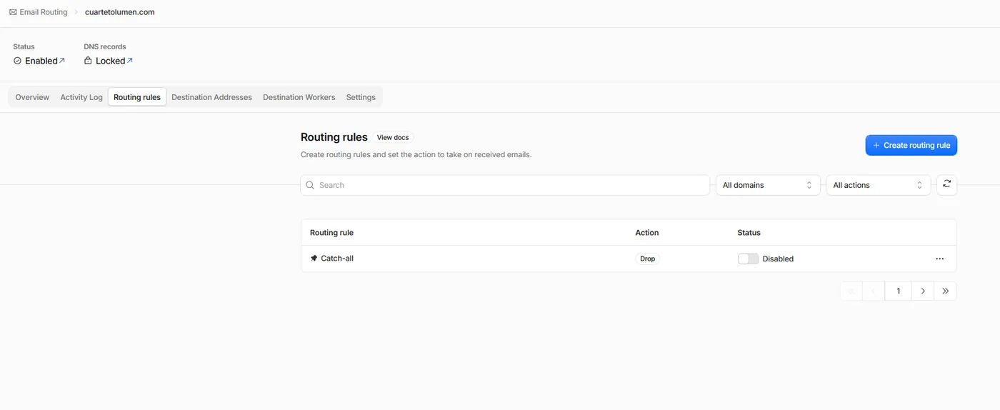
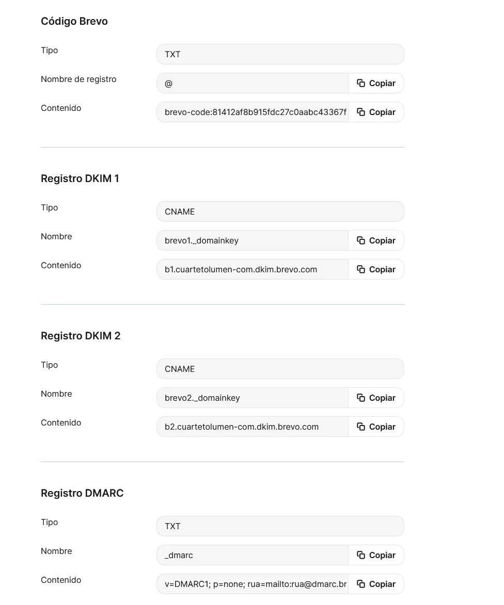
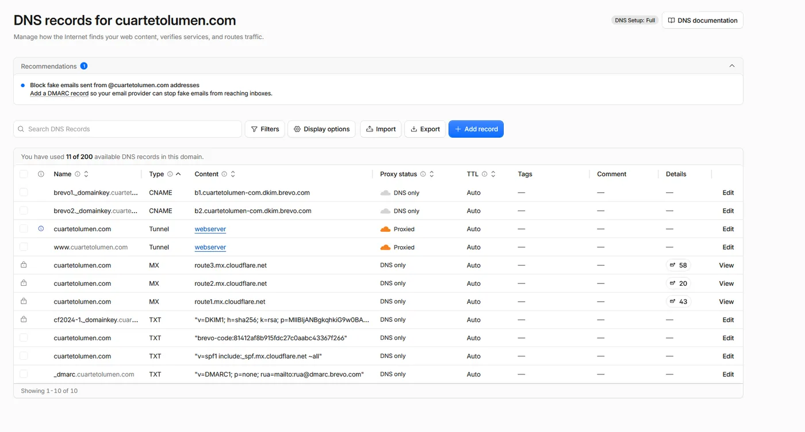
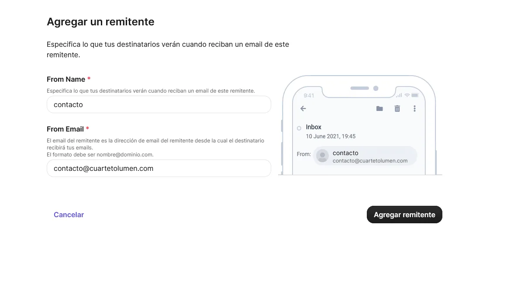
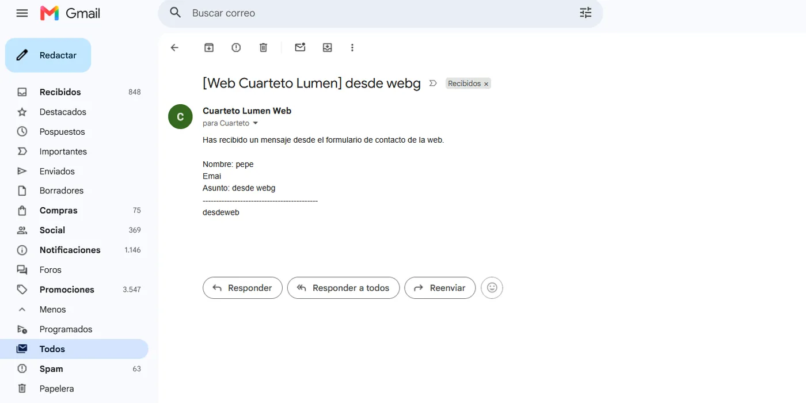

Montar una web es fácil; que su **correo funcione bien y no lo puedan suplantar** ya no tanto. Configurando el dominio de un proyecto (una web para un grupo musical) me tocó dejar el correo en condiciones, y es un tema que mezcla sistemas y seguridad a partes iguales, así que lo documento.

El objetivo es doble: que los correos **lleguen** (y no caigan en spam) y que **nadie pueda enviar correos haciéndose pasar por el dominio**. Eso se consigue con tres registros DNS: **SPF, DKIM y DMARC**.

---

## El montaje

- **Recepción:** con **Cloudflare Email Routing**. No monto un servidor de correo propio (es un dolor de mantener y de reputación); Cloudflare recibe el correo del dominio y lo reenvía a un buzón real.

{: .shadow }

- **Envío:** a través de un proveedor (Brevo) que firma los correos. El formulario de contacto de la web manda a través de él, en vez de con la función de correo del hosting, que acaba en spam.

{: .shadow }

---

## Los tres registros que importan

Todo se configura como registros DNS en Cloudflare:

{: .shadow }

### SPF — quién puede enviar en mi nombre

Un registro **TXT** que dice qué servidores están autorizados a enviar correo con mi dominio. Si llega un correo "de mi dominio" desde un servidor que no está en la lista, el receptor sabe que es sospechoso.

```text
v=spf1 include:spf.proveedor.net -all
```

El `-all` del final es la parte seria: significa "cualquier otro, recházalo". Mucha gente deja `~all` (solo marcar), que es más flojo.

### DKIM — una firma que demuestra que es mío

El proveedor firma cada correo con una clave privada, y yo publico la **clave pública** en el DNS (registros CNAME/TXT). El receptor comprueba la firma: si cuadra, el correo **es auténtico y no ha sido manipulado** por el camino.

### DMARC — qué hacer con los que fallan, y que me avisen

El registro que lo une todo. Le dice al receptor qué hacer con un correo que **no pasa SPF ni DKIM** (nada, cuarentena o rechazo) y, muy útil, **a dónde mandar informes** de quién está intentando enviar en nombre de mi dominio:

```text
v=DMARC1; p=none; rua=mailto:dmarc@midominio.com
```

Se empieza con `p=none` (solo observar y recibir informes) y, cuando ves que tu correo legítimo pasa bien, se endurece a `p=quarantine` o `p=reject`. Pasar directamente a `reject` sin observar antes es la forma típica de tirarte tu propio correo.

---

## Remitente y prueba

Configurado el remitente verificado en el proveedor:

{: .shadow }

La prueba final: enviar desde el formulario de la web y comprobar que **llega a la bandeja de entrada** (no a spam) y que, en los detalles del mensaje, **SPF, DKIM y DMARC salen en PASS**.

{: .shadow }

---

## Por qué esto es seguridad, no solo "configurar el correo"

El **spoofing** de correo (hacerse pasar por un dominio para phishing) es uno de los vectores de ataque más comunes, y lo analizo del otro lado en mis posts de [análisis de phishing](/posts/analisis-phishing/). SPF, DKIM y DMARC son justo la defensa:

- **SPF y DKIM** permiten al receptor comprobar que un correo viene de verdad de donde dice.
- **DMARC con `p=reject`** hace que **suplantar tu dominio sea mucho más difícil**, y los informes te avisan si alguien lo intenta.

Un dominio sin estos tres registros es un dominio que cualquiera puede usar para mandar phishing en tu nombre. Dejarlos bien configurados protege tu marca y a quien recibe tus correos; es de las cosas más baratas y de mayor impacto que puede hacer cualquiera que tenga un dominio.
